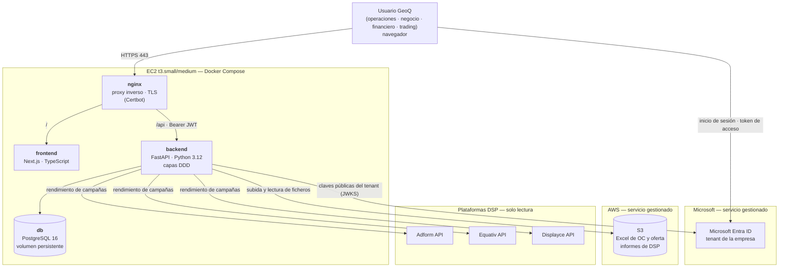
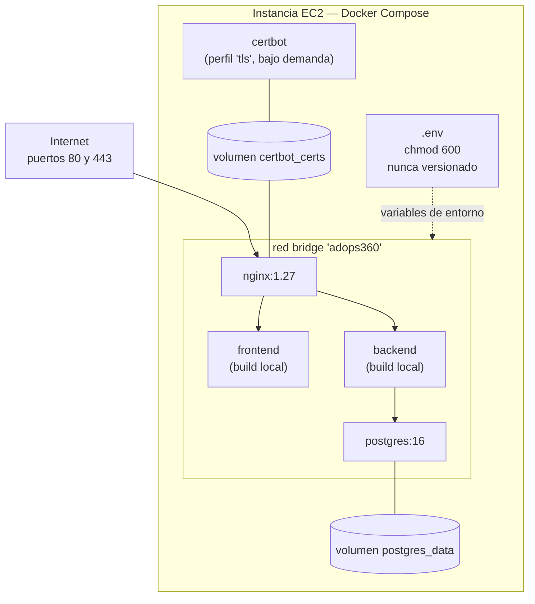
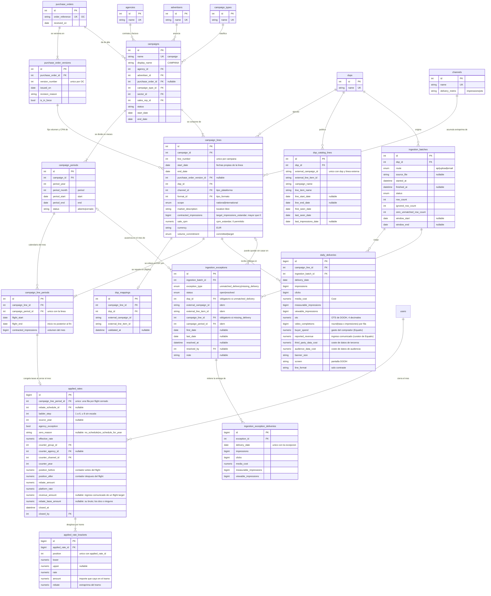
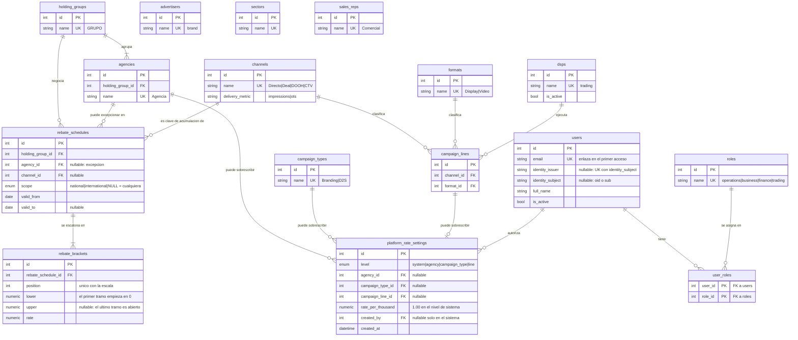

## Índice

0. [Ficha del proyecto](#0-ficha-del-proyecto)
1. [Descripción general del producto](#1-descripción-general-del-producto)
2. [Arquitectura del sistema](#2-arquitectura-del-sistema)
3. [Modelo de datos](#3-modelo-de-datos)
4. [Especificación de la API](#4-especificación-de-la-api)
5. [Historias de usuario](#5-historias-de-usuario)
6. [Tickets de trabajo](#6-tickets-de-trabajo)
7. [Pull requests](#7-pull-requests)

---

## 0. Ficha del proyecto

### **0.1. Tu nombre completo:**

Luis Felipe Morales

### **0.2. Nombre del proyecto:**

AdOps360

### **0.3. Descripción breve del proyecto:**

AdOps360 es la herramienta de gestión centralizada de campañas publicitarias digitales y de exterior (OOH/DOOH) de GeoQ, que reúne en un único sistema la oferta comercial, la configuración de campañas a partir de la orden de compra y el rendimiento real obtenido de los DSP.

Sustituye la cadena actual de hojas de cálculo en OneDrive, descargas manuales de informes y cuadros de mando en Qlik Sense por una única fuente de verdad, de modo que los equipos de negocio, operaciones y financiero trabajen sobre los mismos datos: estado diario de entrega, márgenes por campaña y acumulados por periodo, agencia y tipo de campaña.

### **0.4. URL del proyecto:**

**Sin despliegue en una instancia real en esta entrega.** La aplicación se demuestra en un **vídeo con datos de demostración**, compartido de forma segura con alvaro@lidr.co, y puede levantarse en local con `docker compose` (§1.4). Las imágenes de producción, el proxy HTTPS y la guía de despliegue (`docs/deploy.md`) están verificados con `scripts/verify_prod_images.sh`; la verificación en una instancia de AWS queda pendiente (§7).

> Puede ser pública o privada, en cuyo caso deberás compartir los accesos de manera segura. Puedes enviarlos a [alvaro@lidr.co](mailto:alvaro@lidr.co) usando algún servicio como [onetimesecret](https://onetimesecret.com/).

### 0.5. URL o archivo comprimido del repositorio

https://github.com/lfmorales/AI4Devs-finalproject-temp (rama `final-project-LFMC`)

Las pull requests se abren desde ese repositorio contra `LIDR-academy-temp/AI4Devs-finalproject`: [PR 1](https://github.com/LIDR-academy-temp/AI4Devs-finalproject/pull/3), [PR 2](https://github.com/LIDR-academy-temp/AI4Devs-finalproject/pull/4) y [PR 3](https://github.com/LIDR-academy-temp/AI4Devs-finalproject/pull/18).

> Puedes tenerlo alojado en público o en privado, en cuyo caso deberás compartir los accesos de manera segura. Puedes enviarlos a [alvaro@lidr.co](mailto:alvaro@lidr.co) usando algún servicio como [onetimesecret](https://onetimesecret.com/). También puedes compartir por correo un archivo zip con el contenido


---

## Estado del proyecto

### Historia 2 — Status diario de campañas (`daily-campaign-delivery-status`)

Implementado:

- **Ingesta nocturna desde Adform**: comando `python -m scripts.run_ingestion`, que ingiere la ventana de D-7 a D-1 y se puede repetir sin duplicar. Se programa desde el cron del host (ver [docs/deploy.md](./docs/deploy.md)).
- **Carga de un rango histórico** con `run_ingestion --from AAAA-MM-DD --to AAAA-MM-DD`.
- **Catálogo de líneas de Adform**, que rellena la propia ingesta, con la página «Catálogo Adform» (filtros, paginación, vincular y desvincular).
- **Estado diario de las campañas** (`/status`): contratado frente a entregado y ritmo, con los avisos «Sin datos recibidos» y «Desviación de ritmo».
- **Cola de excepciones** (`/exceptions`): entrega sin emparejar y entrega ausente, con resolver, vincular a una línea y filtro por texto y tipo.
- **Fechas y reparto mensual por línea** en el alta de campañas.
- **Difuminado visual de nombres** de Adform con `NEXT_PUBLIC_MASK_NAMES`, y una hoja de estilos global propia.

Instrucciones de despliegue, ingesta, carga de histórico y copias de seguridad: [docs/deploy.md](./docs/deploy.md).

### Limitaciones conocidas

- La validación `found` al vincular no prueba que la línea entregue ni que sea la correcta.
- No hay edición ni borrado de campañas ni de líneas: solo se pueden recrear.
- Una línea mapeada a mitad de campaña no recibe su histórico sin la carga de rango.
- El difuminado de nombres es visual: los nombres siguen en los datos de la página.
- El catálogo y las excepciones guardan datos de líneas de toda la cuenta de Adform.
- La subida manual de informes está aplazada; su formato está documentado en `design.md`.
- Las copias de seguridad y el `CRON_TZ` están documentados, pero no se han probado en un servidor.

---

### Historia 3 — Margen y devengo de rebates (`campaign-margin-and-rebate-accrual`)

Implementado:

- **Margen por flight** (línea × mes): en una línea comprometida, ingreso sobre el volumen contratado y el CPM de venta (en una línea con objetivo, el que comunica su DSP: ver abajo), coste de medios (el coste de Adform), rebate y coste de plataforma. Cada importe se redondea a dos decimales antes de restar y los totales de línea y de campaña son la suma exacta de los de sus flights.
- **Mes en curso**: en una línea comprometida, el ingreso y el rebate se devengan por días transcurridos del contrato hasta D-1 y se etiquetan como provisionales; los costes salen de lo entregado.
- **Motor de rebate**: escalera de seis pasos de resolución de tarifa, tramos marginales sobre un contador anual por grupo, agencia en excepción y canal, aplicado en orden cronológico.
- **Cierre de mes** (`POST /margin/closings`): congela las tasas aplicadas, es idempotente y rechaza cerrar un mes si uno anterior del mismo año tiene flights terminados sin cerrar, nombrando el mes que bloquea.
- **API de margen** (`GET /margin`) y maestros de tarifas de rebate y de tasa de plataforma, solo para el rol `finance`.
- **Página «Margen»** (solo `finance`): jerarquía campaña → línea → flight con los importes tal como los entrega el servidor, venta contratada y devengado, estado de cada flight («Cerrado», «Pendiente de cierre» o «En curso (provisional)»), días transcurridos y entrega frente a lo contratado, avisos «Margen negativo» y «Sin venta», y cierre de mes con confirmación.
- **Verificación con dos meses reales de Finanzas** (uno cerrado y otro en curso, de compra directa, anonimizados): el dominio reproduce los importes y porcentajes de las campañas comparadas con tolerancia de céntimos y las diferencias con la hoja de origen están explicadas (abajo).

Para verlo con datos de demostración (sintéticos, con nombres `DEMO-…`): `docker compose exec backend python -m scripts.seed_dev_data` da el rol `finance` al usuario de desarrollo, y `docker compose exec backend python -m scripts.seed_margin_demo` crea cuatro campañas (una pendiente de cierre, una en curso con margen positivo, una con margen negativo y una sin precio), más una DOOH y una de Deal cuando existen esos canales y el DSP Equativ (los crea `seed_dev_data`). El segundo comando se puede repetir sin duplicar datos.

---

### Equativ y líneas con objetivo (`equativ-deals`)

Implementado:

- **Ingesta de Equativ**: `run_ingestion --dsp Equativ` pide un informe asíncrono por ejecución, lo lee por su vista previa por días UTC y guarda por línea y día las impresiones, el gasto del comprador, el ingreso comunicado (*curator margin*) y los costes de datos. Un candado por DSP permite solapar Adform y Equativ. Se programa a las 06:15 UTC; antes de las 06:00 UTC no comprueba las líneas sin entrega. Las credenciales van solo en el `.env` de la instancia ([docs/deploy.md](./docs/deploy.md)).
- **Compromiso de volumen por línea**: `committed` o `target`, declarado en el alta (el formulario propone «Objetivo» para `Deal`) y nunca deducido del canal.
- **Margen de las líneas con objetivo**: ingreso comunicado por el DSP, bruto servido como base de la extraprima y del contador, sin prorrateo en el mes en curso, y avisos «Bruto distinto del gasto» y «Coste de datos». El cierre congela su ingreso y su bruto y espera a que el DSP haya cargado el último día del mes.
- **Estado diario**: el volumen de una línea con objetivo se rotula «Objetivo» y superarlo no es un aviso de ritmo.
- **Mapeo de Equativ**: en «Catálogo Adform», «Vincular una línea de Equativ» deja escribir el `auctionPackageDealId`, con sugerencias del catálogo; cuenta como validado por el usuario. Un id mal escrito sale como línea sin entrega.
- **Demo de Deal** (`DEMO-MARGEN-DEAL`) con el ejemplo resuelto en el mes anterior, sin llamar nunca a Equativ.

Limitaciones conocidas:

- Un id de paquete mal escrito no se detecta al escribirlo, solo cuando termina su flight sin entrega.
- Cada ejecución deja un informe en la cuenta de Equativ (`adops360-<ventana>`); no se borran.
- Se supone que la moneda de la cuenta de Equativ es EUR.
- En una campaña que mezcla líneas comprometidas y con objetivo, «Venta contratada» suma también el objetivo de las líneas con objetivo; queda pendiente para la interfaz de la mesa.
- `MarginTotals` tiene valores por defecto en el dominio, en contra de la convención del proyecto (deuda anotada en el design).

### Diferencias con la hoja de origen (Qlik), explicadas

- **Coste de plataforma:** la hoja de origen no lo resta; AdOps360 sí. En el mes cerrado verificado, la brecha entre el margen sin y con plataforma es de unos 17 puntos porcentuales.
- **Campañas sin volumen contratado:** no entran en el margen y su entrega queda como entrega sin casar. En el mes en curso verificado suponen en torno a una cuarta parte del coste, y es la mayor diferencia con la hoja.
- **«%Margen» de la hoja en un mes en curso:** resta costes parciales a la venta de todo el mes y por eso sale más alto. AdOps360 equivale al «%Margen Actual», que devenga el ingreso.
- **Días servidos:** la hoja devenga por días con impresiones servidas; AdOps360, por días transcurridos del contrato hasta D-1. Coinciden si la campaña sirve cada día; si se pausa, la hoja devenga menos. A mes cerrado no hay diferencia. La prueba de aceptación del mes en curso construye la fecha de corte desde los días servidos de la hoja, así que valida la fórmula y no esta definición.
- **Ajustes manuales en la hoja:** dos campañas del mes en curso tienen cifras que no siguen la fórmula de la propia hoja (una con la extraprima por debajo de su tasa y otra con los costes a cero) y quedan excluidas de la comparación.
- **Volumen de la orden no entero:** unas pocas campañas traen un volumen con fracción; AdOps360 usa enteros y la diferencia es de menos de un céntimo por campaña.

### Limitaciones conocidas (margen)

- En una línea comprometida, el **ingreso es el importe de la orden de compra**, que es la base de facturación. El margen no refleja los **ajustes de fin de mes** (por infraentrega o campañas paradas): un mes cerrado usa la venta contratada. En el mes cerrado verificado, ajustar a lo entregado las campañas infraentregadas habría reducido la venta en menos del 1 % y el margen en torno al 1,6 %. Mejora prevista: registrar el ajuste de cada flight mientras está pendiente de cierre, con motivo, como base del ingreso y del rebate; el cierre lo congelaría. La pantalla muestra lo entregado frente a lo contratado para detectar los candidatos.
- Las campañas **sin volumen contratado** y los píxeles sin coste de compra no se contemplan en esta versión.
- Una línea con **precio 0 y volumen** se admite como excepción de precio y se marca «Sin venta»; su margen es el coste en negativo y su porcentaje no se calcula.
- Un flight **sin tarifa de rebate** avanza igualmente el contador del grupo (supuesto pendiente de confirmar con Finanzas).
- La **reexpresión de contadores ya congelados** al crear o quitar una excepción de agencia a mitad de año, el replay cronológico, el recálculo explícito de un mes cerrado y los agregados por agencia, anunciante o tipo de campaña están aplazados; cada uno consta con su motivo en `tasks.md`.
- Un mes cerrado **no se actualiza** si el DSP corrige cifras semanas después: la ingesta solo refresca los últimos siete días. Dentro de esos siete días, en cambio, una reingesta **sí mueve** el coste de medios y el de plataforma de un mes ya cerrado, porque el cierre solo congela la extraprima, la tasa de plataforma y, en las líneas con objetivo, el ingreso y el bruto. Hasta que el cierre congele una foto completa, la regla provisional es cerrar un mes a partir del día 8 del mes siguiente ([docs/deploy.md](./docs/deploy.md)).
- La edición de tarifas y de la tasa de plataforma **no tiene pantalla**: se hace por la API.
- La pantalla lee el mes bloqueante de `previous_month_open` del texto del error; mejora prevista: que la API lo devuelva como campo.
- Las pruebas de aceptación leen datos reales de una carpeta ignorada por Git (`backend/tests/private/`) y **se saltan si no existen**. La **imagen de desarrollo los lleva dentro** y no debe publicarse en ningún registro.
- La base de datos **no tiene restricción** que impida un precio de venta negativo; la validación está en el esquema de la API.
- Los tests de dominio dependen de la base de datos de pruebas por una fixture de sesión global.
---


## 1. Descripción general del producto

> Describe en detalle los siguientes aspectos del producto:

### **1.1. Objetivo:**

AdOps360 es la herramienta interna con la que GeoQ gestiona sus campañas de publicidad digital y de exterior (OOH/DOOH) de principio a fin: desde la oferta comercial y la orden de compra que envía el cliente, hasta el rendimiento real que devuelven las plataformas de compra programática y el margen que deja cada campaña.

Hoy ese recorrido está repartido entre hojas de Excel en OneDrive, descargas manuales de informes y cuadros de mando en Qlik Sense, de modo que cada equipo trabaja sobre su propia copia de los datos y nadie puede afirmar con certeza cuánto se ha entregado ni cuánto se ha ganado en una campaña concreta. AdOps360 sustituye ese mosaico por una única fuente de verdad, compartida por los tres equipos que intervienen en el proceso: **operaciones**, **negocio** y **financiero** — sabiendo que una misma persona puede desempeñar varios de esos roles a la vez.

Los clientes son habitualmente agencias de medios, y de forma excepcional anunciantes directos. Las campañas se ejecutan en tres plataformas: **Adform**, **Equativ** y **Displayce**.

### **1.2. Características y funcionalidades principales:**

**1. Ingesta de órdenes de compra (OC)**
Registro de la información de la orden de compra que envían las agencias o los clientes directos, como punto de entrada para dar de alta una campaña en el sistema. Sustituye la transcripción manual de la OC a la hoja de configuración en OneDrive.

**2. Gestión de la oferta comercial**
El equipo de negocio registra en la herramienta su oferta comercial —hoy mantenida en Excel— como paso previo a su conversión en orden de compra, de modo que la propuesta y la campaña que nace de ella comparten origen en lugar de vivir en documentos separados.

**3. Sincronización del rendimiento vía API**
Conexión directa con Adform, Equativ y Displayce para obtener los datos de rendimiento de las campañas, en lugar de descargar y filtrar informes a mano cada día.

**4. Status diario de campañas**
Vista consultable por los equipos de operaciones y negocio con el estado y el rendimiento actualizado de cada campaña, alimentada por la sincronización anterior.

**5. Cálculo de márgenes**
Cruce del rendimiento obtenido con los datos maestros —precios de venta y extraprima por agencia, entre otros— para que el equipo financiero disponga del margen de cada campaña y de los acumulados por período, tipo de campaña y agencia. Es la función que sustituye a Qlik Sense.

**6. Gestión de datos maestros y configuración**
Mantenimiento administrativo (alta, consulta, modificación y baja) de los parámetros que alimentan el cálculo de márgenes: extraprimas por agencia, costes, precios de venta y demás configuración asociada. Accesible para el rol financiero.

### **1.3. Diseño y experiencia de usuario:**

> **Pendiente de capturas y mockups tras el desarrollo del frontend.**
>
> Este apartado se completará con imágenes o videotutorial del recorrido de usuario una vez exista la interfaz. No se documenta aquí ninguna descripción de UI por no haberse diseñado todavía.

### **1.4. Instrucciones de instalación:**

> **Estado.** Instrucciones validadas con el andamiaje de la entrega 2: las imágenes de `backend/` y `frontend/` ya existen y el stack arranca con `docker compose up`. Pueden aparecer variables de entorno adicionales a medida que se implementen las historias.

#### Requisitos previos

- Docker y Docker Compose, y `openssl` para generar las claves del emisor de pruebas
- El **registro de desarrollo** de la aplicación en Microsoft Entra ID (servicio gestionado, no forma parte del stack de contenedores), con los mismos ajustes que el de producción ([`docs/deploy.md` §5](./docs/deploy.md#5-microsoft-entra-id)) salvo las URI de redirección, que en local son `http://localhost/callback` y `http://localhost` (plataforma SPA)
- Tu usuario de Microsoft del tenant de la empresa, **asignado a esa aplicación** de desarrollo
- Un bucket de S3 y credenciales de AWS con acceso a él
- Credenciales de API de Adform, Equativ y Displayce

#### 1. Clonar el repositorio

```bash
git clone [URL_REPO]
cd AI4Devs-finalproject
```

**Proyecto de Docker Compose.** Los ficheros de Compose llaman al proyecto `adops360` (`name: adops360`), se llame como se llame la carpeta: los contenedores son `adops360-db-1`, `adops360-backend-1`…, y los volúmenes, `adops360_postgres_data`, `adops360_certbot_certs` y `adops360_certbot_webroot`. `COMPOSE_PROJECT_NAME`, en el entorno o en el `.env` de la carpeta, tiene prioridad sobre ese nombre.

- **Worktrees.** La carpeta principal no fija nada y se llama `adops360`. Cada worktree debe fijar en su propio `.env` un nombre distinto, por ejemplo `COMPOSE_PROJECT_NAME=adops360-<rama>`; si no, comparte contenedores y base de datos con la carpeta principal, y un `reset-data.sh` en el worktree borraría sus datos. `reset-data.sh` y los E2E se niegan a seguir si el stack que publica el puerto 80 se levantó desde otra carpeta.
- **Al cambiar de nombre la base de desarrollo arranca vacía.** Los volúmenes llevan el nombre del proyecto delante, así que una carpeta que antes tenía otro nombre (por ejemplo `ai4devs-finalproject`) arranca con volúmenes nuevos. Los antiguos no se borran. Para seguir trabajando, recrea los datos con `bash e2e/scripts/reset-data.sh`, o copia una vez el volumen antiguo en el nuevo, con el stack parado y sin borrar el original:

  ```bash
  docker compose -p ai4devs-finalproject down   # para el stack con el nombre antiguo; sin -v, conserva sus volúmenes
  docker run --rm -v ai4devs-finalproject_postgres_data:/from:ro -v adops360_postgres_data:/to alpine sh -c 'cp -a /from/. /to/'
  docker compose up -d
  ```

#### 2. Configurar las variables de entorno

```bash
cp .env.example .env
```

Edita `.env` con los valores reales. El fichero nunca se versiona y en el servidor debe tener permisos restringidos (`chmod 600`), ya que contiene las credenciales de las APIs de los DSP.

| Bloque | Variables |
|---|---|
| PostgreSQL | `POSTGRES_USER`, `POSTGRES_PASSWORD`, `POSTGRES_DB` |
| Microsoft Entra ID | `ENTRA_TENANT_ID` (`<tenant-id>`) y `ENTRA_CLIENT_ID` (`<client-id>` del registro de desarrollo). **Obligatorias**: sin ellas cualquier comando de `docker compose` falla (`required variable ENTRA_TENANT_ID is missing a value`) y el backend no arranca |
| AWS S3 | `AWS_REGION`, `AWS_ACCESS_KEY_ID`, `AWS_SECRET_ACCESS_KEY`, `S3_BUCKET_NAME` |
| APIs de los DSP | `ADFORM_CLIENT_ID`, `ADFORM_CLIENT_SECRET`, `EQUATIV_CLIENT_ID`, `EQUATIV_CLIENT_SECRET`, `DISPLAYCE_CLIENT_ID`, `DISPLAYCE_CLIENT_SECRET` |
| Frontend | `NEXT_PUBLIC_API_URL`. El tenant y el cliente del navegador (`NEXT_PUBLIC_ENTRA_*`) los deriva Compose de `ENTRA_*`: no se escriben aparte |
| Desarrollo | `SEED_USER_EMAIL`: el correo de tu usuario de Microsoft (ver el paso 3) |

#### 3. Levantar los servicios y aplicar migraciones

Ejecuta estos pasos **en orden exacto**:

**Paso 0:** Generar las claves del emisor de pruebas, antes del primer `up`

```bash
bash scripts/generate_test_issuer_keys.sh
```

Crea el par de claves en `.secrets/test-issuer/` (ignorado por git y por todas las imágenes): la pública se monta en solo lectura en el backend de desarrollo y la privada, con permisos `600`, solo la usan los E2E para firmar tokens. Sin la clave pública el backend de desarrollo no arranca. Si el par ya existe lo conserva; `--force` lo sustituye.

**Paso 1:** Levantar los contenedores

```bash
docker compose up -d
```

Arrancan cuatro servicios: `backend` (FastAPI), `frontend` (Next.js), `db` (PostgreSQL, con volumen persistente) y `nginx` (proxy inverso). `nginx` enruta `/` al frontend y `/api/` al backend. En local sirve solo HTTP en el puerto 80; el bloque HTTPS se añade en la instancia cuando Certbot ha emitido el certificado.

**Paso 2:** Aplicar las migraciones de base de datos

```bash
docker compose exec backend alembic upgrade head
```

Las migraciones **deben ejecutarse antes del seed de datos**: sin ellas, el seed fallará con `relation "roles" does not exist` porque intenta insertar un usuario sin que las tablas base existan.

**Paso 3:** Cargar datos de desarrollo

```bash
docker compose exec backend python -m scripts.seed_dev_data
```

Crea el usuario de desarrollo cuyo email coincide con `SEED_USER_EMAIL` y le asigna los roles `operations` y `finance`. Con ese usuario se entra desde el navegador: `SEED_USER_EMAIL` debe ser el correo que Entra pone en el token de tu usuario de Microsoft. En el primer acceso la aplicación lo encuentra por ese correo y guarda el vínculo (emisor, `oid`); a partir de ahí solo cuenta el vínculo.

> **Base con usuarios vinculados a otro emisor.** Un usuario tiene una sola identidad: si la base viene de una versión anterior y tu usuario quedó vinculado a otro emisor, el acceso con Entra responde 403 `identity_link_conflict`. Recrea la base con `bash e2e/scripts/reset-data.sh`, que **borra todos los datos** y vuelve a aplicar migraciones y semillas.

**Paso 4:** Reiniciar nginx

```bash
docker compose restart nginx
```

**Importante: variables de entorno incrustadas en el build**

Las variables `NEXT_PUBLIC_*` y `ENTRA_TENANT_ID` y `ENTRA_CLIENT_ID` (de las que Compose deriva `NEXT_PUBLIC_ENTRA_*`) se incrustan en el bundle del frontend **al construir la imagen**. Si cambias alguna de estas variables en `.env`, debes reconstruir:

```bash
docker compose build
```

Luego vuelve a ejecutar `docker compose up -d` para reiniciar con el nuevo bundle.

> **El compose no aplica las migraciones al arrancar.** Reconstruir el stack (`docker compose build` y `up -d`) con un change que trae migraciones deja la base en la revisión anterior, y el backend con el código nuevo falla contra el esquema viejo. Después de reconstruir, lanza `bash e2e/scripts/reset-data.sh` (recrea la base, migra y siembra los datos de desarrollo y de demostración; **borra el volumen**) o, si quieres conservar los datos, `docker compose exec backend alembic upgrade head`. La revisión que tiene la base se ve con `docker compose exec backend alembic current`.

#### 4. Requisitos en .env

Estos campos son obligatorios en `.env` (ver `.env.example` para la lista completa; no incluyas valores reales en el repositorio):

| Variable | Propósito |
|---|---|
| `POSTGRES_PASSWORD` | Contraseña de PostgreSQL |
| `ENTRA_TENANT_ID` | Identificador del tenant (`<tenant-id>`). Sin él Compose y el backend no arrancan |
| `ENTRA_CLIENT_ID` | Identificador de la aplicación del registro de desarrollo (`<client-id>`). Sin él Compose y el backend no arrancan |
| `SEED_USER_EMAIL` | Email del usuario de desarrollo que el seed crea y al que asigna los roles `operations` y `finance`. **Debe ser el correo que Entra pone en el token de tu usuario de Microsoft.** |

Nunca incluyas valores reales en el repositorio. `.env.example` documenta la forma; `.env` en la instancia lleva permisos restringidos (`chmod 600`).

#### 5. Verificar

```bash
docker compose ps                         # backend y db en estado "healthy"
curl http://localhost/api/health          # {"status":"ok"}
docker compose logs -f backend
```

La aplicación queda en `http://localhost/` y la documentación de la API en `http://localhost/api/docs`.

#### 6. Ejecutar los tests

```bash
# Backend (requiere uv; descarga Python 3.12 si no está instalado)
cd backend && uv run pytest

# Frontend (Node 22)
cd frontend && npm ci && npm test
```

**End-to-end (Playwright).** Necesitan las claves del paso 0, el stack levantado y datos recién sembrados, porque el cierre de mes es irreversible:

```bash
bash e2e/scripts/reset-data.sh       # borra la base, migra y siembra los datos de demostración
cd e2e && npm ci && npx playwright test
```

- Los E2E no inician sesión en Microsoft ni piden ninguna contraseña. En cada ejecución, el *global setup* siembra un usuario por rol —`e2e-operations`, `e2e-business`, `e2e-finance` y `e2e-trading`, más `e2e-finance-trading` y `e2e-business-trading`, todos `@adops360.example.test`—, firma para cada uno un token del emisor de pruebas con la clave privada y lo inyecta como sesión del navegador.
- Ningún E2E sale a Microsoft: cualquier petición a un host de inicio de sesión de Microsoft se bloquea y hace fallar el test. Ningún E2E pulsa «Cerrar sesión», que llevaría al tenant real.
- Los usuarios E2E son distintos de `SEED_USER_EMAIL`, así que el emisor de pruebas y el tenant real nunca compiten por el mismo usuario.

---

## 2. Arquitectura del Sistema

> Este apartado resume las decisiones de arquitectura. La fuente de verdad detallada está en [`docs/base-standards.md`](./docs/base-standards.md) (stack, modelo de autorización y despliegue), [`docs/backend-standards.md`](./docs/backend-standards.md) y [`docs/frontend-standards.md`](./docs/frontend-standards.md). Aquí se referencian esas secciones en lugar de duplicarlas.

### **2.1. Diagrama de arquitectura:**



Todo lo que queda dentro del recuadro `EC2` son contenedores del mismo `docker-compose.yml`. Microsoft Entra ID, S3 y las APIs de los DSP son externos: el sistema los consume, no los despliega. El emisor de pruebas de desarrollo no aparece: no es un servicio, solo una clave pública que el backend de desarrollo lee de un fichero (§2.5).

#### Patrón: monolito contenedorizado en una única instancia

La aplicación es un **monolito desplegado como conjunto de contenedores en una sola máquina**, con el backend organizado internamente en capas siguiendo Domain-Driven Design (presentación → aplicación → dominio, con infraestructura dependiendo del dominio; ver [Backend Standards § Architecture Overview](./docs/backend-standards.md#architecture-overview)). Es decir: **un único despliegue, pero con fronteras internas explícitas**.

**Por qué es adecuado para el alcance actual:**

- **El alcance es un MVP interno.** Los usuarios son los equipos de operaciones, negocio y financiero de GeoQ —decenas de personas, no miles—, con un volumen de campañas moderado. Una arquitectura distribuida introduciría coste operativo y modos de fallo que este alcance no justifica.
- **El cálculo de margen es transaccional y local.** Cruza orden de compra, entrega real y datos maestros. Con un único esquema PostgreSQL eso es un `JOIN` dentro de una transacción; repartido entre servicios sería consistencia eventual y reconciliación entre copias, exactamente el problema que el producto existe para eliminar.
- **Un solo equipo y un solo artefacto de despliegue.** `docker compose up` levanta el sistema completo, idéntico en local y en el servidor. No hay versionado cruzado entre servicios ni contratos internos que mantener.
- **Coste.** Una instancia `t3.small`/`t3.medium` más S3, sin base de datos gestionada ni balanceadores. La identidad la da el tenant de Entra de la empresa.

**Sacrificios que implica, asumidos conscientemente:**

- **Punto único de fallo.** Una sola instancia, sin alta disponibilidad. Una caída de la máquina es una caída del servicio.
- **Escalado solo vertical.** Crecer significa una instancia mayor, no más instancias.
- **Contención de recursos.** La ingesta de entregas de los DSP —millones de filas, según [Backend Standards § Performance](./docs/backend-standards.md#performance-best-practices)— compite por CPU y memoria con las peticiones de usuario en la misma máquina.
- **La persistencia es responsabilidad nuestra.** PostgreSQL corre en contenedor: copias de seguridad, actualizaciones y el ciclo de vida del volumen con nombre no los cubre ningún servicio gestionado. Borrar el volumen destruye los datos.
- **El despliegue implica un corte breve.** Reconstruir y reiniciar los contenedores deja el servicio no disponible unos segundos.

**Cómo evolucionaría si el uso creciera** (no forma parte de esta entrega ni hay compromiso de implementarlo): mover PostgreSQL a un servicio gestionado, sacar la ingesta de DSP a un proceso trabajador desacoplado del ciclo petición/respuesta, y ejecutar backend y frontend en varias instancias detrás de un balanceador. La arquitectura en capas del backend es precisamente lo que hace que ese movimiento sea viable: el modelo económico vive en el dominio, sin dependencias de infraestructura, y no habría que reescribirlo para cambiar dónde se ejecuta.

### **2.2. Descripción de componentes principales:**

| Componente | Tecnología | Responsabilidad |
|---|---|---|
| `backend` | Python 3.12, FastAPI, SQLAlchemy, Alembic, pandas/openpyxl | API de la aplicación. Contiene el modelo de dominio y el cálculo de márgenes, orquesta la ingesta de OC, ofertas y rendimiento, verifica el token de acceso de Entra y **aplica la autorización por rol en cada endpoint**. |
| `frontend` | Node 22 LTS, Next.js, TypeScript | Interfaz única para los cuatro roles (operaciones, negocio, financiero y trading). Inicia la sesión del usuario con Microsoft Entra ID, adjunta el token de acceso a las llamadas a la API y compone la navegación a partir de los roles del usuario. No calcula cifras financieras: las muestra ya calculadas por el backend. |
| `db` | PostgreSQL 16 (contenedor, volumen con nombre) | Único almacén transaccional: campañas, órdenes de compra versionadas, datos maestros, entregas y el modelo de usuarios y roles. |
| `nginx` | nginx 1.27 + Certbot | Proxy inverso y terminación TLS. Único punto de entrada: enruta hacia `frontend` y `backend` y expone los puertos 80 y 443. |
| **Microsoft Entra ID** (externo) | Tenant de la empresa y registro de la aplicación | Identidad: credenciales, tokens y sesión. **No guarda roles que la aplicación lea.** |
| **S3** (externo) | Amazon S3 | Almacenamiento de los Excel de orden de compra y oferta comercial subidos, y de los informes descargados de los DSP. Los ficheros no se guardan en el disco de la instancia. |
| **APIs de DSP** (externas) | Adform, Equativ, Displayce | Fuente del rendimiento real de las campañas. La integración es **de solo lectura**: el sistema no crea ni modifica campañas en los DSP. |

El reparto entre Entra y la aplicación es deliberado: **Entra responde "quién es"; la aplicación responde "qué puede hacer"**. Los roles viven únicamente en la base de datos, en la tabla puente `user_roles`, de modo que hay una sola fuente de verdad y nada que sincronizar. El modelo completo está en [Base Standards § Authorization Model](./docs/base-standards.md#6-authorization-model).

### **2.3. Descripción de alto nivel del proyecto y estructura de ficheros**

El repositorio es un **monorepo**: el código de aplicación vive en la raíz, un directorio por servicio desplegable.

```
.
├── backend/                 # Servicio Python 3.12 + FastAPI (DDD en capas: domain, application, presentation, infrastructure)
├── frontend/                # Aplicación Node 22 + Next.js, TypeScript, organización por funcionalidad (app/, features/, lib/)
├── nginx/                   # Configuración del proxy inverso (conf.d/) y TLS
├── docs/                    # Estándares y documentación de producto
├── openspec/                # Especificaciones de cambios (OpenSpec)
├── ai-specs/                # Artefactos canónicos de agentes (agents, skills, scripts)
├── packages/                # Tooling interno, no desplegado
├── docker-compose.yml       # Cuatro servicios: backend, frontend, db, nginx
└── .env.example             # Variables de entorno requeridas, sin valores reales
```

`packages/` y `ai-specs/` quedan fuera del runtime: `ai-specs/` es la fuente canónica de los artefactos de agentes (referenciada por symlinks desde `.claude/` y `.cursor/`) y `packages/` contiene herramientas internas de desarrollo.

**Dentro de `backend/`** la organización obedece a DDD en capas, con la regla de dependencia en un solo sentido —presentación → aplicación → dominio; infraestructura → dominio; **nada depende de infraestructura**—:

```
backend/app/
├── domain/           # Entidades, value objects, servicios e interfaces de repositorio.
│                     # Aquí vive el modelo económico, sin dependencias externas.
├── application/      # Servicios de caso de uso; dependen de interfaces, no de SQLAlchemy
├── presentation/     # Routers FastAPI, esquemas Pydantic y dependencias de rol
└── infrastructure/   # Repositorios SQLAlchemy, clientes de DSP, S3, parsers, verificación de tokens
```

El motivo de aislar el dominio es concreto: el cálculo de margen incluye devengo de extraprima por tramos, órdenes de compra versionadas y tasas congeladas en el momento del cálculo. Reglas de esa forma deben poder ejercitarse en tests sin base de datos, sin servidor HTTP y sin DSP.

**Dentro de `frontend/`** la agrupación es **por funcionalidad, no por tipo de fichero**: rutas y layouts en `app/`, módulos de dominio en `features/`, cliente de API tipado y manejo de sesión en `lib/`, y lo compartido en `components/` solo cuando una segunda funcionalidad lo necesita de verdad.

El detalle completo de ambos árboles está en [Backend Standards § Project Structure](./docs/backend-standards.md#project-structure) y [Frontend Standards § Project Structure](./docs/frontend-standards.md#project-structure).

### **2.4. Infraestructura y despliegue**



**Infraestructura**

- Una instancia **EC2** (`t3.small` o `t3.medium`) con Docker y Docker Compose.
- Cuatro servicios en ejecución permanente —`backend`, `frontend`, `db`, `nginx`— más un `certbot` bajo el perfil `tls`, que se ejecuta solo a demanda para emitir y renovar certificados.
- Todos los contenedores comparten una red bridge interna. **Solo `nginx` publica puertos** hacia el exterior (80 y 443); la base de datos y las aplicaciones no son alcanzables desde fuera de la instancia.
- Dos volúmenes con nombre: `postgres_data` (persistencia de la base de datos) y `certbot_certs` (certificados TLS, montados en `nginx` en solo lectura).
- Microsoft Entra ID y S3 son servicios gestionados y **no forman parte del stack de Compose**: solo se declara la configuración necesaria para alcanzarlos.

**Configuración**

Toda la configuración llega por variables de entorno, declaradas sin valores reales en `.env.example` y resueltas en el servidor desde un `.env` que nunca se versiona y que lleva permisos restringidos, porque contiene las credenciales de las APIs de los DSP. El detalle de los bloques de variables está en [§1.4 Instrucciones de instalación](#14-instrucciones-de-instalación).

**Proceso de despliegue**

El despliegue es **manual y deliberado**, ejecutado sobre la instancia:

```bash
git pull
docker compose up -d --build          # reconstruye y reinicia los servicios
docker compose exec backend alembic upgrade head   # migraciones, paso explícito
docker compose ps && docker compose logs -f backend
```

Las migraciones se aplican como **paso explícito de despliegue, nunca implícitamente al arrancar la aplicación**: una migración que se ejecuta sola al iniciar un contenedor se ejecuta también en un reinicio automático, y eso no es un momento elegido por nadie.

Los certificados se emiten y renuevan con el perfil `tls`:

```bash
docker compose run --rm certbot renew
```

> **CI/CD:** no hay pipeline de integración o despliegue continuo, porque todavía no se ha tomado esa decisión. Documentarlo aquí sería describir algo que no existe.

### **2.5. Seguridad**

Las medidas se corresponden con el alcance —un MVP interno en una sola instancia— y no pretenden ir más allá.

**1. Autenticación delegada en Microsoft Entra ID.** Entra es el único proveedor de identidad, en desarrollo y en producción; la aplicación no almacena ni gestiona contraseñas. El navegador inicia sesión con Entra y envía el token de acceso. El backend acepta tokens solo de los emisores configurados y, en cada petición, comprueba firma (con las claves públicas del tenant), caducidad, emisor, audiencia, versión 2 y el ámbito `access_as_user`; solo el token de acceso lleva ese ámbito, así que cualquier otro token del inicio de sesión se rechaza. `ENTRA_TENANT_ID` y `ENTRA_CLIENT_ID` son obligatorias: sin ellas el backend no arranca.

**2. Autorización propia, siempre en el servidor.** El token solo dice quién es el usuario; lo que puede hacer lo dice la base de datos. De ahí estas reglas, que se aplican sin excepción:

- **Identidad estable.** Cada usuario se une a su identidad por el par (emisor, `oid`). En el primer acceso, un usuario registrado y sin vínculo se encuentra por el *claim* `email` del token y se guarda el par; después solo cuenta el par, aunque cambie el correo. Un usuario tiene una sola identidad: si el correo coincide con un usuario ya vinculado a otro par, la respuesta es 403 `identity_link_conflict` y el vínculo no cambia. Sin correo en el token y sin vínculo, 403 `user_not_registered`.
- **La autenticación nunca crea usuarios.** Un token válido que no corresponde a ningún usuario registrado es **prohibido (403), no se autoprovisiona**. Autenticar correctamente no concede acceso.
- **Los roles viven solo en la base de datos** (`user_roles`). El *claim* `roles` de un token de Entra se ignora.
- **Usuario activo.** Operaciones activa o desactiva un usuario con `POST /users/activation` (o quien administra la base, con `python -m scripts.set_user_active`); surte efecto en la siguiente petición, diga lo que diga el token. Operaciones no puede desactivarse a sí misma ni dejar el sistema sin ningún usuario de operaciones activo.
- **Cada endpoint declara explícitamente el rol o roles que requiere.** Un endpoint sin requisito declarado es un fallo de revisión, no un endpoint abierto.
- Los endpoints que exponen coste o margen están restringidos a los roles de operaciones y financiero.

**3. Las guardas del frontend son usabilidad, no seguridad.** Las rutas protegidas por rol en Next.js ocultan lo que el usuario no puede usar; nunca son la única comprobación. Toda vista protegida está respaldada por una verificación en el servidor, que asume que la API puede llamarse directamente.

**4. Gestión de secretos por entorno.** Ninguna credencial aparece en el código. `.env` no se versiona y en la instancia lleva permisos restringidos (`chmod 600`) por contener las credenciales de Adform, Equativ y Displayce. Solo los identificadores públicos de Entra —tenant y cliente— llegan al navegador; lo que debe permanecer secreto no vive en el frontend. *(Secrets Manager queda explícitamente fuera del alcance del MVP.)*

**4 bis. Emisor de pruebas, solo en desarrollo y test.** Los E2E y las llamadas a la API en desarrollo usan un emisor con la forma de Entra que **no inicia sesión de ninguna persona**: firma tokens con una clave privada local (`scripts/generate_test_issuer_keys.sh`) y el backend los verifica con la clave pública, con las mismas reglas que los de Entra. Su emisor (`http://localhost/test-issuer/v2.0`) y su audiencia (`api://adops360-test-issuer`) son fijos en el código, distintos de los de cualquier tenant real, así que uno de sus tokens nunca pasa por uno de Entra. Solo está activo con `TEST_ISSUER_PUBLIC_KEY_FILE` definida y `APP_ENV` exactamente `development` o `test`, y **falla cerrado**: con la clave definida y `APP_ENV` ausente, `production` o cualquier otro valor, el backend no arranca, y tampoco arranca si el fichero de la clave no se puede usar. El Compose de producción fija `APP_ENV=production` y no monta ninguna clave.

**5. HTTPS de extremo a extremo hacia el exterior.** nginx termina TLS con certificados de Let's Encrypt gestionados por Certbot. Es el único servicio con puertos publicados; el resto solo es alcanzable desde la red interna de Compose, de modo que PostgreSQL no está expuesto a Internet.

**6. Validación de toda entrada en el límite de la API.** Los cuerpos de petición se validan con Pydantic. Los ficheros subidos se tratan como no confiables: se valida tipo y tamaño antes de parsearlos y se almacenan en S3, no en el disco de la instancia.

**7. Sin SQL interpolado.** Todo el acceso a datos pasa por SQLAlchemy con parámetros vinculados.

**8. Registros sin secretos y errores sin fugas.** Los tokens, las credenciales y los cuerpos completos de petición no se escriben en los logs, y las respuestas de error nunca incluyen trazas, SQL ni credenciales de DSP.

El modelo de autorización completo está en [Base Standards § Authorization Model](./docs/base-standards.md#6-authorization-model) y su implementación en [Backend Standards § Authentication and Authorization](./docs/backend-standards.md#authentication-and-authorization).

### **2.6. Tests**

El desarrollo sigue TDD: toda funcionalidad nueva empieza por un test que falla.

**Estado actual (change `equativ-deals`, 25 de noviembre de 2026):** todas las suites pasan, cada una ejecutada dos veces con los mismos resultados:

- **2.697** tests recogidos en el backend (más 1 deseleccionado, el marcado `slow`; 0 saltados), con las **38** pruebas de aceptación de margen incluidas, que leen las dos hojas privadas de `backend/tests/private/` (ignoradas por Git). Ningún test puede llegar a la API real de Equativ: una fixture `autouse` de `backend/tests/conftest.py` corta cualquier petición a sus hosts, y los clientes de los tests usan un Equativ falso.
- **654** en Vitest (65 ficheros), con `tsc --noEmit` sin errores.
- **48** en `node --test` de `e2e/` y **15** en los scripts de la raíz (`scripts/*.test.mjs`).
- **45** en Playwright, sobre la pila Docker con los datos recién sembrados por `e2e/scripts/reset-data.sh`.

Informes de este change: [paso 16, revisión de los tests](./docs/reports/2026-11-25-step-16-test-review.md) · [paso 17, suites y estado de la base](./docs/reports/2026-11-25-step-17-unit-test-and-db-verification.md) · [paso 18, comprobaciones con curl y ejecución real de Equativ](./docs/reports/2026-11-25-step-18-curl.md) · [paso 19, E2E y revisión en navegador](./docs/reports/2026-11-25-step-19-e2e.md).

Informes del change `ctv-and-delivery-metric` (20 de noviembre de 2026): [paso 16, revisión de los tests](./docs/reports/2026-11-19-step-16-test-review.md) · [paso 17, suites y estado de la base](./docs/reports/2026-11-20-step-17-unit-test-and-db-verification.md) · [paso 18, comprobaciones con curl](./docs/reports/2026-11-20-step-18-curl.md) · [paso 19, E2E y revisión en navegador](./docs/reports/2026-11-20-step-19-e2e.md).

Informes del change `entra-auth-and-roles` (18 de noviembre de 2026): [paso 13, tests que nombran un rol](./docs/reports/2026-11-18-step-13-role-test-review.md) · [paso 14, tests y base de datos](./docs/reports/2026-11-18-step-14-unit-test-and-db-verification.md) · [paso 15, endpoints con curl](./docs/reports/2026-11-18-step-15-curl-endpoint-checks.md) · [paso 16, E2E](./docs/reports/2026-11-18-step-16-e2e.md) · [paso 17, acceso real con Entra](./docs/reports/2026-11-18-step-17-real-entra-sign-in.md). El informe de la Entrega 2 sigue en [docs/reports/2026-10-18-entrega-2-test-report.md](./docs/reports/2026-10-18-entrega-2-test-report.md).

| Nivel | Herramientas | Resultados |
|---|---|---|
| **Tests de dominio** | `pytest` (backend) | Reglas de negocio puras sin base de datos: expansión de períodos, versionado de órdenes de compra, modelo económico (ingreso, extraprima escalonada, coste de plataforma y margen), ritmo de entrega en `Decimal` y totales de margen. |
| **Tests de API** | `pytest` + `httpx` contra FastAPI + PostgreSQL real | Endpoints reales: códigos de estado, esquemas, autenticación con tokens de Entra y del emisor de pruebas, y **aplicación de roles en los endpoints protegidos por rol**. Base de pruebas (`adops360_test`) recreada al inicio de cada ejecución. |
| **Tests de infraestructura y migraciones** | `pytest` contra PostgreSQL real | Modelos, repositorios y coherencia entre cada migración Alembic y los modelos, con prueba de subida y bajada. Incluidos en los 2.697 tests de backend. |
| **Tests unitarios frontend** | `Vitest` + Testing Library | 654 tests en 65 ficheros, entorno jsdom. Comportamiento de componentes, formato de cifras, pantallas de estado y margen (con objetivo, bruto y avisos), formulario de alta, mapeo de Equativ, layout de autenticación. Aprobados dos veces consecutivas. |
| **Verificación de tipos** | TypeScript `tsc --noEmit` | ✓ Paso: sin errores de tipo en frontend. |
| **Scripts** | `node --test` | 48 tests de `e2e/` (emisor de pruebas y sesiones, comprobación del proyecto Compose, `reset-data.sh`, elección de maestros y compromiso de volumen) y 15 de los scripts de la raíz (nombre del proyecto Compose, claves del emisor de pruebas). |
| **End-to-end** | `Playwright` | 45 casos en 7 ficheros contra la aplicación desplegada en Docker, con el emisor de pruebas: registro de campañas (también una línea Deal con objetivo), estado, margen y cierre de mes, excepciones, navegación y matriz de roles, incluidas las campañas DOOH y Deal de demostración. Ninguno llama a Equativ. |
| **Integración frontend-backend** | Tests E2E + backend real | Cubierta por los E2E anteriores: el frontend corre contra el backend real y la base real del compose. |

Tres criterios concretos que la estrategia impone:

- **Todo endpoint protegido por rol tiene un test que afirma que un usuario *sin* ese rol recibe un 403.** Un endpoint no está cubierto hasta que su caso negativo de autorización lo está. La misma regla aplica a los componentes protegidos del frontend.
- **Los ejemplos resueltos de [Product Description](./docs/product-description.md) se codifican como tests.** Son la especificación del modelo económico y la referencia contra la que se juzga la paridad con las cifras actuales de Qlik Sense: es el criterio que decide si el sistema puede sustituirlo.
- **Los flujos E2E cubren un rol cada uno**, más un cuarto caso con un usuario que acumula varios roles a la vez —el caso normal en este equipo, y el que una suite de tres flujos nunca ejercitaría.

| Flujo E2E | Cubre | Estado |
|---|---|---|
| Operaciones | Registrar una campaña desde la orden de compra, mapearla al DSP y revisar una excepción de ingesta | **Cubierto en parte.** Registro de campañas y sus rechazos (`campaign.spec.ts`); lectura de la cola, filtros, resolución y vínculo de una fila sin casar a una línea, que crea el mapeo (`exceptions.spec.ts`). El mapeo desde el Catálogo Adform, y el de un paquete de Equativ, no tienen E2E propio (cubiertos por Vitest y por las comprobaciones con curl del paso 18) |
| Negocio | Crear una oferta comercial y seguirla hasta convertirse en campaña | **No aplica en la fase 1**: la oferta comercial es de la fase 3. El perfil `business` se cubre en la matriz de roles (`roles-matrix.spec.ts`) y con la lectura del estado diario |
| Financiero | Consultar el margen de campaña y los acumulados por periodo | **Cubierto.** Margen por campaña, línea y flight con sus estados, totales del periodo, avisos, unidad de entrega, el ejemplo resuelto de la demo de Deal («Venta objetivo» y «Bruto») y cierre de mes real e idempotente (`margin.spec.ts`). Sin E2E de la exportación a Excel o CSV |
| Varios roles | Un usuario que acumula roles | **Cubierto.** `finance` + `trading` y `business` + `trading` en `roles-matrix.spec.ts` |

El detalle está en [Backend Standards § Testing Standards](./docs/backend-standards.md#testing-standards) y [Frontend Standards § Testing Standards](./docs/frontend-standards.md#testing-standards).

---

## 3. Modelo de Datos

> El modelo no se ha inventado: se deriva de los ficheros que GeoQ usa hoy —`campaigns.xlsx` (hojas `Campaigns`, `History`, `Customer`, `Providers`), `extraprimas 2023/2024/2026.xlsx` y `CuratorMargin2024/2025/2026.xlsx`— y de las decisiones ya cerradas con el PO en [Product Description §4 y §5](./docs/product-description.md). Los nombres de tablas y columnas van en inglés, conforme a [Base Standards §2](./docs/base-standards.md#2-language-standards); la prosa va en español como el resto de este documento.
>
> Donde un dato no existe en ningún fichero ni está decidido, aparece marcado como **pendiente de validar** (§3.3) en lugar de rellenarse con una suposición.

### **3.1. Diagrama del modelo de datos:**

El esquema es **uno solo**. Se presenta en dos vistas porque más de treinta entidades en un único diagrama no se leen. Las entidades que aparecen en ambas —`agencies`, `advertisers`, `dsps`, `channels`, `campaign_types`, `campaign_lines`— son la costura entre las dos vistas, no copias de un modelo distinto.

**Estado de implementación (entrega final).** La base de datos tiene **29 tablas** (migración `439b6b8481f8`) y el diagrama refleja el esquema real. Respecto al diseño de la entrega 1 y a la entrega 2:

| Cambio | Detalle |
|---|---|
| **La línea cuelga de la campaña** | `campaign_lines` tiene `campaign_id`, número de línea y fechas propias. Antes colgaba de un periodo mensual |
| **Nuevo: flight** (`campaign_line_periods`) | Reparte el volumen de una línea por mes natural. Es la unidad del margen y del cierre de mes. `campaign_periods` queda como calendario |
| **Nuevo: catálogo de Adform** (`dsp_catalog_lines`) | Las líneas que Adform ha entregado, con nombres y fechas; permite vincular excepciones sin teclear identificadores |
| **Excepciones con entrega retenida** | `ingestion_exceptions` tiene dos tipos (`unmatched_delivery`, `missing_delivery`) y `ingestion_exception_deliveries` conserva la entrega mientras no hay línea |
| **`applied_rates` por flight, con desglose** | Una fila por flight cerrado, con la posición del contador antes y después, y `applied_rate_brackets` con el desglose por tramo |
| **Sin tabla en esta entrega** | `commercial_offers` (ofertas comerciales, fase 3) y `rebate_accruals` (devengado frente a liquidado: el contador se recorre en orden cronológico y su posición queda congelada en `applied_rates`) |

#### Vista 1 — Núcleo operativo: de la orden de compra a la entrega diaria



#### Vista 2 — Identidad, maestros y motor de extraprima



`advertisers` y `sectors` aparecen aquí como maestros del catálogo; su única relación es con `campaigns` y se dibuja en la Vista 1.

**Nota sobre el margen.** No hay entidad `margins`. El margen es una función de datos que ya están en el modelo —`campaign_lines` (volumen contratado y CPM de venta), `daily_deliveries` (coste de medios e impresiones servidas) y `applied_rates` (tasas congeladas)— y se calcula, no se almacena. Lo mismo vale para el `CuratorMargin`: [Product Description §5.3](./docs/product-description.md) lo verifica como `ingreso OC − coste de compra` en 404 de las 408 filas de los ficheros `CuratorMargin20XX.xlsx`, por lo que es un resultado, no un dato de origen. La instantánea inmutable de cierre mensual es una entidad de fase 2, fuera de este diagrama.

### **3.2. Descripción de entidades principales:**

#### Identidad y autorización

| Entidad | Propósito | Campos clave | Restricciones |
|---|---|---|---|
| `users` | Usuario local. Es el lado de la aplicación del modelo de identidad: el proveedor autentica, esta tabla autoriza. | `id` PK · `email` · `identity_issuer` · `identity_subject` · `full_name` · `is_active` | `email` **UNIQUE** y **NOT NULL**. `identity_issuer` e `identity_subject` son opcionales y guardan el vínculo con la identidad (emisor y sujeto del token): **UNIQUE** sobre el par (`uq_users_identity_issuer_subject`) y un `CHECK` que obliga a que estén las dos o ninguna (`ck_users_identity_pair_complete`). El primer acceso de un usuario sin vínculo lo enlaza por el *claim* `email` y guarda el par; desde entonces entra por el par. Un token válido sin fila aquí es **forbidden**, nunca se autoprovisiona. |
| `roles` | Catálogo de roles funcionales. | `id` PK · `name` | `name` UNIQUE, valores `operations`, `business`, `finance`, `trading`. |
| `user_roles` | Tabla puente. Un usuario acumula varios roles a la vez, que es el caso normal en este equipo. | PK compuesta (`user_id` FK, `role_id` FK) | PK compuesta; **prohibida** una columna `role` en `users`. |

Procedencia: [Base Standards §6](./docs/base-standards.md#6-authorization-model), no de los ficheros.

#### Maestros comerciales

| Entidad | Propósito | Campos clave | Procedencia |
|---|---|---|---|
| `holding_groups` | Grupo de comunicación. **Es la clave por defecto contra la que se negocia la extraprima y se acumula su volumen anual**; una agencia con excepción se desgaja de ese contador (ver `rebate_accruals`). | `id` PK · `name` UNIQUE | Columna `GRUPO` de `Customer` y de los tres ficheros `extraprimas` |
| `agencies` | Entidad a la que se factura la campaña. Pertenece a un grupo, y puede tener una extraprima propia que se aparte de la de su grupo — en cuyo caso también acumula volumen por separado. | `id` PK · `holding_group_id` FK **NOT NULL** · `name` UNIQUE | `Customer.Agencia`; `customer` en `Campaigns`. `RECLAM` no se ha incorporado: era metadato descriptivo y no gobierna nada (§8 del PO) |
| `advertisers` | Anunciante o marca. | `id` PK · `name` UNIQUE | Columna `brand` |
| `dsps` | Catálogo mantenido de plataformas, **no un enum**: el histórico contiene Adform, Equativ, Displayce, Pubmatic, DV360, RevenueMaker e Ikreate. | `id` PK · `name` UNIQUE · `is_active` | Columna `trading` (no `DSP`, ver §3.4) |
| `channels` | Tipo de plataforma. Es la clave de acumulación de los tramos de extraprima, así que una mala clasificación desplaza los tramos de todo el año. Lleva además la **unidad** en que se cuenta la entrega de sus líneas: `DOOH` en `ots`, el resto en `impressions`. Una campaña no mezcla unidades. | `id` PK · `name` UNIQUE · `delivery_metric` (`impressions` por defecto, o `ots`; `NOT NULL`, con restricción `CHECK`) | `tipo_plataforma` (`Directo`, `Deal`, `DOOH`) y la columna de canal de `extraprimas 2024/2026` (que además incluye `CTV`) |
| `campaign_types` | Tipo de campaña. | `id` PK · `name` UNIQUE | `tipo_campaign`: `Branding`, `D2S` |
| `formats` | Formato creativo. | `id` PK · `name` UNIQUE | `tipo_formato`: `Display`, `Vídeo` |
| `sectors` | Sector del anunciante, dimensión de los acumulados. | `id` PK · `name` UNIQUE | Columna `sector`, 21 valores distintos |
| `sales_reps` | Comercial responsable. | `id` PK · `name` UNIQUE | Columna `Comercial`, 5 valores distintos |

#### Extraprima y coste de plataforma

| Entidad | Propósito | Campos clave | Procedencia |
|---|---|---|---|
| `rebate_schedules` | Escala de extraprima vigente para un canal y un ámbito, **con vigencia temporal**. Se negocia normalmente **con el grupo**, pero una agencia concreta puede tener su propia escala que se aparte de la de su grupo: por eso `agency_id` es *nullable* y, cuando viene informado, la fila es una **excepción que gana sobre la del grupo**. Es lo que permite resolver la tasa por fecha en vez de por un `if` fijo. Una restricción de exclusión impide que dos escalas de la misma clave se solapen en el tiempo. | `id` PK · `holding_group_id` FK **NOT NULL** · `agency_id` FK *nullable* · `channel_id` FK *nullable* · `scope` *nullable* (NULL = cualquier ámbito) · `valid_from` **NOT NULL** · `valid_to` *nullable* | Normalización de los tres ficheros `extraprimas`, cuyas claves **no coinciden entre sí** (§3.4). La excepción por agencia **no existe en ellos**: los tres van por `GRUPO` |
| `rebate_brackets` | Tramos marginales de una escala: desde, hasta y tasa. Los tramos se aplican a la porción, como los tramos del IRPF. Se validan al crearlos: la tabla empieza en 0, los tramos son contiguos y el último es abierto. | `id` PK · `rebate_schedule_id` FK · `position` · `lower` · `upper` *nullable* · `rate` | **No existe en ningún fichero.** Los tres traen una sola tasa por clave; la migración las carga como un tramo único que cubre todo el volumen. `(rebate_schedule_id, position)` único |
| `rebate_accruals` | **No implementada.** El diseño preveía devengado frente a liquidado por contador, canal y año. La implementación no la necesita para calcular: el contador anual (grupo, agencia o NULL, canal, año) se recorre en orden cronológico y su posición queda congelada en `applied_rates`. La **liquidación** queda fuera de alcance. | — | Aplazado, ver §3.3 |
| `platform_rate_settings` | Tarifa de infraestructura configurable en cuatro niveles, ganando el más específico: línea → agencia → tipo de campaña → sistema (1,00 € por mil impresiones). | `id` PK · `level` (`system`\|`agency`\|`campaign_type`\|`line`) · `agency_id`/`campaign_type_id`/`campaign_line_id` FK *nullable* (exactamente uno, según el nivel) · `rate_per_thousand` · `created_by` FK *nullable* (solo en el sistema) · `created_at` | Hoy **no es un dato**: es un `1` incrustado en una expresión de Qlik. Cada sobrescritura guarda autor y fecha porque mueve el margen |

**La excepción por agencia desgaja el contador, no solo la tasa.** Una agencia con escala propia **acumula su volumen anual por separado y deja de computar en el de su grupo**. La consecuencia es que el contador del grupo baja: sus agencias hermanas tardan más en cruzar un tramo, y la agencia excepcionada recorre los suyos con su propio volumen. Por eso `rebate_accruals` lleva `agency_id` además de `holding_group_id`, y la clave de acumulación es:

```
contador = (grupo, agencia | NULL, canal, año)
           └─ agencia informada  → la agencia tiene excepción en ese canal: cuenta sola
           └─ agencia a NULL     → el caso normal: cuenta con su grupo
```

El desgaje es **por canal**, no global, porque la excepción se negocia por canal: una agencia puede tener escala propia en `Directo` y seguir acumulando con su grupo en `DOOH`. Y como el reparto en tramos es cronológico, mover una agencia dentro o fuera de un contador **restablece el año completo** de todas las afectadas, igual que un cambio de escala: es el mismo recálculo, no un caso aparte.

#### Ciclo comercial y campaña

| Entidad | Propósito | Campos clave | Procedencia |
|---|---|---|---|
| `commercial_offers` | Oferta del equipo de negocio, previa a la OC. **Fase 3, sin tabla en esta entrega.** | `id` PK · `offer_reference` UNIQUE · `agency_id` FK · `advertiser_id` FK · `status` · `presented_on` · `accepted_on` · `net_budget` · `currency` | Columna `OF` (47% de relleno) y el bloque `Estatus Agencias BEYUP` del Qlik, que ya define el embudo `OFERTA → GANADA` |
| `purchase_orders` | Orden de compra que envía el cliente y que da de alta la campaña. | `id` PK · `order_reference` UNIQUE · `received_on` | Columna `OC` (38% de relleno, 47 OC distintas, 11 de ellas con más de una campaña) |
| `purchase_order_versions` | **La OC se versiona, no se sobrescribe.** Una campaña que paró antes de tiempo se factura al menor entre contratado y servido, mediante abono u OC revisada, y el ingreso, la base de extraprima y la acumulación de tramos leen siempre la versión en vigor. | `id` PK · `purchase_order_id` FK · `version_number` · `issued_on` · `revision_reason` · `is_in_force` | Decisión del PO (2026-09-17). No existe en los ficheros |
| `campaigns` | Cabecera de campaña. | `id` PK · `name` · `display_name` · `agency_id` FK **NOT NULL** · `advertiser_id` FK · `purchase_order_id` FK ***nullable*** · `campaign_type_id`/`sector_id`/`sales_rep_id` FK · `status` · `start_date` · `end_date` | `campaign`, `CAMPAÑA`, `customer`, `brand`. La FK a la OC es **nullable a propósito**: solo el 38% de las filas actuales trae referencia de OC |
| `campaign_periods` | **Mes natural como entidad de primer nivel.** Es como el negocio piensa (`period` = `agosto`), como se compromete el presupuesto y como consolida el equipo financiero. Aplanarlo a un rango de fechas perdería la forma de trabajar del equipo. **En la entrega final solo es calendario:** las líneas ya no cuelgan de él y el volumen por mes vive en `campaign_line_periods`. | `id` PK · `campaign_id` FK · `period_year` · `period_month` · `period_start` · `period_end` · `status` | El grano real de `Campaigns`: 259 filas para 113 campañas, una por mes |
| `campaign_lines` | La línea es donde viven las tarifas y los volúmenes, porque `cpm_estandar` ya varía entre filas de una misma campaña (21 valores distintos, de 2 € a 31,25 €). **Cuelga de la campaña y tiene fechas propias**: puede empezar o acabar dentro del rango de la campaña. El CPM de venta puede ser 0 (excepción de precio, que el margen marca como «Sin venta»); el volumen contratado, nunca. | `id` PK · `campaign_id` FK · `line_number` · `start_date` · `end_date` · `purchase_order_version_id` FK *nullable* · `dsp_id`/`channel_id`/`format_id` FK · `scope` · `market_description` · `contracted_impressions` · `sale_cpm` · `currency` · `volume_commitment` (`committed`\|`target`, `NOT NULL`, por defecto `committed`; la línea lo declara y nunca se deduce del canal) | `target_impressions_estandar`, `cpm_estandar`, `trading`, `tipo_plataforma`, `tipo_formato`, `location`. `(campaign_id, line_number)` único |
| `campaign_line_periods` | **El flight: la parte de una línea que cae en un mes natural.** Reparte el volumen contratado por mes, en proporción a los días o con los volúmenes que fija el usuario, y es la unidad sobre la que se calcula el margen, se cierra el mes y se congelan las tasas. | `id` PK · `campaign_line_id` FK · `campaign_period_id` FK · `flight_start` · `flight_end` · `contracted_impressions` | Corrección de modelo del propietario del producto: la línea no pertenece a un mes, el volumen sí. `(campaign_line_id, campaign_period_id)` único y `flight_start <= flight_end` |
| `dsp_mappings` | **Clave foránea real contra el DSP**, en sustitución del nombre de campaña troceado por posición que hoy sostiene todo el modelo financiero. Es la mitigación del riesgo principal del proyecto. | `id` PK · `campaign_line_id` FK · `dsp_id` FK · `external_campaign_id` · `external_line_item_id` · `validated_at` | Requisito de [§7](./docs/product-description.md). Una línea activa sin mapeo es estado **bloqueante**, no aviso. `(dsp_id, external_campaign_id, external_line_item_id)` único: una pareja externa solo se enlaza a una línea. En Equativ la pareja es el `auctionPackageDealId` en los dos identificadores, que operaciones escribe y cuenta como validado por el usuario |
| `dsp_catalog_lines` | **Catálogo de las líneas que Adform y Equativ han entregado** (en Equativ, un paquete por fila, sin fechas de línea), con sus nombres y fechas. Se actualiza con cada ingesta (primera y última fecha vista, y última con impresiones) y permite **vincular** una excepción a una línea de AdOps360 sin escribir identificadores a mano. | `id` PK · `dsp_id` FK · `external_campaign_id` · `external_line_item_id` · `campaign_name` · `line_item_name` · `line_start_date`/`line_end_date` *nullable* · `first_seen_date` · `last_seen_date` · `last_impressions_date` *nullable* | `(dsp_id, external_campaign_id, external_line_item_id)` único. Nace de las dimensiones de nombre y fechas que devuelve la API de reporting de Adform, y del nombre del paquete en el informe de Equativ |
| `applied_rates` | Tasa de extraprima y tarifa de plataforma **congeladas al cerrar el mes**, **una fila por flight**, con su procedencia: qué escalón de la escalera de resolución las produjo (1 a 6, u 8 si no hay escala), de qué año venía la tabla y si salió de una excepción de agencia. Guarda la **posición del contador anual antes y después del flight** y el importe del rebate. Sin ese dato, un 25% negociado con una agencia concreta y el 25% heredado de su grupo son indistinguibles al revisar un margen. | `id` PK · `campaign_line_period_id` FK único · `rebate_schedule_id` FK *nullable* · `ladder_step` · `source_year` *nullable* · `agency_exception` · `zero_reason` *nullable* · `effective_rate` · `counter_group_id`/`counter_agency_id`/`counter_channel_id`/`counter_year` · `position_before` · `position_after` · `rebate_amount` · `platform_rate` · `revenue_amount`/`rebate_base_amount` (`Numeric(24,12)`, *nullable*, los dos o ninguno: el ingreso comunicado y el bruto de un flight `target` al cerrar, para que una reexpresión del DSP no los mueva) · `closed_at` · `closed_by` FK | Decisión de [§5.9](./docs/product-description.md). Se escribe una vez, al cerrar el mes: una cifra financiera que cambia sola cuando alguien edita un maestro no es auditable. El escalón 7 (arrastre de la tabla anterior) queda aplazado |
| `applied_rate_brackets` | Desglose por tramo del rebate de un flight: **qué parte del importe cayó en cada tramo y cuánta extraprima generó**. Sin él, un importe no se podría reconstruir tras cambiar la escala. | `id` PK · `applied_rate_id` FK · `position` · `lower` · `upper` *nullable* · `rate` · `amount` · `rebate` | `(applied_rate_id, position)` único |

#### Ingesta y entrega

| Entidad | Propósito | Campos clave | Procedencia |
|---|---|---|---|
| `daily_deliveries` | Entrega real por línea y día. Es el grano que hoy no existe en ninguna hoja de cálculo: **ninguno de los dos Excel contiene una sola fila de entrega real**. Volumen esperado: ~4.600 filas/día. | `id` PK · `campaign_line_id` FK · `ingestion_batch_id` FK · `delivery_date` · `impressions` · `clicks` · `media_cost` · `measurable_impressions` · `viewable_impressions` · `ots` (`Numeric(18,4)`, `NOT NULL`, por defecto 0) · `video_completions` (`BigInteger`, `NOT NULL`, por defecto 0) · `buyer_spend` · `reported_revenue` · `third_party_data_cost` · `audience_data_cost` (los cuatro `Numeric(18,6)`, `NOT NULL`, por defecto 0; los informa Equativ, Adform no) · `banner_size` · `screen` · `line_format` | Grano del QVD de entrega de Adform; `ots` y los completados de vídeo vienen de las métricas `ots` y `videoCompletionRate` de su API. Los cuatro importes vienen del informe asíncrono de Equativ (gasto del comprador, *curator margin* y los dos costes de datos), por día UTC. Las filas guardadas antes de esas columnas leen 0. `line_format` se guarda **solo como contraste**: el canal manda desde la configuración, nunca desde el DSP |
| `ingestion_batches` | Cada ejecución de ingesta, con su ruta, fichero y resultado. Sustituye las 49 etiquetas escritas a mano (`carga 1`, `carga octopus`, `carga equativ 8/11`) por trazabilidad real. Guarda además la **ventana de fechas pedida** y cuántas filas se ignoraron o llegaron sin casar y sin impresiones. | `id` PK · `dsp_id` FK · `route` (`api`\|`upload`\|`email`) · `source_file` *nullable* · `started_at` · `finished_at` *nullable* · `status` · `row_count` · `ignored_row_count` · `zero_unmatched_row_count` · `window_start`/`window_end` *nullable* | Campos `origen` y `file` del QVD, y la hoja `Providers` para la ruta de correo (fase 2). La ventana y los recuentos nacen de la ingesta real contra Adform. En Equativ, `source_file` guarda el id del informe asíncrono en cuanto se crea, también si la ejecución falla después |
| `ingestion_exceptions` | Claves sin casar, **en ambos sentidos**: `unmatched_delivery` (entrega sin línea) y `missing_delivery` (línea mapeada sin entrega en un periodo terminado). Hoy las dos son invisibles, y una es un problema comercial mientras que la otra es una errata. Hay **una excepción abierta por pareja externa y DSP**, y una ausencia por línea y mes; se cierra resolviéndola con una nota o vinculándola a una línea. | `id` PK · `ingestion_batch_id` FK · `exception_type` · `status` (`open`\|`resolved`) · `dsp_id`/`external_campaign_id`/`external_line_item_id` (obligatorios en `unmatched_delivery`) · `campaign_line_id`/`campaign_period_id` (obligatorios en `missing_delivery`) · `first_date`/`last_date` · `resolved_at`/`resolved_by`/`note` | Requisito de [§7](./docs/product-description.md): 87 claves de entrega sin configuración y 178 configuraciones sin entrega. Restricciones `CHECK` por tipo y por estado, e índices únicos parciales |
| `ingestion_exception_deliveries` | **La entrega retenida de una excepción sin casar**, día a día: no se pierde nada mientras no haya una línea a la que asignarla. | `id` PK · `exception_id` FK · `delivery_date` · `impressions` · `clicks` · `media_cost` · `measurable_impressions` · `viewable_impressions` | `(exception_id, delivery_date)` único |

### **3.3. Pendiente de validar**

Lo que no está en ningún fichero ni decidido, y por tanto no se ha rellenado con una suposición:

| # | Punto abierto | Por qué queda abierto |
|---|---|---|
| 1 | **Umbrales y tasas reales de los tramos de extraprima** | Los tres ficheros traen exactamente una tasa por clave. Los tramos de [§5.4](./docs/product-description.md) son el ejemplo del PO, no la escala negociada. La migración carga cada tasa histórica como tramo único |
| 2 | **Métricas exactas de Equativ y Displayce** | El grano conocido procede del QVD de Adform. Fase 1 es solo Adform; los conectores de las otras dos son fase 2 y su conjunto de métricas se confirmará contra sus APIs |
| 3 | **Campos de la OC más allá de referencia, volumen, CPM, motivo y fecha de revisión** | Importes totales, condiciones de pago y plazos no aparecen en `campaigns.xlsx` ni en ningún otro fichero. Solo se modela lo que se usa |
| 4 | **Qué ocurre con las líneas al revisar una OC** | ¿La revisión crea filas nuevas de `campaign_lines` asociadas a la nueva versión, o una tabla puente volumen-por-versión? Aquí se asume lo primero, que preserva el histórico, pero no está confirmado |
| 5 | **Conjunto de estados de `campaigns` y `campaign_periods`** | El fichero actual solo tiene `Activa`/`Inactiva`; el ciclo de vida es nuevo y sus estados no están enumerados todavía |
| 6 | **El rol `admin`** | [Base Standards §6](./docs/base-standards.md#6-authorization-model) fija tres roles; [Product Description §3](./docs/product-description.md) menciona cuatro, añadiendo `admin`. El diagrama sigue los tres de Base Standards |
| 7 | **Ajuste de facturación de fin de mes** | La facturación es por el importe de la orden de compra y puede ajustarse a final de mes por infraentrega o por campaña parada. El margen se calcula sobre la venta contratada y no hay dónde registrar el ajuste. En el mes cerrado real verificado, ajustar a lo entregado habría reducido la venta en menos del 1 % y el margen en torno al 1,6 %. Mejora diseñada: ajuste por flight mientras está pendiente de cierre, que el cierre congelaría |
| 8 | **Campañas sin volumen contratado** | Hay campañas con entrega y coste y sin venta ni orden de compra (en el mes en curso verificado, en torno a una cuarta parte del coste). No se contemplan: el registro exige un volumen mayor que 0 y su entrega queda como entrega sin casar |
| 9 | **Contador de extraprima de un flight sin tarifa** | Se supone que avanza igualmente el contador del grupo; hay que confirmarlo con Finanzas |
| 10 | **Reexpresión de contadores ya congelados** | Crear o quitar una excepción de agencia a mitad de año cambiaría posiciones ya congeladas. Se aplaza con su motivo |
| 11 | **Escalón 7 de la escalera (arrastre de la tabla anterior)** | Aplazado: sin tabla del año, el flight se tarifica al 0 % con su motivo registrado |

### **3.4. Incompatibilidades detectadas entre los ficheros de origen**

Los ficheros no son consistentes entre sí, y esas discrepancias son requisitos de migración, no erratas a limpiar en silencio.

**1. La clave de la extraprima cambia cada año, y falta 2025.** `extraprimas 2023.xlsx` tiene 17 filas con clave `GRUPO`; el de 2024, 80 filas con clave `GRUPO × canal`; el de 2026, 167 filas con clave `GRUPO × canal × location`. No hay fichero de 2025. Se resuelve con `valid_from`/`valid_to` y una escalera que degrada de lo específico a lo general, hereda del año anterior cuando falta la tabla, y registra siempre qué escalón dio la tasa — para poder distinguir un 0% negociado de un hueco en los datos:

| Escalón | Se busca | Cubre |
|---:|---|---|
| 1 | agencia + canal + ámbito | Excepción negociada con una agencia concreta |
| 2 | agencia + canal | Excepción sin distinción de ámbito |
| 3 | agencia | Excepción plana para toda la agencia |
| 4 | grupo + canal + ámbito | El caso normal, y la clave del fichero de 2026 |
| 5 | grupo + canal | La clave del fichero de 2024 |
| 6 | grupo | La clave del fichero de 2023 |
| 7 | tabla anterior en vigor, volviendo al escalón 1 | La regla de arrastre: 2025 se tarifica con la tabla de 2024. **Aplazado en la implementación** (§3.3) |
| 8 | 0%, registrado con su motivo | Grupo sin fila de extraprima en ningún año |

Los escalones 1 a 3 son la novedad: **la extraprima se negocia normalmente con el grupo, pero una agencia puede tener excepción propia dentro de él**, y en ese caso gana sobre la de su grupo y acumula volumen por separado (§3.2). Ninguno de los tres ficheros contiene excepciones de agencia —los tres van por `GRUPO`—, así que la migración las carga todas como escala de grupo y las excepciones se dan de alta desde la aplicación.

**2. `location` significa cosas distintas en cada fichero.** En `extraprimas 2026.xlsx` solo toma dos valores (`Nacional`, `Internacional`) y **se usa para tarificar**. En `campaigns.xlsx` es texto libre: solo en las filas activas ya aparecen `Nacional`, `nacional`, `Internacional `, `Internacional (Francia)`, `Nacional (Vigo)`, `Nacional (Madrid)`… y sobre el corpus completo son 80 valores distintos, de los que un 2% no clasifica en ninguno de los dos cubos (`UK`, `Rotterdam`, `Madrid`, `España_Italia`). **El campo sobre el que se tarifica no existe de forma fiable en los datos.** Por eso se parte en dos: `scope` validado, que es lo que tarifica, y `market_description` libre, que es lo que describe.

**3. La extraprima va por grupo; las campañas, por agencia — y la unión falla.** 7 de los 22 grupos de `extraprimas 2026.xlsx` no existen en la hoja `Customer` (`CONTVERSION`, `HABITANT`, `IRISHMEDIA`, `IRISHMEDIA EL LIBERAL`, `MEDIA DIAMOND`, `OHMM`, `PRENSA IBERICA`), y parte del fallo es puramente ortográfico: `PRENSA IBÉRICA` en extraprimas frente a `PRENSA_IBERICA` en `Customer`. Por el otro lado, 3 de las 16 agencias de `Campaigns` no están en `Customer`. Esto es lo que justifica que la agencia sea una referencia validada y no texto libre, y que el maestro de agencias sea prerrequisito de migración.

**4. La vigencia temporal se apaña creando entidades nuevas.** `extraprimas 2026.xlsx` contiene a la vez `GROUPM` y `GROUPMWPP`, esta última con la nota libre *"11/5/2026 se baja desde el 35% porque no llega a volumen"*; y también `IRISHMEDIA` e `IRISMEDIA` como grupos separados. En `Customer` conviven `GESTION_DE_MEDIOS` (nota `2024`) y `xxGESTION_DE_MEDIOS` (nota `2023`), prefijada para desactivarla. Es decir: **hoy un cambio de tasa o de adscripción a mitad de año se codifica inventando una fila nueva y anotando el motivo en texto libre.** Eso es exactamente lo que pasan a hacer `valid_from`/`valid_to` y los tramos.

**5. `CuratorMargin20XX.xlsx` se une a las campañas por el nombre en texto libre, y no casa.** De los 92 nombres distintos del fichero de 2026, 73 encuentran campaña en `History` y solo 16 en `Campaigns`; además hay nombres con espacio duro final (`…Autoking abr26\xa0`) y con carácter de ancho cero (`…Cullera​_mar26`), y nombres duplicados dentro del mismo fichero. Es la misma fragilidad que [§7](./docs/product-description.md) documenta como riesgo principal, y el argumento directo a favor de `dsp_mappings` como clave foránea real.

**6. El DSP está en la columna equivocada.** El DSP real vive en `trading` (relleno en las 169 filas activas) mientras que la columna llamada `DSP` está vacía en 251 de 259 filas. `trading` además arrastra erratas —`Equative`, `adfomr`— que resultan ser predictores casi perfectos de fila huérfana. El modelo se queda con `trading` como origen de `dsps.name` y descarta la columna `DSP`.

**7. `CuratorMargin` no aporta entidad, aporta verificación.** Sus 14 columnas son todas derivables de datos que ya están en el modelo, y la aritmética cuadra en 404 de 408 filas. Se conserva un matiz que sí es estructural: el `% Margen` de esos informes **excluye** el coste de plataforma, mientras que el margen interno lo incluye, así que son dos números distintos por construcción y el producto no debe presentarlos como el mismo.

**8. Columnas muertas.** `KPI`, `frecuencia`, `device`, `temporality`, `activo|inactivo`, `Configurada`, `Check`, `GENERA`, `cpm_especial`, `target_impressions_especial` y `conf_impressions_*` están vacías en el 100% de las filas activas, y `providers` es un contador de días mal etiquetado. No son requisitos: son intenciones abandonadas, y no pasan al modelo.

---

## 4. Especificación de la API

AdOps360 expone **26 operaciones**. Todas, salvo `GET /api/health`, exigen un token válido y un rol (`operations`, `business`, `finance` o `trading`). Los importes viajan como **cadenas decimales**, nunca como números de coma flotante.

| Método y ruta | Rol | Para qué | Respuestas |
|---|---|---|---|
| `GET /api/health` | ninguno | Salud del servicio | 200 |
| `GET /api/masters/*` (8 catálogos) | `operations`, `business`, `finance` | Desplegables: agencias, anunciantes, tipos de campaña, sectores, comerciales, DSP, canales y formatos | 200 |
| `POST /api/campaigns` · [§4.1](#41-post-apicampaigns--registrar-campaña) | `operations` | Registrar una campaña con sus líneas y flights | 201, 409, 422 |
| `GET /api/campaigns` · [§4.2](#42-get-apicampaigns--listar-campañas) | `operations`, `business`, `finance` | Listar campañas | 200 |
| `POST /api/flights/preview` · §4.4 | `operations` | Calcular el reparto mensual antes de registrar | 200, 422 |
| `GET /api/campaign-status` · §4.5 | `operations`, `business`, `finance`, `trading` | Estado diario de entrega por flight | 200 |
| `GET /api/ingestion-exceptions` · §4.6 | `operations` | Cola de excepciones de la ingesta | 200, 422 |
| `POST /api/ingestion-exceptions/{id}/resolve` · §4.6 | `operations` | Resolver una excepción con una nota | 200, 422 |
| `POST /api/ingestion-exceptions/{id}/link` · §4.6 | `operations` | Vincular una excepción a una línea | 200, 422 |
| `GET /api/dsp-catalog` · §4.7 | `operations` | Catálogo de líneas que Adform ha entregado | 200, 422 |
| `GET /api/campaign-lines/unmapped` · §4.7 | `operations` | Líneas de AdOps360 sin mapeo | 200 |
| `POST` y `DELETE /api/campaign-lines/{id}/dsp-mappings` · §4.7 | `operations` | Crear o quitar el mapeo de una línea | 201 / 200, 422 |
| `GET /api/margin` · §4.8 | `operations`, `finance` | Margen por campaña, línea y flight | 200, 422 |
| `POST /api/margin/closings` · §4.8 | `operations`, `finance` | Cerrar un mes | 200, 409, 422 |
| `POST /api/margin/rebate-schedules` · §4.9 | `operations` | Crear una escala de extraprima | 201, 409, 422 |
| `POST /api/margin/platform-rates` · §4.9 | `operations` | Fijar una tarifa de plataforma | 201, 422 |
| `GET /api/users/me` · §4.10 | `operations`, `business`, `finance`, `trading` | Leer los roles propios | 200 |
| `POST /api/users/activation` · §4.10 | `operations` | Activar o desactivar un usuario | 200, 404, 409, 422 |

Los ejemplos de §4.4 a §4.8 salen de la **base de demostración** (`seed_margin_demo`, `seed_exceptions_demo`): son datos sintéticos, sin ninguna campaña ni importe real.


### **4.1. POST /api/campaigns — Registrar campaña**

**Rol requerido:** `operations`

**Descripción:** Registra una campaña con sus líneas desde una orden de compra. Valida las referencias a maestros, crea los **periodos mensuales** (calendario) y reparte el volumen de cada línea en **flights**, uno por mes natural que toca, en proporción a los días o con los volúmenes que fije el usuario. Cada línea puede tener **fechas propias** dentro de las de la campaña.

**Petición:**

```bash
curl -X POST http://localhost/api/campaigns \
  -H "Authorization: Bearer <token>" \
  -H "Content-Type: application/json" \
  -d '{
    "name": "ACME_nov26_adform",
    "display_name": "ACME Noviembre 2026 Adform",
    "agency_id": 1,
    "advertiser_id": 2,
    "campaign_type_id": 1,
    "sector_id": 3,
    "sales_rep_id": 1,
    "start_date": "2026-11-01",
    "end_date": "2026-12-31",
    "order_reference": "PO-2026-001",
    "order_received_on": "2026-10-28",
    "lines": [
      {
        "dsp_id": 1,
        "channel_id": 1,
        "format_id": 1,
        "scope": "national",
        "market_description": "Nacional (Madrid)",
        "contracted_impressions": 6100000,
        "sale_cpm": "5.50",
        "volume_commitment": "committed"
      }
    ]
  }'
```

Cada línea admite además `start_date` y `end_date` (por defecto, las de la campaña) y `monthly_volumes`, que fija el volumen de cada mes en lugar del reparto proporcional y debe sumar `contracted_impressions`.

**Respuesta exitosa (201 Created):**

```json
{
  "id": 42,
  "name": "ACME_nov26_adform",
  "display_name": "ACME Noviembre 2026 Adform",
  "agency_id": 1,
  "advertiser_id": 2,
  "campaign_type_id": 1,
  "sector_id": 3,
  "sales_rep_id": 1,
  "purchase_order_id": 15,
  "start_date": "2026-11-01",
  "end_date": "2026-12-31",
  "status": "active",
  "periods": [
    { "id": 127, "campaign_id": 42, "period_year": 2026, "period_month": 11, "period_start": "2026-11-01", "period_end": "2026-11-30", "status": "open" },
    { "id": 128, "campaign_id": 42, "period_year": 2026, "period_month": 12, "period_start": "2026-12-01", "period_end": "2026-12-31", "status": "open" }
  ],
  "lines": [
    {
      "id": 301,
      "line_number": 1,
      "start_date": "2026-11-01",
      "end_date": "2026-12-31",
      "dsp_id": 1,
      "channel_id": 1,
      "format_id": 1,
      "scope": "national",
      "market_description": "Nacional (Madrid)",
      "contracted_impressions": 6100000,
      "sale_cpm": "5.50",
      "currency": "EUR",
      "volume_commitment": "committed",
      "flights": [
        { "campaign_period_id": 127, "period_year": 2026, "period_month": 11, "flight_start": "2026-11-01", "flight_end": "2026-11-30", "contracted_impressions": 3000000 },
        { "campaign_period_id": 128, "period_year": 2026, "period_month": 12, "flight_start": "2026-12-01", "flight_end": "2026-12-31", "contracted_impressions": 3100000 }
      ]
    }
  ]
}
```

**Reglas del precio y del volumen:** `contracted_impressions` debe ser **mayor que 0** y está en la unidad del canal de la línea (OTS en una línea DOOH, impresiones en el resto); `sale_cpm` puede ser **0,00** (excepción de precio: el margen la marca «Sin venta») pero **nunca negativo**. Las líneas de una campaña comparten una sola métrica de entrega.

**Compromiso de volumen:** cada línea declara `volume_commitment`, obligatorio y sin valor por defecto en la API: `committed` (el comprador se compromete al volumen; el ingreso es el volumen contratado por el CPM) o `target` (el volumen es un objetivo que puede no alcanzar o superar; el ingreso es el que comunica su DSP). Lo declara la línea y nunca se deduce del canal; el formulario propone `target` para el canal `Deal` y `committed` para el resto, y respeta lo que elija el usuario.

**Errores:**

- **401 Unauthenticated:** Token ausente, inválido o expirado.
- **403 Forbidden:** Usuario sin rol `operations`. `{"code": "missing_role", "message": "User lacks the required role"}`.
- **409 Conflict:** Orden de compra duplicada (`duplicate_order_reference`) o nombre de campaña duplicado (`duplicate_campaign_name`).
- **422 `mixed_delivery_metrics`:** las líneas nombran canales con métricas de entrega distintas, por ejemplo `DOOH` con `Directo`, en cualquier orden. `{"code": "mixed_delivery_metrics", "message": "A campaign cannot mix channels that count delivery in different metrics"}`. No se crea nada. Un canal inexistente se informa antes (400), porque la mezcla se comprueba después de validar las referencias de todas las líneas.
- **422 Validation Error:** Campo ausente o malformado (también una línea sin `volume_commitment` o con un valor distinto de `committed` y `target`), CPM negativo, volumen 0, fechas de línea fuera de las de la campaña o un reparto manual que no suma el total. Ejemplo con `lines: []`: `{"detail": [{"type": "too_short", "loc": ["body", "lines"], "msg": "List should have at least 1 item after validation, not 0", "input": [], "ctx": {"field_type": "List", "min_length": 1, "actual_length": 0}}]}`.

---

### **4.2. GET /api/campaigns — Listar campañas**

**Rol requerido:** `operations`, `business` o `finance`

**Descripción:** Obtiene la lista de todas las campañas (vista simplificada sin períodos ni líneas por rendimiento).

**Petición:**

```bash
curl -X GET http://localhost/api/campaigns \
  -H "Authorization: Bearer <token>" \
  -H "Content-Type: application/json"
```

**Respuesta exitosa (200 OK):**

```json
[
  {
    "id": 42,
    "name": "ACME_may26_adform",
    "display_name": "ACME Mayo 2026 Adform",
    "agency_id": 1,
    "advertiser_id": 2,
    "status": "active",
    "start_date": "2026-05-01",
    "end_date": "2026-05-31"
  },
  {
    "id": 41,
    "name": "NIKE_apr26_equativ",
    "display_name": "Nike Abril 2026 Equativ",
    "agency_id": 3,
    "advertiser_id": 5,
    "status": "active",
    "start_date": "2026-04-01",
    "end_date": "2026-04-30"
  }
]
```

**Errores:**

- **401 Unauthenticated:** Token ausente o inválido.
- **403 Forbidden:** Token válido pero usuario sin rol `operations`, `business` o `finance`. Código: `{"code": "missing_role", "message": "User lacks the required role"}`.

---

### **4.3. GET /api/masters/agencies — Obtener lista de agencias**

**Rol requerido:** `operations`, `business` o `finance` (los ocho catálogos `masters`)

**Descripción:** Obtiene el catálogo de agencias para usar en selectores de formulario. Solo devuelve agencias activas.

**Petición:**

```bash
curl -X GET http://localhost/api/masters/agencies \
  -H "Authorization: Bearer <token>" \
  -H "Content-Type: application/json"
```

**Respuesta exitosa (200 OK):**

```json
[
  {
    "id": 1,
    "name": "GroupM"
  },
  {
    "id": 2,
    "name": "Dentsu"
  },
  {
    "id": 3,
    "name": "Publicis"
  },
  {
    "id": 4,
    "name": "Havas"
  }
]
```

**Errores:**

- **401 Unauthenticated:** Token ausente o inválido.

---

### **4.4. POST /api/flights/preview — Calcular el reparto mensual**

**Rol requerido:** `operations`

**Descripción:** Calcula, **sin guardar nada**, cómo se repartiría el volumen de una línea entre los meses naturales que toca. Es lo que alimenta el botón «Calcular reparto» del formulario. Si no se indican `start_date` y `end_date`, se usan las de la campaña.

```bash
curl -X POST http://localhost/api/flights/preview \
  -H "Authorization: Bearer <token>" -H "Content-Type: application/json" \
  -d '{ "campaign_start_date": "2026-11-01", "campaign_end_date": "2026-12-31", "contracted_impressions": 6100000 }'
```

```json
{
  "start_date": "2026-11-01",
  "end_date": "2026-12-31",
  "flights": [
    { "period_year": 2026, "period_month": 11, "flight_start": "2026-11-01", "flight_end": "2026-11-30", "contracted_impressions": 3000000 },
    { "period_year": 2026, "period_month": 12, "flight_start": "2026-12-01", "flight_end": "2026-12-31", "contracted_impressions": 3100000 }
  ]
}
```

**Errores:** 422 con `volume_too_small_for_flights` si el volumen no alcanza para dar al menos una impresión a cada mes.

---

### **4.5. GET /api/campaign-status — Estado diario de entrega**

**Rol requerido:** `operations`, `business`, `finance` o `trading`

**Descripción:** Una fila por **flight en curso**, con lo contratado, lo entregado y el ritmo. Se alimenta de las ingestas nocturnas de Adform y de Equativ y no muestra ningún coste. Dos avisos independientes: `pacing_flag` (el ritmo se desvía de lo esperado) y `missing_data_flag` (no hay entrega donde debería haberla).

```json
[
  {
    "campaign": { "id": 5, "name": "DEMO-EXC-CAMPANA" },
    "agency": { "id": 2, "name": "DEMO Agency" },
    "line_number": 1,
    "flight": { "campaign_period_id": 9, "year": 2026, "month": 11, "start": "2026-11-01", "end": "2026-11-20" },
    "contracted_impressions": 487805,
    "delivery_metric": "impressions",
    "delivered": "0.0000",
    "delivered_impressions": 0,
    "delivery_ratio": 0.0,
    "pacing": { "expected_impressions": 48780.5, "deviation": -1.0, "days_remaining": 18, "status": "under_delivering" },
    "pacing_flag": true,
    "missing_data_flag": true,
    "volume_commitment": "committed"
  },
  {
    "campaign": { "id": 5, "name": "DEMO-MARGEN-DOOH" },
    "agency": { "id": 2, "name": "DEMO Agency" },
    "line_number": 1,
    "flight": { "campaign_period_id": 8, "year": 2026, "month": 11, "start": "2026-11-10", "end": "2026-11-30" },
    "contracted_impressions": 484615,
    "delivery_metric": "ots",
    "delivered": "250764.2500",
    "delivered_impressions": 12530,
    "delivery_ratio": 0.5174504503575003,
    "pacing": { "expected_impressions": 230769.04761904763, "deviation": 0.0866459457507506, "days_remaining": 11, "status": "on_pace" },
    "pacing_flag": false,
    "missing_data_flag": false,
    "volume_commitment": "committed"
  },
  {
    "campaign": { "id": 7, "name": "DEMO-MARGEN-DEAL" },
    "agency": { "id": 2, "name": "DEMO Agency" },
    "line_number": 1,
    "flight": { "campaign_period_id": 12, "year": 2026, "month": 11, "start": "2026-11-01", "end": "2026-11-30" },
    "contracted_impressions": 1500000,
    "delivery_metric": "impressions",
    "delivered": "1440000.0000",
    "delivered_impressions": 1440000,
    "delivery_ratio": 0.96,
    "pacing": { "expected_impressions": 1200000.0, "deviation": 0.2, "days_remaining": 6, "status": "over_delivering" },
    "pacing_flag": false,
    "missing_data_flag": false,
    "volume_commitment": "target"
  }
]
```

**La unidad de cada fila.** `delivery_metric` es `impressions` u `ots` y dice en qué unidad van `contracted_impressions` (un entero), `delivered` (un texto decimal con cuatro decimales, tal como llega; el navegador lo muestra sin ceros de relleno), `delivery_ratio` (un número) y `pacing.expected_impressions` (un número), aunque sus nombres sigan diciendo «impresiones». `delivered_impressions` son siempre las impresiones reales, sea cual sea la métrica: en la fila DOOH hay 250.764,25 OTS sobre 12.530 impresiones. El ritmo se calcula sobre `delivered`. Un usuario con solo el rol `trading` recibe estos mismos campos, y ningún campo de dinero.

**El aviso de ritmo según el compromiso.** `volume_commitment` es el de la línea. En una línea `committed`, `pacing_flag` se activa con cualquier desviación de más del 10 %, por debajo o por encima. En una línea `target` solo se activa por debajo: superar el objetivo no es un aviso, aunque `pacing.status` siga diciendo `over_delivering` y `deviation` la desviación (la fila de Deal del ejemplo va un 20 % por encima y no lleva aviso). La pantalla rotula «Objetivo» el volumen de esas filas. `volume_commitment` no es una cifra de dinero y lo recibe también `trading`.

---

### **4.6. Cola de excepciones de la ingesta**

**Rol requerido:** `operations`

**`GET /api/ingestion-exceptions?status=open|resolved`** lista las excepciones. Hay dos tipos: `unmatched_delivery` (Adform entrega una línea que AdOps360 no conoce) y `missing_delivery` (una línea mapeada no recibe entrega en un periodo terminado).

```json
[
  {
    "id": 5,
    "exception_type": "missing_delivery",
    "status": "open",
    "ingestion_batch_id": 2,
    "dsp_id": null,
    "external_campaign_id": null,
    "external_line_item_id": null,
    "campaign_line_id": 6,
    "campaign_period_id": 10,
    "first_date": null,
    "last_date": null,
    "days": 0,
    "impressions_total": 0,
    "clicks_total": 0,
    "resolved_at": null,
    "resolved_by": null,
    "note": null,
    "campaign_name": null,
    "line_item_name": null
  }
]
```

**`POST /api/ingestion-exceptions/{id}/resolve`** la cierra con una nota opcional (`{"note": "..."}`) y devuelve la excepción resuelta, con quién y cuándo. **`POST /api/ingestion-exceptions/{id}/link`** con `{"campaign_line_id": 6}` la vincula a una línea de AdOps360: crea el mapeo, resuelve la excepción y devuelve `{"mapping": {...}, "exception": {...}, "needs_history_load": true|false}`. `needs_history_load` avisa de que la línea empezó antes de la ventana que descarga la ingesta (siete días), así que hay un histórico que no se ha cargado.

**Errores:** 401, 403 y los errores de negocio con su código (por ejemplo, una excepción que ya estaba resuelta), que la pantalla muestra en español.

---

### **4.7. Catálogo de los DSP y mapeos de línea**

**Rol requerido:** `operations`

**`GET /api/dsp-catalog`** pagina las líneas que Adform ha entregado y los paquetes de Equativ (uno por fila, con su nombre en los dos nombres y sin fechas de línea). Parámetros: `dsp_id`, `q` (busca en los **nombres** de campaña y de línea, no en los identificadores), `mapped` (`true` o `false`), `active_since`, `limit` (por defecto 50, máximo 200) y `offset`.

```json
{
  "items": [
    {
      "dsp_id": 4,
      "external_campaign_id": "991000001",
      "external_line_item_id": "992000001",
      "campaign_name": "DEMO Catálogo Campaña 1",
      "line_item_name": "DEMO Catálogo Línea 1",
      "line_start_date": null,
      "line_end_date": null,
      "first_seen_date": "2026-10-26",
      "last_seen_date": "2026-10-30",
      "last_impressions_date": "2026-10-30",
      "mapped_line_id": null
    }
  ],
  "total": 5,
  "limit": 1,
  "offset": 0
}
```

**`GET /api/campaign-lines/unmapped`** devuelve las líneas de AdOps360 sin mapeo:

```json
[ { "id": 1, "campaign_name": "DEMO-MARGEN-CERRADO", "line_number": 1, "start_date": "2026-09-01", "end_date": "2026-09-30", "dsp_id": 4, "dsp_name": "DEMO DSP" } ]
```

**`POST /api/campaign-lines/{id}/dsp-mappings`** (201) enlaza la línea con una pareja externa, `{"external_campaign_id": "...", "external_line_item_id": "..."}`; devuelve el mapeo, el resultado de la validación (`validation`) y `needs_history_load`. En una línea de Adform la pareja se valida contra Adform (`found`, `unknown` o `unreachable`). En una línea de **Equativ** la pareja es el `auctionPackageDealId` que escribe operaciones, el mismo en los dos identificadores, y cuenta como **validada por el usuario** (`user_validated`, con `validated_at` desde ese momento) sin preguntar a Equativ: un id equivocado no se detecta al escribirlo, sino como línea sin entrega cuando termina su flight. Si los dos ids difieren, o no son un entero mayor que cero sin ceros a la izquierda (`0`, `0900000001` o un texto no numérico), responde **422** `{"code": "invalid_equativ_package", "message": "…"}` y no guarda nada. Un paquete ya enlazado a otra línea responde 409 `duplicate_dsp_mapping`. **`DELETE`** sobre la misma ruta (200) quita el mapeo y devuelve `{"campaign_line_id": 1, "removed_delivery_days": 7}`, los días de entrega que se retiran con él.

---

### **4.8. Margen y cierre de mes**

**Rol requerido:** `operations` o `finance`

**`GET /api/margin?year=2026&month=11&campaign_id=5`** (los tres parámetros son opcionales). Devuelve el margen por campaña, línea y flight, con totales en cada nivel que son la **suma exacta** del nivel inferior. Cada flight lleva su `state`: `running` (en curso: el ingreso y el rebate se devengan por los días transcurridos hasta `as_of`, que es el día anterior), `pending_close` (terminado y sin cerrar) o `closed` (con las tasas **congeladas**). `provisional` es verdadero mientras el flight no está cerrado. `contracted_revenue` es la venta de la orden de compra completa; `revenue`, la devengada. `below_cost` marca un margen final negativo, `zero_sale` un CPM de venta 0, y `margin_pct` es `null` cuando no hay ingreso.

**Líneas con objetivo.** Cada flight lleva el `volume_commitment` de su línea. Un flight `committed` ingresa el volumen contratado por el CPM, como arriba. Un flight **`target`** (las líneas de `Deal`, que compran en Equativ) ingresa **lo que comunica su DSP** (`revenue`, el *curator margin* de Equativ), sin prorrateo en un mes en curso; `contracted_revenue` es la venta de su objetivo, y `gross_revenue`, las impresiones servidas por el CPM de venta, que es la base de su extraprima. `gross_revenue` es `null` en un flight `committed`. Dos avisos, que no cambian ningún importe: `gross_differs_from_buyer_spend` (el bruto se aleja más de un 1 % del gasto del comprador) y `data_cost_reported` (el DSP comunica costes de datos, que no se restan). Las líneas, campañas y totales llevan `gross_revenue` (la suma de los brutos de sus flights `target`, `null` si no hay), `gross_differs_count`, `data_cost_count` y el `volume_commitment` común, `null` si mezclan los dos. El ejemplo resuelto de un Deal cerrado (objetivo de 1.000.000 a 5,00 €, 1.100.000 servidas, 4.400,00 € comunicados y 5.500,00 € de gasto, extraprima plana del 10 % y plataforma de 1,00 €) da `revenue` `"4400.00"`, `contracted_revenue` `"5000.00"`, `gross_revenue` `"5500.00"`, `rebate` `"550.00"`, `platform_cost` `"1100.00"`, `margin` `"2750.00"` y `margin_pct` `"62.50"`.

```json
{
  "as_of": "2026-11-02",
  "campaigns": [
    {
      "campaign_id": 5,
      "name": "DEMO-EXC-CAMPANA",
      "status": "active",
      "zero_sale": false,
      "lines": [
        {
          "campaign_line_id": 5,
          "line_number": 1,
          "channel": "DEMO Channel",
          "scope": "national",
          "zero_sale": false,
          "flights": [
            {
              "flight_id": 9,
              "period_year": 2026,
              "period_month": 11,
              "flight_start": "2026-11-01",
              "flight_end": "2026-11-20",
              "state": "running",
              "provisional": true,
              "below_cost": false,
              "zero_sale": false,
              "revenue": "243.90",
              "contracted_revenue": "2439.03",
              "accrued_days": 2,
              "window_days": 20,
              "delivered_impressions": 0,
              "contracted_impressions": 487805,
              "delivery_metric": "impressions",
              "delivered": "0.0000",
              "media_cost": "0.00",
              "rebate": "24.39",
              "platform_cost": "0.00",
              "margin": "219.51",
              "margin_pct": "90.00",
              "volume_commitment": "committed",
              "gross_revenue": null,
              "gross_differs_from_buyer_spend": false,
              "data_cost_reported": false,
              "rates": {
                "platform_rate": "1.000000",
                "effective_rebate_rate": "0.1000000000000000000000",
                "rebate_step": 6,
                "agency_exception": false,
                "zero_reason": null,
                "source_year": 2026
              }
            }
          ],
          "totals": { "revenue": "243.90", "contracted_revenue": "2439.03", "delivered_impressions": 0, "contracted_impressions": 487805, "delivery_metric": "impressions", "delivered": "0.0000", "media_cost": "0.00", "rebate": "24.39", "platform_cost": "0.00", "margin": "219.51", "provisional": true, "flights_counted": 1, "below_cost_count": 0, "zero_sale_count": 0, "margin_pct": "90.00", "volume_commitment": "committed", "gross_revenue": null, "gross_differs_count": 0, "data_cost_count": 0 }
        }
      ],
      "totals": { … }
    }
  ],
  "totals": { … }
}
```

**Volúmenes y unidad.** Cada flight, línea y campaña lleva `delivery_metric` (`impressions` u `ots`, la del canal de sus líneas), `contracted_impressions` (un entero en esa unidad), `delivered` (un texto decimal con cuatro decimales, en la misma unidad) y `delivered_impressions` (las impresiones reales, siempre). Un flight DOOH de 300.000 OTS que sirvió 280.000,50 OTS y 12.000 impresiones lleva `delivery_metric` `ots`, `contracted_impressions` 300000, `delivered` `"280000.5000"` y `delivered_impressions` 12000. El ingreso sigue saliendo del volumen contratado (1.500,00 € a 5,00 €) y el coste de plataforma de las impresiones reales (12,00 € a 1,00 € por mil). Los niveles superiores suman sus flights de forma exacta. Los **totales generales** mezclan campañas: si todas comparten métrica, la llevan y suman `contracted_impressions` y `delivered`; si hay más de una, **`delivery_metric`, `contracted_impressions` y `delivered` son `null`**, `delivered_impressions` se suma igualmente y los importes también.

**`POST /api/margin/closings`** con `{"year": 2026, "month": 10}` cierra un mes: congela, para cada flight terminado, la tasa de extraprima y la de plataforma, con su procedencia (`applied_rates`), y en un flight `target` también su ingreso y su bruto, para que una reexpresión posterior de su DSP no los mueva. Es **idempotente**: repetirlo no cambia nada. Responde `{"year": 2026, "month": 10, "closed": 3, "already_closed": 0}` (ejemplo). Dos rechazos, los dos **409** y sin escribir nada:

- `{"code": "previous_month_open", "message": "…"}`: un mes **anterior del mismo año** tiene flights terminados sin cerrar; el mensaje nombra el mes que bloquea. Se comprueba primero.
- `{"code": "month_delivery_not_loaded", "message": "…"}`: el mes tiene un flight `target` cuyo DSP aún no tiene una ingesta correcta cuya ventana incluya el último día del mes; el mensaje nombra el mes y el DSP. Un mes solo de líneas `committed` no espera a ninguna ingesta.

El coste de medios y el de plataforma de un mes cerrado se siguen leyendo de la entrega guardada, así que una reingesta dentro de la ventana de siete días los mueve: hasta que el cierre congele una foto completa (un change propio), la regla provisional es cerrar un mes **a partir del día 8 del mes siguiente** ([docs/deploy.md](./docs/deploy.md)).

---

### **4.9. Maestros del margen**

**Rol requerido:** `operations`

**`POST /api/margin/rebate-schedules`** (201) crea una escala de extraprima. Los tramos deben empezar en 0, ser contiguos y el último debe ser abierto, y dos escalas de la misma clave no pueden solaparse en el tiempo. Ejemplo (valores ficticios):

```json
{
  "holding_group_id": 1,
  "agency_id": null,
  "channel_id": 2,
  "scope": "national",
  "valid_from": "2026-01-01",
  "valid_to": null,
  "brackets": [
    { "lower": "0", "upper": "100000", "rate": "0.05" },
    { "lower": "100000", "upper": null, "rate": "0.08" }
  ]
}
```

**`POST /api/margin/platform-rates`** (201) fija la tarifa de infraestructura por mil impresiones en un nivel (`system`, `agency`, `campaign_type` o `line`); gana el más específico. Ejemplo: `{"level": "campaign_type", "campaign_type_id": 2, "rate_per_thousand": "1.25"}`.

**Errores** (`{"code": ..., "message": ...}`, 422, o 409 si la escala se solapa con otra): `bracket_table_empty`, `bracket_table_must_start_at_zero`, `bracket_table_not_contiguous`, `last_bracket_must_be_open`, `validity_ends_before_it_starts`, `schedule_overlaps_existing` o `reference_not_found`.

---

### **4.10. Usuarios: roles propios y activación**

**`GET /api/users/me`** — **Rol requerido:** `operations`, `business`, `finance` o `trading`. Devuelve **solo** la lista de roles del usuario autenticado, leída de la base de datos y ordenada por nombre; ni email ni identificador. La interfaz la usa para mostrar a cada perfil solo lo que puede usar.

```json
{ "roles": ["finance", "operations"] }
```

**`POST /api/users/activation`** — **Rol requerido:** `operations`. Activa o desactiva un usuario; surte efecto en su siguiente petición, diga lo que diga su token. El email va en el cuerpo, no en la ruta, para que no llegue a los registros de acceso. Petición:

```json
{ "email": "<email>", "active": false }
```

Respuesta 200, con el email y el estado resultante, sin roles ni otros datos:

```json
{ "email": "<email>", "is_active": false }
```

**Errores** (`{"code": ..., "message": ...}`): **404** `user_not_found` (ningún usuario tiene ese email), **409** `cannot_deactivate_self` (un usuario no puede desactivarse a sí mismo) y **409** `last_active_operations_user` (no se puede desactivar al último usuario `operations` activo). Un usuario sin rol `operations` recibe **403** `missing_role`.

---

### **Nota: Formatos de error**

El API utiliza tres formatos de error según el tipo:

1. **Errores de negocio y de validación de las rutas del margen:** `{"code": "<error_code>", "message": "<mensaje>"}`. Códigos: `validation_error` (422, campos inválidos), `previous_month_open` (409), `month_delivery_not_loaded` (409, §4.8), los de las reglas de extraprima de §4.9 y `internal_error` (500, con un mensaje genérico: el detalle queda en el registro del servidor).

2. **Errores de negocio de las rutas anteriores al margen:** `{"code": "<error_code>", "message": "<mensaje>"}` en los 40x (`missing_role`, `duplicate_order_reference`, `duplicate_campaign_name`, `invalid_equativ_package`…), y **`{"detail": [...]}`** de FastAPI en los 422 de validación, con un elemento por campo: `{"detail": [{"loc": ["body", "field_name"], "msg": "error message", "type": "error_type"}]}`.

3. **Errores de maestros inexistentes (400):** `{"detail": "Agency with id 999 not found"}`.

La tabla completa de códigos y estados vive en `backend/app/presentation/errors.py`.

---

## 5. Historias de Usuario

> Las tres historias cubren los tres bloques de valor del producto: **registrar** la campaña una sola vez, **ver** lo que entrega cada día y **calcular** lo que deja. Los criterios de aceptación se apoyan en las entidades del [apartado 3](#3-modelo-de-datos) y en las reglas ya cerradas en [Product Description](./docs/product-description.md), no en supuestos genéricos.
>
> Cada criterio lleva la fase en la que se entrega, porque el recorte de alcance de [§6](./docs/product-description.md) no coincide con el listado de funcionalidades del apartado 1: **[F1]** fase 1 (MVP, solo Adform), **[F2]** fase 2 (conectores de Equativ y Displayce), **[F3]** fase 3 (gestión de oferta comercial). Una historia sin marcas de fase prometería en el MVP cosas que llegan después.

---

**Historia de Usuario 1 — Alta de campaña desde la orden de compra**

> **Como** responsable de **operaciones**, **quiero** dar de alta una campaña completa a partir de la orden de compra que envía el cliente, arrastrando la oferta comercial que la originó cuando existe, **para** que la campaña quede configurada una sola vez y con su origen comercial trazable, en lugar de transcribirla a mano desde la OC a una hoja de cálculo.

| | |
|---|---|
| **Roles** | `operations` (alta desde OC) · `business` (oferta comercial) |
| **Funcionalidades** | 1 — Ingesta de OC · 2 — Gestión de oferta comercial |
| **Métrica de éxito** | Tiempo desde recibir la OC hasta tener la campaña configurada: **menos de 10 minutos** |

**Criterios de aceptación**

| # | Criterio |
|---|---|
| **1** `[F1]` | **Dado** un usuario con rol `operations` y una agencia existente en el maestro, **cuando** registra una campaña con referencia de OC, anunciante, tipo, sector, comercial y fechas, **entonces** se crea la fila en `campaigns`, su `purchase_orders` con `order_reference` único, y la versión 1 en `purchase_order_versions` con `is_in_force = true`. |
| **2** `[F1]` | **Dada** una campaña del 01/08/2026 al 31/12/2026, **cuando** se guarda, **entonces** se crean **cinco** filas en `campaign_periods`, una por mes natural, con `period_start` y `period_end` recortados a las fechas de la campaña. El mes es el grano real del negocio, no un rango de fechas. |
| **3** `[F1]` | **Dado** un periodo, **cuando** se añade una línea con DSP, canal, formato, ámbito, impresiones contratadas y CPM de venta, **entonces** se crea `campaign_lines` ligada a la versión de OC en vigor. **Y** dos líneas de la misma campaña pueden llevar CPM distintos: el precio vive en la línea, no en la cabecera. |
| **4** `[F1]` | **Dado** que el usuario indica `Nacional (Vigo)` como mercado, **cuando** guarda la línea, **entonces** `scope` queda como `national` —valor validado, obligatorio— y `Nacional (Vigo)` se conserva en `market_description` como texto descriptivo. El ámbito tarifica; el mercado solo describe. |
| **5** `[F1]` | **Dado** que el usuario teclea una agencia que no existe en el maestro, **cuando** intenta guardar, **entonces** el alta se rechaza nombrando el valor no resuelto, **y** no se crea ninguna agencia automáticamente. La agencia es una referencia validada, nunca texto libre. |
| **6** `[F1]` | **Dada** una línea guardada sin `dsp_mappings`, **cuando** se consulta la campaña, **entonces** la línea aparece en estado **bloqueante** `sin mapeo DSP` y no se considera lista para ingesta. Es aviso insuficiente: sin mapeo, la línea no puede recibir entrega. |
| **7** `[F1]` | **Dada** una línea con DSP `Adform`, **cuando** el usuario introduce el id externo, **entonces** se valida contra la API de Adform en el momento de guardar; si no existe, se rechaza nombrando el id, **y** `validated_at` solo se informa cuando la validación pasa. |
| **8** `[F1]` | **Dado** que solo el 38% de las campañas actuales llega con referencia de OC, **cuando** se da de alta una campaña sin ella, **entonces** se permite y `campaigns.purchase_order_id` queda a `NULL`. La OC no puede ser obligatoria sin dejar fuera a dos de cada tres campañas. |
| **9** `[F3]` | **Dada** una oferta en `commercial_offers` con estado `GANADA`, **cuando** negocio la convierte en OC, **entonces** se crea `purchase_orders` con `commercial_offer_id` apuntando a ella y los datos de la campaña se precargan desde la oferta. |
| **10** `[F3]` | **Dada** una oferta de 800.000 impresiones a 5,00 € y una OC de 726.202 a 5,00 €, **cuando** se confirma el alta, **entonces** la campaña se crea con los valores de la **OC**, la desviación (−9,2%) se registra como dato informativo **y el alta no se bloquea**. La OC es el documento contractual; la oferta queda como antecedente. |
| **11** `[F1]` | **Dado** un usuario con rol `finance` únicamente, **cuando** llama al endpoint de alta, **entonces** recibe **403**. Un token válido de un email sin fila en `users` recibe **403**; un token ausente o inválido, **401**. |

**Entidades implicadas** · `campaigns` · `campaign_periods` · `campaign_lines` · `purchase_orders` · `purchase_order_versions` · `commercial_offers` `[F3]` · `dsp_mappings` · `agencies` · `advertisers` · `dsps` · `channels` · `formats`

**Fuera de alcance** · La creación o el *trafficking* de la campaña en el DSP: excluido explícitamente por el PO. AdOps360 lee de los DSP, nunca escribe en ellos.

---

**Historia de Usuario 2 — Status diario de campañas**

> **Como** responsable de **operaciones**, **quiero** ver cada mañana el estado de entrega de todas las campañas activas junto a su ritmo frente a lo contratado, **para** detectar una campaña parada o desviada el mismo día en que ocurre, en lugar de descargar y filtrar a mano un informe por cada DSP.

| | |
|---|---|
| **Roles** | `operations` (gestión y excepciones) · `business` (consulta, sin cifras de coste) |
| **Funcionalidades** | 3 — Sincronización vía API · 4 — Status diario |
| **Métrica de éxito** | Esfuerzo manual en el status diario: **de una rutina de descarga por DSP a cero** |

**Criterios de aceptación**

| # | Criterio |
|---|---|
| **1** `[F1]` | **Dadas** campañas activas con mapeo de Adform, **cuando** se ejecuta la ingesta nocturna, **entonces** se registra un `ingestion_batches` con `route = api`, fechas de inicio y fin, estado y número de filas, **y** se crean las `daily_deliveries` por línea y día con impresiones, clics, coste de medios, impresiones medibles y visibles, **OTS** (con cuatro decimales) y **completados de vídeo**. |
| **2** `[F1]` | **Dada** una ingesta ya ejecutada para el rango D-7 a D-1, **cuando** se vuelve a ejecutar, **entonces** las entregas de ese rango se **reemplazan**, no se acumulan. Los DSP corrigen cifras a posteriori, así que la ingesta debe ser idempotente sobre una ventana móvil de 7 días. |
| **3** `[F1]` | **Dada** una campaña activa cuya última entrega es anterior a **D-1**, **cuando** se consulta el status tras la ingesta nocturna, **entonces** aparece marcada como `sin datos recibidos`. |
| **4** `[F1]` | **Dada** una línea con volumen contratado y días de periodo, **cuando** lo servido acumulado se desvía más de un **±10%** de lo esperado a fecha, **entonces** se marca `desviación de ritmo`, indicando días restantes. En una línea con objetivo (`target`, las de Deal) solo se marca por debajo: superar el objetivo no es un aviso. El volumen contratado y el servido están en la unidad del canal (OTS en DOOH) y la comparación con el umbral se hace en `Decimal`, sin coma flotante: 300.000 OTS a 10 de septiembre con 90.000 entregados dan exactamente −10 % y no se marca; con 89.999,5 dan −10,0005 % y sí, con 20 días restantes. |
| **5** `[F1]` | **Cuando** se muestra una campaña, **entonces** el volumen **contratado** y el **servido** aparecen como columnas distintas junto a su ratio, **en la unidad del canal** —impresiones, u OTS en DOOH— y con esa unidad indicada. Nunca se presentan como una sola cifra de "impresiones": el ingreso sale del contratado y el coste de plataforma de las impresiones realmente servidas, que no son los OTS. |
| **6** `[F1]` | **Dada** una entrega que no casa con ninguna línea, **entonces** se registra en `ingestion_exceptions` como `unmatched_delivery`; **dada** una línea activa sin ninguna entrega en un periodo ya terminado, como `missing_delivery`. Las dos se trabajan; ninguna se descarta en silencio. Hoy una es un problema comercial y la otra una errata, y son indistinguibles. «Sin ninguna entrega» se mide en la unidad del canal: una línea DOOH con 12.000 impresiones y 0 OTS cuenta como sin entrega, y con 0,5 OTS no; una línea CTV con OTS y sin impresiones sí cuenta. Una fila sin línea que solo trae OTS también se trabaja como entrega sin línea. Cada ingesta comprueba solo las líneas de su DSP: la de Adform, las de Adform, y la de Equativ, las de Equativ (entre ellas las de `Deal`); una línea de Deal cuyo paquete nunca recibe pujas, o con un id de paquete mal escrito, sale como línea sin entrega cuando termina su flight. |
| **7** `[F1]` | **Dado** que el `line_format` que envía el DSP dice `Deal` y el canal configurado en la línea dice `Directo`, **cuando** se ingesta, **entonces** el canal de la línea **no cambia**, el `line_format` se guarda solo como contraste y la fila se marca `channel_mismatch` para revisión. El canal es la clave de acumulación de la extraprima: reclasificar en silencio desplazaría los tramos de todo el año. |
| **8** `[F1]` | **Dado** un DSP sin conector, o una caída de la API, **cuando** operaciones sube el Excel de exportación, **entonces** se ingesta por el mismo contrato, con `route = upload` y el fichero de origen registrado en el lote. Es la única ruta que existe hoy y no es solo una red de seguridad: es también la vía de migración del histórico. |
| **9** `[F2]` | **Dadas** campañas con mapeo de Equativ o Displayce, **cuando** se ejecuta la ingesta nocturna, **entonces** se comportan igual que Adform. El conector de Adform define el contrato; los otros dos lo implementan. **Equativ, implementado** (change `equativ-deals`): `run_ingestion --dsp Equativ` pide un informe asíncrono por ejecución, lo lee por su vista previa por días UTC y guarda por línea y día las impresiones, el gasto del comprador, el ingreso comunicado (*curator margin*) y los dos costes de datos; el id del informe queda como origen del lote en cuanto se crea. Se programa a las 06:15 UTC y, antes de las 06:00 UTC, no comprueba las líneas sin entrega. Una línea de Equativ se mapea escribiendo su `auctionPackageDealId`, validado por el usuario. Displayce sigue pendiente. |
| **10** `[F1]` | **Dado** un usuario con rol `business` y sin `finance`, **cuando** consulta el status, **entonces** ve las campañas y su entrega, **pero** las columnas de coste y margen no aparecen ni se devuelven en la respuesta de la API. |
| **11** `[F1]` | **Cuando** una lista aún no ha cargado, **entonces** su estado es visualmente distinto del de una lista vacía. Una campaña sin entrega y una vista que no ha terminado de cargar no pueden parecer lo mismo. |

**Entidades implicadas** · `daily_deliveries` · `ingestion_batches` · `ingestion_exceptions` · `campaign_lines` · `campaign_periods` · `campaigns` · `dsp_mappings` · `dsps` · `channels`

**Fuera de alcance** · Alertas por correo o Teams (fase 2) · Conciliación contra el *ad server* del anunciante (CM360, Sizmek), excluida por el PO.

---

**Historia de Usuario 3 — Margen de campaña y acumulados**

> **Como** responsable **financiero**, **quiero** obtener el margen de cada campaña y sus acumulados por periodo, agencia y tipo de campaña, calculado con reglas explícitas y auditables, **para** cerrar el mes sin reconstruir la cifra dentro de las expresiones de un cuadro de mando.

| | |
|---|---|
| **Roles** | `finance` (exclusivo: las cifras de coste y margen no salen de este rol) |
| **Funcionalidades** | 5 — Cálculo de márgenes · 6 — Datos maestros y configuración |
| **Métrica de éxito** | Cada diferencia frente a Qlik Sense queda **explicada**, no aproximada |

**Criterios de aceptación**

| # | Criterio |
|---|---|
| **1** `[F1]` | **Dado** un periodo cerrado de una línea comprometida (`committed`) con entrega ingestada y tasas resueltas, **cuando** se calcula el margen, **entonces** `Ingreso = contracted_impressions / 1000 × sale_cpm`, `Extraprima = Ingreso × rebate_rate`, `Coste de plataforma = impresiones servidas / 1000 × platform_cpm_rate` y `Margen = Ingreso − Coste de medios − Extraprima − Coste de plataforma`. **El coste de plataforma forma parte del margen.** El volumen contratado está en la unidad del canal (en DOOH, OTS), mientras que el coste de plataforma se calcula siempre sobre impresiones, nunca sobre OTS. |
| **2** `[F1]` | **Dada** una campaña que sirvió 700.000 impresiones sobre 726.202 contratadas, **cuando** se calcula el ingreso, **entonces** usa **726.202**, no 700.000. El ingreso se reconoce sobre lo contratado; lo servido solo mueve el coste. **Dada** una línea DOOH de 300.000 OTS contratados a 5,00 € que sirvió 280.000,50 OTS y 12.000 impresiones, **entonces** el ingreso es 1.500,00 € y, a 1,00 € por mil, el coste de plataforma es 12,00 €, no 280,00 €. |
| **3** `[F1]` | **Dado** un periodo aún abierto de una línea comprometida, **cuando** se consulta su margen, **entonces** el ingreso se prorratea por días transcurridos —`(días transcurridos / días del periodo)`—, la extraprima se prorratea igual, **y** la cifra se presenta **etiquetada como devengo provisional**, nunca como resultado cerrado. |
| **4** `[F1]` | **Cuando** se calcula el margen de una línea, **entonces** se escribe `applied_rates` con la tasa de extraprima, el escalón que la resolvió, si vino de excepción de agencia, el año de la tabla de origen, la tarifa de plataforma y la fecha de cálculo. **Y** editar después un maestro **no altera** un margen ya calculado. |
| **5** `[F1]` | **Dada** una agencia con excepción en `Directo`, **cuando** se resuelve su tasa, **entonces** sale de la escala de la agencia (escalones 1–3) y no de la de su grupo. **Dado** un grupo sin fila de extraprima en ningún año, **entonces** la tasa es **0% registrado explícitamente con su motivo**, distinguible en la vista de maestros de un 0% negociado. |
| **6** `[F1]` | **Dados** tramos del 15% hasta 100.000 € y del 20% entre 100.000 y 500.000 €, **y** un contador en 90.000 € al que llega una campaña de 30.000 €, **entonces** 10.000 € devengan al 15% y 20.000 € al 20% — tasa efectiva del 18,3% para esa campaña. Los tramos se aplican a la porción, no al total. |
| **7** `[F1]` | **Dada** una agencia con excepción en `Directo`, **cuando** su campaña devenga, **entonces** acumula en `rebate_accruals` con `agency_id` informado **y no suma** al contador de su grupo en ese canal. El desgaje es por canal: la misma agencia puede seguir acumulando con su grupo en `DOOH`. |
| **8** `[F1]` | **Cuando** se consulta la extraprima de un grupo o agencia, **entonces** el **devengado** y el **liquidado** aparecen como cantidades separadas por canal y año. Se devenga por campaña pero se paga una vez, a año vencido; son dos números distintos. |
| **9** `[F1]` | **Cuando** se presenta cualquier margen fuera de un año ya cerrado, **entonces** se presenta como **estimación**. La tasa aplicada en febrero depende de volumen que la agencia todavía no ha entregado. |
| **10** `[F1]` | **Dado** un usuario con rol `business` u `operations` y sin `finance`, **cuando** llama a un endpoint de coste o margen, **entonces** recibe **403**, tanto desde la interfaz como llamando a la API directamente. |
| **11** `[F1]` | **Cuando** se consultan los acumulados, **entonces** se agregan por periodo, agencia, anunciante y tipo de campaña, con exportación a Excel o CSV. |
| **12** `[F1]` | **Dado** un mes cerrado recalculado, **cuando** se compara línea a línea contra Qlik Sense, **entonces** cada diferencia queda clasificada como **defecto conocido y cuantificado** —coste de plataforma omitido, ámbito promediado, año de extraprima mal elegido— **o** como error de la nueva implementación. Ninguna se acepta como "suficientemente parecida": el criterio de aceptación es divergencia explicada, no paridad. |
| **13** `[F1]` | **Dada** una línea cuyo coste de compra supera su precio de venta, **cuando** se calcula el margen, **entonces** la línea se **marca** en lugar de promediarse dentro del acumulado. |
| **14** `[F2]` | **Dada** una línea con objetivo (`target`, toda línea de `Deal`), **cuando** se calcula el margen, **entonces** el ingreso es **el que comunica su DSP** (el *curator margin* de Equativ) dentro de la ventana del flight, sin prorrateo en un mes en curso, y la extraprima se calcula sobre su **bruto servido** (impresiones servidas / 1000 × CPM de venta), que es también lo que avanza el contador. El ejemplo resuelto: objetivo de 1.000.000 a 5,00 €, 1.100.000 servidas, 4.400,00 € comunicados, extraprima plana del 10 % y plataforma de 1,00 € dan ingreso 4.400,00 €, bruto 5.500,00 €, extraprima 550,00 €, plataforma 1.100,00 € y margen 2.750,00 € (62,50 %). El cierre congela su ingreso y su bruto, y espera a que el DSP haya cargado el último día del mes (`month_delivery_not_loaded`). Se marcan, sin cambiar ningún importe, un bruto que se aleja más de un 1 % del gasto del comprador y un coste de datos comunicado. |

**Entidades implicadas** · `applied_rates` · `rebate_schedules` · `rebate_brackets` · `rebate_accruals` · `platform_rate_settings` · `campaign_lines` · `daily_deliveries` · `holding_groups` · `agencies` · `channels`

**Fuera de alcance** · Facturación y contabilización en ERP · Compensaciones por infraentrega (*make-goods*) · Multidivisa: todo es EUR, aunque el importe lleve moneda explícita.

---

**Definición de hecho, común a las tres historias**

- Los tres flujos de rol —operaciones, negocio, financiero— cubiertos con **Playwright**, más un cuarto caso con un usuario que acumula varios roles, que es el caso normal en este equipo.
- **Todo endpoint protegido tiene un test que afirma que un usuario sin el rol recibe 403.** Un endpoint no está cubierto hasta que su caso negativo lo está.
- Los ejemplos resueltos del modelo económico codificados como tests: son la especificación de la cifra, no una comprobación auxiliar.
- Migración Alembic creada y revisada para cualquier cambio de modelo.
- Importes monetarios en `Decimal` y columnas `Numeric`; nunca coma flotante.
- Documentación actualizada según [Documentation Standards](./docs/documentation-standards.md) antes de dar por cerrada la historia.

---

## 6. Tickets de Trabajo

> Los tres tickets salen del desglose real generado con OpenSpec para las tres historias del apartado 5. Cada historia produjo un *change* con su propuesta, sus specs, su diseño técnico y su lista de tareas:
>
> | Change | Historia | Specs | Escenarios | Tareas |
> |---|---|---:|---:|---:|
> | `register-campaign-from-purchase-order` | HU 1 | 4 | 36 | 64 |
> | `daily-campaign-delivery-status` | HU 2 | 3 | 28 | 69 |
> | `campaign-margin-and-rebate-accrual` | HU 3 | 5 | 49 | 81 |
> | **Total** | | **12** | **113** | **214** |
>
> De esas 214 tareas se seleccionan tres grupos: uno de base de datos, uno de backend y uno de frontend, cada uno de una historia distinta. Están en `openspec/changes/`, y el número de grupo que cita cada ticket corresponde a su `tasks.md`.

**Nota previa sobre el andamiaje.** Existe una tarea previa de andamiaje —configuración de la conexión a base de datos, *wiring* de la autenticación con Cognito y estructura base de `backend/` y `frontend/`— estimada aparte en **~5 puntos**. No se documenta como uno de los tres tickets porque la plantilla pide ejemplos representativos por categoría (backend, frontend y base de datos), no el desglose completo del proyecto. Los tres tickets siguientes **asumen ese andamiaje ya resuelto** y no son ejecutables de forma aislada sin él.

> **Escala de estimación.** Puntos de historia en secuencia Fibonacci, donde **1 punto ≈ media jornada** de trabajo enfocado de una persona con el stack ya conocido. 8 puntos ≈ una semana; 13 ≈ semana y media.

---

### Ticket 1 — Base de datos

**Título:** Esquema inicial de AdOps360 y primera migración Alembic

**Descripción**

Crear el esquema fundacional del sistema: las tablas de identidad, los nueve maestros comerciales, el árbol de campaña y las órdenes de compra versionadas. Es el primer trabajo de base de datos del proyecto y condiciona todo lo que se construya después, porque es contra este esquema contra el que se unen la entrega diaria y el cálculo de márgenes.

Sustituye una hoja de cálculo sin integridad referencial, y eso marca las decisiones: la agencia pasa a ser clave foránea obligatoria hacia su grupo en lugar de texto libre —hoy 167 de 2.921 filas históricas no resuelven, por valor de 324.428 €—, el `location` de campo único se parte en un `scope` validado que tarifica y un `market_description` que solo describe, y el volumen contratado y el CPM de venta viven en la línea y no en la cabecera, porque el CPM ya varía entre líneas de una misma campaña.

Origen: `register-campaign-from-purchase-order`, grupo 1 de `tasks.md` (9 tareas).

**Criterios de aceptación**

- [ ] Alembic inicializado en `backend/alembic/`, con `alembic current` respondiendo contra el contenedor `db`.
- [ ] Tablas de identidad `users`, `roles` y `user_roles` creadas, con `users.email` único y no nulo y clave primaria compuesta en la tabla puente. Un test verifica que **no existe** una columna `role` en `users`.
- [ ] Los nueve maestros creados con nombre único y `agencies.holding_group_id` obligatorio, verificado por tests de restricción.
- [ ] Árbol de campaña creado —`campaigns`, `campaign_periods`, `campaign_lines`— con `contracted_impressions` y `sale_cpm` en la línea. Un test recorre el esquema y **falla si alguna columna monetaria no es `Numeric`**.
- [ ] `purchase_orders`, `purchase_order_versions` y `dsp_mappings` creadas, con versión única por orden y una sola versión en vigor a la vez.
- [ ] Tipo enumerado `scope` y columna `market_description` separada en `campaign_lines`; un test rechaza un valor de ámbito fuera del conjunto aceptado.
- [ ] Migración generada con `--autogenerate` y **revisada a mano** buscando renombrados mal detectados: Alembic los detecta como borrado más alta, lo que destruiría datos.
- [ ] `alembic upgrade head` seguido de `downgrade base` ejecuta limpio.
- [ ] Índices creados sobre las columnas que usarán los joins y los filtros, verificados con `EXPLAIN` sobre una consulta representativa.

**Prioridad: Alta.** Es la dependencia dura de los otros dos tickets y de todo el proyecto: sin este esquema no hay dónde ingestar la entrega ni sobre qué calcular un margen. Además es el trabajo más caro de corregir tarde, porque un esquema equivocado ya poblado obliga a migrar datos.

**Estimación: 8 puntos** (≈ 1 semana). Unas veinte tablas, pero ninguna compleja por separado; el coste está en el volumen, en las restricciones y en revisar la migración con cuidado, no en la dificultad conceptual.

**Historia de usuario relacionada:** Historia 1 — Alta de campaña desde la orden de compra.

---

### Ticket 2 — Backend

**Título:** Motor de tramos de extraprima con acumulación cronológica y recálculo de año

**Descripción**

Implementar el devengo de extraprima por tramos marginales en la capa de dominio, sin dependencias de base de datos ni de HTTP. Es el núcleo técnico del producto y no existe hoy en ninguna herramienta: las tres hojas de extraprima guardan **una sola tasa plana por clave**, mientras que lo que el negocio negocia realmente es una escala por tramos.

Tres reglas gobiernan el diseño. Los tramos son **marginales**, aplicados a la porción y no al total, como los tramos del IRPF. El volumen anual se atribuye **cronológicamente**, así que la tasa de una campaña depende de todo lo devengado antes que ella. Y el contador es el grupo **salvo que la agencia tenga excepción**, en cuyo caso lleva volumen propio y queda desgajada del contador de su grupo en ese canal.

De esas tres se deriva la decisión central: el motor **recalcula el año completo de un contador** en lugar de aplicar incrementos. Cualquier inserción, revisión o baja anterior invalida todo lo posterior, y un devengo incremental necesitaría asientos compensatorios para cada uno de esos casos. Un recálculo no necesita ninguno.

Origen: `campaign-margin-and-rebate-accrual`, grupo 4 de `tasks.md` (10 tareas).

**Criterios de aceptación**

- [ ] Con tramos del 15% hasta 100.000 € y del 20% entre 100.000 y 500.000 €, un contador en 90.000 € que recibe una campaña de 30.000 € devenga 10.000 € al 15% y 20.000 € al 20% — **tasa efectiva del 18,3%**, no el 20% sobre el total. Test escrito antes que la implementación.
- [ ] Cada canal lleva contador anual independiente: un test verifica que el volumen de `DOOH` nunca adelanta el tramo de `Directo`.
- [ ] Una agencia con excepción devenga contra sí misma y **queda excluida** del contador de su grupo, con el desgaje aplicado **por canal**: la misma agencia puede llevar contador propio en `Directo` y seguir acumulando con su grupo en `DOOH`.
- [ ] El cruce de tramo por volumen es **marginal y hacia adelante**: los meses ya devengados conservan su tasa. Un cambio de escala, en cambio, **recalcula el año entero**. Un test verifica que los dos casos se comportan de forma distinta.
- [ ] Una campaña que cruza un umbral reparte su importe entre los dos tramos y su tasa efectiva es la mezcla de ambos.
- [ ] El recálculo es **determinista**: dos ejecuciones sobre las mismas entradas producen resultados idénticos, garantizado por un desempate estable en la ordenación dentro del mes.
- [ ] Crear o eliminar una excepción de agencia recalcula el año **a ambos lados** —agencia y grupo— y el recálculo queda registrado, no aplicado en silencio.
- [ ] Todo el grupo se ejercita **sin base de datos**: un test verifica que ningún módulo bajo `domain/` importa SQLAlchemy.
- [ ] Aritmética decimal exacta: la suma de los devengos individuales de un año cuadra exactamente con el total.
- [ ] Tiempo de recálculo medido contra la combinación real más grande —`GRUPO HAVAS / Directo / 2024`, 1.159.752 €— y registrado.

**Prioridad: Alta.** Es la razón de ser del producto. Con tramos frente a tasa plana, la diferencia sobre el corpus completo es de **2,24 M€ frente a 2,98 M€**: ese es el orden de magnitud de hacer bien el mecanismo en lugar de aproximarlo con un porcentaje único.

**Estimación: 13 puntos** (≈ 1,5 semanas). Es el ticket más caro de los tres y el único que lo merece: la atribución cronológica con recálculo no es lógica de negocio corriente, los casos límite son sutiles —campaña a caballo de un umbral, corrección retroactiva, movimiento de contador— y cada uno necesita su test antes que su implementación. La compensación es que no toca infraestructura: es dominio puro y se prueba en memoria.

**Historia de usuario relacionada:** Historia 3 — Margen de campaña y acumulados.

---

### Ticket 3 — Frontend

**Título:** Vista de status diario de campañas y cola de excepciones de ingesta

**Descripción**

Construir la pantalla que el equipo de operaciones abre cada mañana, y que sustituye la rutina de descargar y filtrar a mano un informe por cada DSP. Muestra las campañas activas con su entrega frente a lo contratado y levanta dos banderas: **campaña activa sin datos recibidos** cuando falta D-1, y **desviación de ritmo** más allá del ±10% respecto de lo esperado a fecha.

Junto a ella, la cola de excepciones de ingesta, que es donde se hace visible lo que hoy no lo es: una entrega que no casa con ninguna línea y una línea activa sin entrega en un periodo ya terminado. Hoy las dos se ven igual, y una es un problema comercial mientras la otra es una errata.

La pantalla tiene una responsabilidad que no es cosmética: **no recalcula ninguna cifra**. Margen, extraprima y coste de plataforma llegan calculados del backend, porque recomputarlos en el navegador crearía una segunda fuente de verdad para los números exactos que este producto existe para hacer fiables.

Origen: `daily-campaign-delivery-status`, grupo 8 de `tasks.md` (6 tareas).

**Criterios de aceptación**

- [ ] Cliente de API tipado en `lib/api/`; un test verifica que **ningún componente llama a `fetch` directamente**.
- [ ] La tabla muestra volumen contratado y servido como **columnas distintas** junto a su ratio, nunca como una sola cifra de impresiones.
- [ ] Las dos banderas se renderizan correctamente, y la de desviación indica además los días restantes del periodo. Tests escritos antes que la implementación.
- [ ] Ordenación y filtrado por periodo, agencia, anunciante y canal, que son las dimensiones sobre las que trabaja el negocio.
- [ ] Un test verifica que una lista **cargada y vacía** se renderiza de forma visualmente distinta de una **aún cargando**: una campaña sin entrega y una vista que no ha terminado de cargar no pueden parecer lo mismo.
- [ ] Cola de excepciones con resolución, protegida por el rol `operations`, con un test que afirma qué ve un usuario **sin** ese rol.
- [ ] Un test verifica que para un usuario sin rol `finance` **no se renderiza ninguna columna de coste ni de margen**. La guarda del frontend es usabilidad, no seguridad: el criterio equivalente en el backend verifica que el campo tampoco viaja en la respuesta.
- [ ] Ningún valor monetario se redondea ni se recalcula en cliente; se formatea para mostrar, en euros y con moneda explícita.

**Prioridad: Media.** Es la superficie de mayor uso diario y la que materializa el ahorro de esfuerzo manual, pero depende de que la ingesta del backend ya escriba entrega, así que no puede ir primero. Media respecto a los otros dos, que son dependencias duras; alta respecto al resto del backlog.

**Estimación: 8 puntos** (≈ 1 semana). Es una tabla de datos, que es trabajo conocido, pero con cuatro complicaciones que suman: el renderizado condicional por rol, dos estados de bandera, la distinción entre vacío y cargando, y la cola de excepciones con su flujo de resolución. La disciplina de no recalcular nada en cliente simplifica más de lo que complica.

**Historia de usuario relacionada:** Historia 2 — Status diario de campañas.

---

## 7. Pull Requests

> Las tres entregas se recogen en tres pull requests abiertas desde `lfmorales/AI4Devs-finalproject-temp` contra `LIDR-academy-temp/AI4Devs-finalproject` (`main`): la **PR 1** ([#3](https://github.com/LIDR-academy-temp/AI4Devs-finalproject/pull/3)) con la documentación técnica de la entrega 1, la **PR 2** ([#4](https://github.com/LIDR-academy-temp/AI4Devs-finalproject/pull/4)) con el registro de campañas desde la orden de compra, y la **PR 3** ([#18](https://github.com/LIDR-academy-temp/AI4Devs-finalproject/pull/18)), de la entrega final, con el estado diario de entrega y el margen.
>
> Las PR se revisan y no se fusionan, porque `main` es la plantilla compartida del curso: cada una incluye los commits de las anteriores, y por eso *Files changed* de la 2 y de la 3 muestra también el trabajo previo.

---

**Pull Request 1**

**Título:** `docs: documentación técnica entrega 1 — AdOps360`

**Descripción**

Documentación técnica completa del proyecto, previa a cualquier código de aplicación. Parte del análisis de los ficheros que GeoQ usa hoy —`campaigns.xlsx`, los tres ficheros de extraprima y los tres informes `CuratorMargin`— y de la aplicación Qlik Sense, y cierra con el desglose de trabajo con el que arranca la Entrega 2.

Ficheros modificados, sobre los dos únicos ya versionados:

| Fichero | Cambio |
|---|---|
| `readme.md` | +939 líneas. Apartados 0 a 6 completos: ficha, descripción de producto, arquitectura, modelo de datos, historias de usuario y tickets |
| `prompts.md` | +299 líneas. Registro de los prompts usados para generar cada apartado |

Ficheros nuevos, por área:

| Área | Ficheros | Contenido |
|---|---:|---|
| `docs/` | 8 | Estándares base, de backend y de frontend; descripción de producto con el modelo económico y las decisiones del PO; estándares de documentación |
| `openspec/` | 27 | Tres *changes* con propuesta, specs, diseño y tareas — 12 ficheros de spec, 113 escenarios y 214 tareas — más `config.yaml` con el contexto del proyecto |
| `ai-specs/` | 25 | Artefactos canónicos de agentes: *skills*, agentes y scripts |
| `.claude/` · `.cursor/` | 89 | Exposición de esos artefactos a cada agente mediante enlaces simbólicos |
| `packages/` | 31 | Tooling interno (`specboot`), fuera del runtime |
| Raíz | 8 | `docker-compose.yml` con los cuatro servicios, `.env.example` sin valores reales, `.gitignore`, `CLAUDE.md`, `AGENTS.md`, `GEMINI.md`, `codex.md`, `LICENSE` |

**Cómo probarlo / revisarlo**

*Contenido*

1. **Estructura de plantilla.** Verificar que `readme.md` conserva los siete apartados de la plantilla oficial con su numeración, y que el índice enlaza correctamente.
2. **Modelo de datos contra los ficheros reales.** Contrastar el apartado 3 con `campaigns.xlsx`: que el grano sea campaña × mes natural (259 filas para 113 campañas), que el CPM de venta viva en la línea y no en la cabecera, y que la clave de extraprima sea el `GRUPO` y no la agencia. Las ocho incompatibilidades del apartado 3.4 son verificables ejecutando el contraste sobre los ficheros.
3. **Coherencia entre documentos.** Que el apartado 2 del README no contradiga `docs/base-standards.md` en stack, modelo de autorización ni despliegue, y que ambos digan Cognito.
4. **Diagramas.** Que los cuatro bloques Mermaid rendericen en GitHub: dos `flowchart` en el apartado 2 y dos `erDiagram` en el 3.

*Verificaciones ejecutables*

5. `openspec validate` sobre los tres *changes* — los tres deben dar `valid`.
6. `docker compose config` debe validar, y `.env.example` no debe contener ningún valor real.

7. **Los ficheros de datos quedan fuera de la entrega.** `.gitignore` excluye `*.xlsx`, `*.xls`, `*.xlsm`, `*.qvd`, `*.qvf`, los ficheros de bloqueo `~$*` y el extracto `docs/campanas-sin-entrega.csv`: **293 MB** que no se versionan. Son insumos del análisis, no entregables, y todos llevan cifras comerciales reales —agencia, marca e importe contratado—; además `Campaigns_all_1.qvd` (251 MB) y `C.C.C. v2.qvf` (40 MB) superan el límite de 100 MB por fichero de GitHub, de modo que el push habría fallado. Al revisar, comprobar que `git status` no lista ninguno y que las conclusiones del apartado 3 siguen siendo verificables sin ellos, contra las cifras citadas en el propio documento.

8. **La documentación queda sin residuos de la plantilla.** El andamiaje traía tres ficheros de ejemplo del proyecto LTI —`data-model.md`, `api-spec.yml` y `development_guide.md`—, eliminados porque describían un sistema de seguimiento de candidatos sobre Node, Prisma y React, un stack que contradice el de este proyecto en todos sus puntos. Sus equivalentes son los apartados 3, 4 y 1.4 de este documento, y las referencias a ellos en `ai-specs/specboot-instructions.md` quedaron redirigidas. Verificable con `grep -rniE 'candidat|LTI ATS|Prisma|AI4Devs-LTI' docs/ readme.md`, que no devuelve resultados.

9. **Las definiciones de agente, reescritas para el stack real.** `ai-specs/agents/backend-developer.md` y `frontend-developer.md` describían un backend TypeScript sobre Express y Prisma y un frontend React, con ejemplos de candidatos y vacantes. No eran documentación pasiva sino instrucciones activas: un agente que las adoptara habría escrito código del stack equivocado. Ahora recogen la arquitectura en capas con FastAPI y SQLAlchemy y la estructura por funcionalidad de Next.js, con los invariantes del dominio y el criterio de revisión de cada capa. Sus copias en `.claude/agents/` y `.cursor/agents/` se sustituyeron por **enlaces simbólicos** a la fuente canónica, conforme a `CLAUDE.md` §11.

10. **Skills sincronizadas contra la fuente canónica.** Las copias duplicadas de `.claude/skills/` y `.cursor/skills/` se sustituyeron por **22 enlaces simbólicos** a `ai-specs/skills/`, cumpliendo `CLAUDE.md` §11. Quedan fuera del enlazado, deliberadamente: las once skills `openspec-*` que genera el propio CLI de OpenSpec, **porque son específicas de cada agente** — 8 de las 10 comparadas difieren entre `.claude` y `.cursor`, de 2 a 44 líneas, así que un enlace compartido daría a uno de los dos el contenido del otro. La copia canónica de `openspec-sync-specs`, que había quedado en la versión 1.3.1 frente a la 1.13.0 de los espejos, se actualizó a la 1.13.0; su única diferencia restante es la sintaxis del comando (`/opsx:sync` frente a `/opsx-sync`). Al revisar, comprobar que `find .claude .cursor -type l ! -exec test -e {} \; -print` no devuelve ningún enlace roto.

---

**Pull Request 2**

**Título:** feat(entrega-2): registrar campaña desde orden de compra — esquema, capa de dominio, API

**Descripción**

Primera implementación del change `register-campaign-from-purchase-order`: esquema de 18 tablas, capa de dominio con expansión de períodos y versionado de órdenes de compra, endpoints de registro y consulta de campañas con autenticación y autorización por rol.

**Alcance y diseño**

Este change cubre **1 de 3 historias** de usuario: el alta de campaña desde la orden de compra. Es el flujo vertical que establece los patrones arquitectónicos (layering, testing, API) que luego se replican en el status diario y el cálculo de márgenes. La entrega diaria va primero y el margen después, porque el margen se calcula sobre los datos de entrega. **El change se archivó con 38 tareas sin marcar**, aplazadas a propósito o pendientes de documentación.

**Estado de tareas**

| Estado | Tareas | Motivo |
|---|---|---|
| ✅ Hecho y marcado en `tasks.md` (26) | 0.1–0.2, 1.1–1.8, 2.1–2.5, 3.1–3.3, 5.1–5.8 | Implementadas y con tests. Nota: la 5.4 incluye un router `/purchase-orders` que no existe; solo está el de `/campaigns` |
| ✅ Hecho y verificado, sin marcar | 6.1–6.4, 10.2, 10.3, 11.1, 11.3, 11.4 | Verificadas con tests de frontend, `curl` (10.3) y a mano en el navegador (10.2 a través de los desplegables del formulario); sin informe escrito |
| 🟡 Parcial | 10.5 | Probados 3 de 4 casos (agencia inexistente, referencia duplicada, `lines` vacío); falta el identificador externo desconocido, que depende del cliente DSP |
| | 10.6 | 401 y 403 por rol comprobados; el token de un email no registrado solo está cubierto por el test 5.6 |
| | 11.2 | Flujo operativo comprobado salvo el mapeo a Adform, que no está implementado |
| ❔ Sin verificar | 6.5, 10.4 | 6.5: no se ha comprobado que los estados de carga y vacío sean distintos y estén cubiertos por test. 10.4: la API no expone la revisión de una orden de compra |
| ⏸️ Aplazado a propósito | 1.9 | Optimización de rendimiento, no requerida para el MVP |
| | 4.1–4.4 | Cliente DSP real: se usa un doble en memoria y la API real llega en Fase 2 |
| | 7.1–7.3 | Importación de Excel y reconciliación de agencias: fixtures SQL en el MVP, corpus histórico en Fase 2 |
| | 8.1 | Los tests unitarios del §9 cubren los casos negativos |
| | 11.5, 11.6 | Fase 1.5 |
| 📋 Pendiente de documentar | 10.1, 10.7, 12.1, 12.2 | Falta el informe de las pruebas con `curl` (10.1, 10.7) y la revisión de §3 y de los estándares (12.1, 12.2) |
| ✅ Hecho | 12.3, 12.4 | `.env.example` actualizado en la fusión; `openspec validate` pasó (4 specs) después de archivar |
| | 8.2 | Los endpoints con guarda de rol (`POST` y `GET /campaigns`) tienen su caso negativo (403 `missing_role`) cubierto por tests. Los endpoints de datos maestros solo exigen usuario autenticado y no tienen guarda de rol |
| | 9.1–9.6 | Informe en [`docs/reports/2026-10-18-entrega-2-test-report.md`](docs/reports/2026-10-18-entrega-2-test-report.md). La ruta difiere de la prevista en la tarea 9.5 porque el change ya está archivado, y el punto 9.2 se cubre con la ejecución de la suite completa |


**Pruebas ejecutadas**

- Backend: 65 tests passed (pytest)
- Frontend: 61 tests en 16 ficheros (Vitest + Testing Library)
- Ejecuciones: dos pasadas completas con resultado idéntico
- Modelo de datos: 18 tablas + `alembic_version`
- Informe completo: [`docs/reports/2026-10-18-entrega-2-test-report.md`](docs/reports/2026-10-18-entrega-2-test-report.md)

**Cómo revisarlo**

1. **Stack:** Seguir §1.4 (arriba hasta `docker compose up -d`, luego `docker compose exec backend alembic upgrade head`, `docker compose exec backend python -m scripts.seed_dev_data`, `docker compose restart nginx`).
2. **Flujo manual:** Login en `http://localhost/`, registrar una campaña, listarlas.
3. **Tests:**
   ```bash
   docker compose exec backend python -m pytest -q
   cd frontend && npm test
   ```
4. **Endpoints con curl (con token válido):** Ver ejemplos en §4.1.
5. **Esquema BD:**
   ```bash
   docker compose exec db sh -c 'psql -U "$POSTGRES_USER" "$POSTGRES_DB" -c "\dt"'
   ```
   Verificar 18 tablas + `alembic_version`.

**Limitaciones conocidas**

- **Maestro inexistente en POST /campaigns:** devuelve `{"detail": "..."}` (no `{"code": "...", "message": "..."}`).
- **campaigns.name único en BD:** registrar dos campañas con el mismo nombre rechaza la segunda con 409 `duplicate_campaign_name`, sin validación previa.
- **sale_cpm sin normalizar:** se devuelve como se guardó (ej. "5.5" o "5.50"), sin forzar dos decimales.
- **Migraciones manuales:** se aplican como paso explícito, no al arrancar (por diseño: son operacionales).
- **Imagen con dependencias de desarrollo:** el Dockerfile actual incluye `tests/` y `scripts/`; despliegue limpio en Entrega 3.
- **Sesión caducada en el formulario:** si el token caduca mientras se rellena «Nueva campaña», se muestra la pantalla de sesión caducada y se pierde lo escrito.
- **Detección de errores en el formulario:** el `catch` de `CreateCampaignForm` identifica los errores del API con `'kind' in err && 'status' in err` en lugar de `instanceof ApiError`. Funciona, pero conviene volver a `instanceof` con un test que use el cliente real.
- **Una línea mapeada a mitad de campaña no recibe su histórico** Se solventa manualmente mediante (docker compose exec backend python -m scripts.run_ingestion --date 2026-10-05; echo "salida: $?")

---

**Pull Request 3**

<!-- pr3:start (generado por readme_patch_s4s7.py: vuelve a ejecutarlo tras marcar tareas) -->

**Título:** `feat(entrega-final): estado diario de entrega y margen con devengo de extraprima — ingesta de Adform, vistas, E2E e imágenes de producción`

**Descripción**

Implementa las historias de usuario **2** (estado diario de entrega de campañas) y **3** (margen y devengo de extraprima), sobre los changes `daily-campaign-delivery-status` y `campaign-margin-and-rebate-accrual`. Con la del alta de campaña (PR 2) quedan las tres historias.

- **Ingesta nocturna de Adform** (API de reporting, solo lectura, en una sola petición por ejecución sobre la ventana de los últimos siete días): idempotente, con bloqueo, códigos de salida y cuota compartida de la agencia.
- **Estado diario** por flight, con ritmo, entrega esperada y avisos; **cola de excepciones** (entrega sin casar y línea sin entrega), **catálogo de líneas de Adform**, mapeo y desvinculación de líneas.
- **Corrección de modelo** del propietario del producto: la campaña tiene **líneas con fechas propias** y cada línea se reparte en **flights** mensuales (§3).
- **Margen por flight** (ingreso, coste de medios, rebate y coste de plataforma), provisional en el mes en curso, con **cierre de mes** explícito, idempotente y ordenado, que congela las tasas; **motor de extraprima** con tramos marginales, contador anual y escalera de seis pasos.
- **Verificado con dos meses reales de Finanzas** (uno cerrado y otro en curso), anonimizados y fuera del repositorio: el dominio reproduce importes y porcentajes con tolerancia de céntimos y las diferencias con la hoja de origen están explicadas (sección «Estado del proyecto»).
- **Interfaz**: estado diario, excepciones, catálogo, margen y alta de campaña, con diálogos nativos, nombres accesibles en el formulario y etiquetas «Margen negativo» y «Sin venta».
- **Pruebas de extremo a extremo** con Playwright (35 casos, 34 ejecutados) sobre la aplicación real, con datos de demostración.
- **Producción**: imágenes de backend y frontend sin dependencias de desarrollo, `docker-compose.prod.yml`, nginx con HTTPS, `docs/deploy.md`, carga de maestros desde un JSON fuera del repositorio y verificación automática de las imágenes.

**Tamaño** (respecto a la PR 2, a 3 de noviembre de 2026): 274 commits.

| Área | Ficheros | Líneas |
|---|---:|---:|
| `backend/` | 269 | +25.344 −215 |
| `frontend/` | 95 | +9.745 −288 |
| `e2e/` | 25 | +2.350 |
| `openspec/` | 17 | +2.092 −321 |
| `docs/` | 8 | +776 |
| `prompts.md` | 1 | +980 −5 |
| Raíz, `scripts/`, `nginx/`, `deploy/` | 7 | +385 |

**Estado de tareas**

Los recuentos se calculan de los `tasks.md` de cada change:

| Change | Hechas | Aplazadas con su motivo | Abiertas |
|---|---:|---:|---:|
| **`daily-campaign-delivery-status`** | **143** de 161 | **18** | **0** |
| **`campaign-margin-and-rebate-accrual`** | **123** de 155 | **32** | **0** |

- ⏸️ **Aplazadas, margen:** 1.3, 2A.5, 3.5–3.6, 4.4–4.10, 6.6, 6.9, 7.4, 7.7, 7.10–7.12, 7A.4, 8.1, 8.3–8.5, 11.2–11.8, 13.2–13.3. Reexpresión de contadores, repetición cronológica y reajustes de extraprima, `rebate_accruals`, exportaciones, agregados por agencia y anunciante, edición de tarifas en pantalla, campañas sin volumen contratado y reconciliación con Qlik sobre todos los meses cerrados. Cada una consta con su motivo en `tasks.md`.
- ⏸️ **Aplazadas, estado diario:** 1.6, 5.1–5.5, 6.6, 7.2, 8.6, 11.2–11.8, 12.4, 13.2. Prueba de carga con un millón de filas, subida manual de ficheros (el formato de la exportación de Adform queda documentado en `design.md`) y los casos de visibilidad de costes y de última carga, con su motivo en `tasks.md`.
- 📋 **Abiertas, margen:** —.
- 📋 **Abiertas, estado diario:** —.

**Pruebas ejecutadas**

- Backend: **1.886 pasados**, 1 saltado y 1 excluido (`pytest`, dos pasadas con resultado idéntico). Incluyen las pruebas de aceptación contra los dos meses reales, que se **saltan** si faltan los ficheros privados.
- Frontend: **546 tests en 54 ficheros** (Vitest y Testing Library), dos pasadas idénticas.
- E2E: **34 pasados y 1 saltado** (el inicio de sesión real con Cognito, que necesita credenciales), contra el stack levantado con datos de demostración.
- Scripts de apoyo: 56 de 56 (`node --test`, para el token, el reinicio de datos y la comprobación del stack).
- `openspec validate` de los dos changes: válidos.
- `scripts/verify_prod_images.sh`: imágenes de producción construidas, `/api/health` 200 sobre HTTPS, puerto 80 redirigido, sin `pytest`, `tests/` ni semillas de desarrollo.
- Modelo de datos: **29 tablas** más `alembic_version`, migración `439b6b8481f8` (cadena de 12 revisiones aplicada desde una base vacía).
- Informe completo: [`docs/reports/2026-11-07-entrega-3-test-report.md`](https://github.com/lfmorales/AI4Devs-finalproject-temp/blob/final-project-LFMC/docs/reports/2026-11-07-entrega-3-test-report.md)

**Cómo revisarlo**

1. **Stack y datos de demostración:** §1.4, y después `docker compose exec backend alembic upgrade head` y `python -m scripts.seed_dev_data`, `scripts.seed_margin_demo` y `scripts.seed_exceptions_demo`. El primero da a tu usuario los roles `operations` y `finance`.
2. **Interfaz:** «Estado», «Excepciones» (resolver y vincular), «Catálogo», «Margen» (abrir campaña y línea; «Cerrar mes» con el aviso previo) y «Nueva campaña» (reparto mensual, fechas propias y CPM 0).
3. **Pruebas unitarias e integración:**
   ```bash
   docker compose exec backend python -m pytest -q
   cd frontend && npm test
   ```
4. **E2E:** `bash e2e/scripts/reset-data.sh`, `bash e2e/scripts/get-token.sh` (pide la contraseña sin eco) y `cd e2e && npx playwright test`.
5. **API con `curl`:** los ejemplos de §4 con un token válido.
6. **Esquema:** `docker compose exec db sh -c 'psql -U "$POSTGRES_USER" "$POSTGRES_DB" -c "\dt"'` debe listar 29 tablas más `alembic_version`.
7. **Imágenes de producción:** `bash scripts/verify_prod_images.sh`.

**Limitaciones conocidas**

- **El despliegue en una instancia real queda pendiente**: las imágenes de producción, el proxy HTTPS y la guía (`docs/deploy.md`) están verificados con `scripts/verify_prod_images.sh`, pero todavía no se ha creado la instancia de AWS (necesita un subdominio, DNS y las URL de retorno de Cognito en HTTPS).
- **Adform:** la cuota (10 peticiones por minuto y 500 al día) es compartida por toda la agencia. La ingesta descarga solo los últimos siete días: lo anterior exige una carga histórica explícita, y la vinculación avisa con `needs_history_load`.
- **Margen:** las campañas **sin volumen contratado** no entran; el ingreso es el importe de la orden de compra y **no refleja los ajustes de facturación de fin de mes**; y un mes cerrado no se actualiza si Adform corrige cifras semanas después. El detalle está en «Estado del proyecto» y en §3.3.
- **Formulario de campaña:** con el formulario vacío, «Agencia» y «DSP» no muestran un error propio (el esquema de validación no los marca); los identificadores de línea se generan con la hora, y dos líneas añadidas en el mismo milisegundo colisionarían.
- **Pruebas:** las de aceptación necesitan ficheros privados; la **imagen de desarrollo los lleva dentro y no debe publicarse** en ningún registro. Los E2E parten de una base recién sembrada porque el cierre de mes es irreversible.
- **Sin endpoint de borrado ni de lectura por identificador** de campañas: lo guardado se comprueba contra la respuesta del alta y contra la lista.

<!-- pr3:end -->
