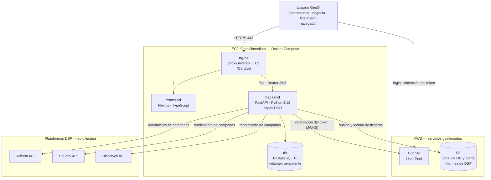
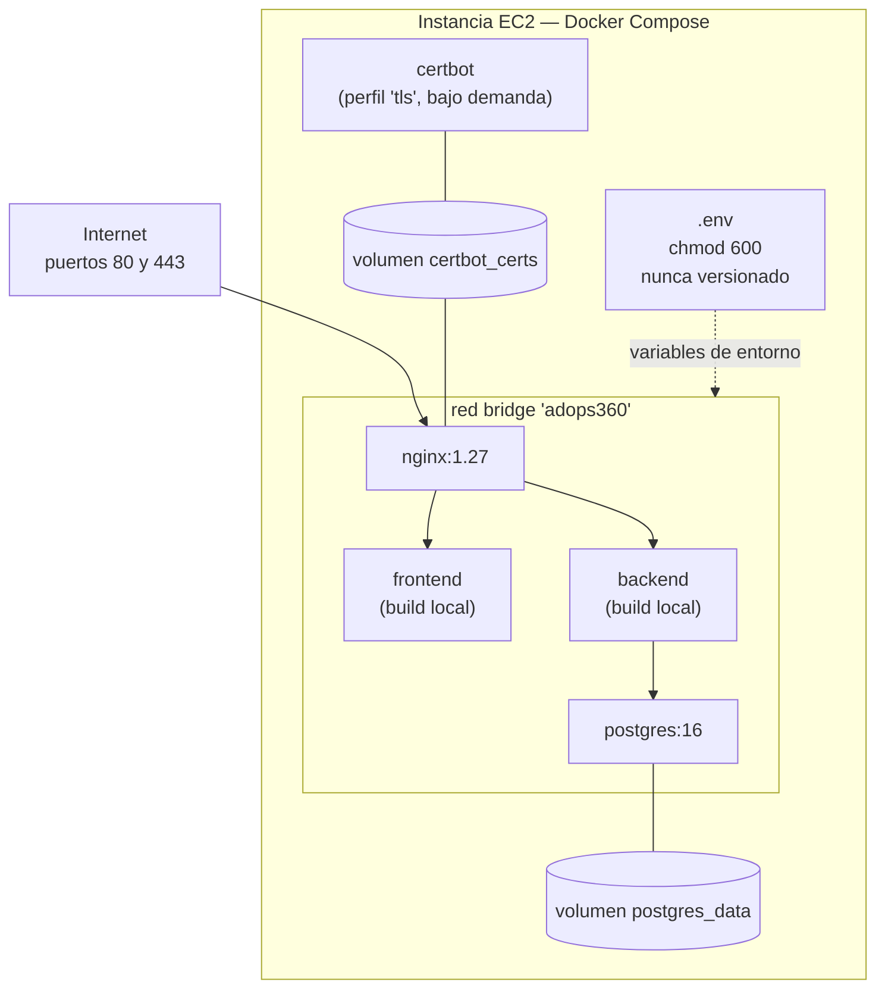
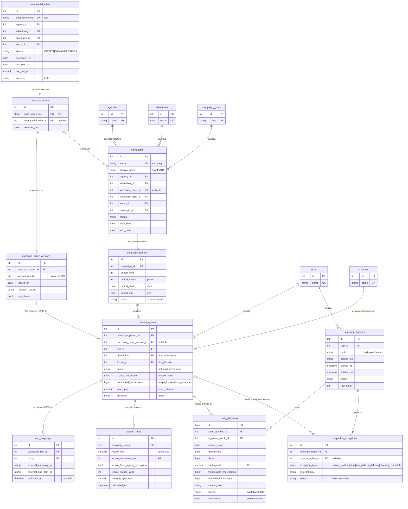
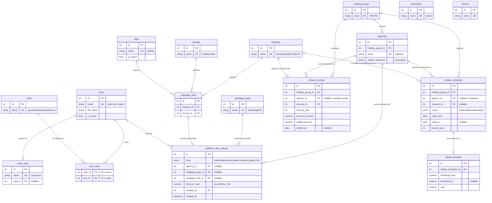

## Índice

0. [Ficha del proyecto](#0-ficha-del-proyecto)
1. [Descripción general del producto](#1-descripción-general-del-producto)
2. [Arquitectura del sistema](#2-arquitectura-del-sistema)
3. [Modelo de datos](#3-modelo-de-datos)
4. [Especificación de la API](#4-especificación-de-la-api)
5. [Historias de usuario](#5-historias-de-usuario)
6. [Tickets de trabajo](#6-tickets-de-trabajo)
7. [Pull requests](#7-pull-requests)

---

## 0. Ficha del proyecto

### **0.1. Tu nombre completo:**

Luis Felipe Morales

### **0.2. Nombre del proyecto:**

AdOps360

### **0.3. Descripción breve del proyecto:**

AdOps360 es la herramienta de gestión centralizada de campañas publicitarias digitales y de exterior (OOH/DOOH) de GeoQ, que reúne en un único sistema la oferta comercial, la configuración de campañas a partir de la orden de compra y el rendimiento real obtenido de los DSP.

Sustituye la cadena actual de hojas de cálculo en OneDrive, descargas manuales de informes y cuadros de mando en Qlik Sense por una única fuente de verdad, de modo que los equipos de negocio, operaciones y financiero trabajen sobre los mismos datos: estado diario de entrega, márgenes por campaña y acumulados por periodo, agencia y tipo de campaña.

### **0.4. URL del proyecto:**

Pendiente de despliegue

> Puede ser pública o privada, en cuyo caso deberás compartir los accesos de manera segura. Puedes enviarlos a [alvaro@lidr.co](mailto:alvaro@lidr.co) usando algún servicio como [onetimesecret](https://onetimesecret.com/).

### 0.5. URL o archivo comprimido del repositorio

https://github.com/lfmorales/AI4Devs-finalproject

> Puedes tenerlo alojado en público o en privado, en cuyo caso deberás compartir los accesos de manera segura. Puedes enviarlos a [alvaro@lidr.co](mailto:alvaro@lidr.co) usando algún servicio como [onetimesecret](https://onetimesecret.com/). También puedes compartir por correo un archivo zip con el contenido


---

## Estado del proyecto

### Historia 2 — Status diario de campañas (`daily-campaign-delivery-status`)

Implementado:

- **Ingesta nocturna desde Adform**: comando `python -m scripts.run_ingestion`, que ingiere la ventana de D-7 a D-1 y se puede repetir sin duplicar. Se programa desde el cron del host (ver [docs/deploy.md](./docs/deploy.md)).
- **Carga de un rango histórico** con `run_ingestion --from AAAA-MM-DD --to AAAA-MM-DD`.
- **Catálogo de líneas de Adform**, que rellena la propia ingesta, con la página «Catálogo Adform» (filtros, paginación, vincular y desvincular).
- **Estado diario de las campañas** (`/status`): contratado frente a entregado y ritmo, con los avisos «Sin datos recibidos» y «Desviación de ritmo».
- **Cola de excepciones** (`/exceptions`): entrega sin emparejar y entrega ausente, con resolver, vincular a una línea y filtro por texto y tipo.
- **Fechas y reparto mensual por línea** en el alta de campañas.
- **Difuminado visual de nombres** de Adform con `NEXT_PUBLIC_MASK_NAMES`, y una hoja de estilos global propia.

Instrucciones de despliegue, ingesta, carga de histórico y copias de seguridad: [docs/deploy.md](./docs/deploy.md).

### Limitaciones conocidas

- La validación `found` al vincular no prueba que la línea entregue ni que sea la correcta.
- No hay edición ni borrado de campañas ni de líneas: solo se pueden recrear.
- Una línea mapeada a mitad de campaña no recibe su histórico sin la carga de rango.
- El difuminado de nombres es visual: los nombres siguen en los datos de la página.
- El catálogo y las excepciones guardan datos de líneas de toda la cuenta de Adform.
- La subida manual de informes está aplazada; su formato está documentado en `design.md`.
- Las copias de seguridad y el `CRON_TZ` están documentados, pero no se han probado en un servidor.

---

### Historia 3 — Margen y devengo de rebates (`campaign-margin-and-rebate-accrual`)

Implementado:

- **Margen por flight** (línea × mes): ingreso sobre el volumen contratado y el CPM de venta, coste de medios (el coste de Adform), rebate y coste de plataforma. Cada importe se redondea a dos decimales antes de restar y los totales de línea y de campaña son la suma exacta de los de sus flights.
- **Mes en curso**: el ingreso y el rebate se devengan por días transcurridos del contrato hasta D-1 y se etiquetan como provisionales; los costes salen de lo entregado.
- **Motor de rebate**: escalera de seis pasos de resolución de tarifa, tramos marginales sobre un contador anual por grupo, agencia en excepción y canal, aplicado en orden cronológico.
- **Cierre de mes** (`POST /margin/closings`): congela las tasas aplicadas, es idempotente y rechaza cerrar un mes si uno anterior del mismo año tiene flights terminados sin cerrar, nombrando el mes que bloquea.
- **API de margen** (`GET /margin`) y maestros de tarifas de rebate y de tasa de plataforma, solo para el rol `finance`.
- **Página «Margen»** (solo `finance`): jerarquía campaña → línea → flight con los importes tal como los entrega el servidor, venta contratada y devengado, estado de cada flight («Cerrado», «Pendiente de cierre» o «En curso (provisional)»), días transcurridos y entrega frente a lo contratado, avisos «Margen negativo» y «Sin venta», y cierre de mes con confirmación.
- **Verificación con dos meses reales de Finanzas** (uno cerrado y otro en curso, de compra directa, anonimizados): el dominio reproduce los importes y porcentajes de las campañas comparadas con tolerancia de céntimos y las diferencias con la hoja de origen están explicadas (abajo).

Para verlo con datos de demostración (sintéticos, con nombres `DEMO-…`): `docker compose exec backend python -m scripts.seed_dev_data` da el rol `finance` al usuario de desarrollo, y `docker compose exec backend python -m scripts.seed_margin_demo` crea cuatro campañas (una pendiente de cierre, una en curso con margen positivo, una con margen negativo y una sin precio). El segundo comando se puede repetir sin duplicar datos.

### Diferencias con la hoja de origen (Qlik), explicadas

- **Coste de plataforma:** la hoja de origen no lo resta; AdOps360 sí. En el mes cerrado verificado, la brecha entre el margen sin y con plataforma es de unos 17 puntos porcentuales.
- **Campañas sin volumen contratado:** no entran en el margen y su entrega queda como entrega sin casar. En el mes en curso verificado suponen en torno a una cuarta parte del coste, y es la mayor diferencia con la hoja.
- **«%Margen» de la hoja en un mes en curso:** resta costes parciales a la venta de todo el mes y por eso sale más alto. AdOps360 equivale al «%Margen Actual», que devenga el ingreso.
- **Días servidos:** la hoja devenga por días con impresiones servidas; AdOps360, por días transcurridos del contrato hasta D-1. Coinciden si la campaña sirve cada día; si se pausa, la hoja devenga menos. A mes cerrado no hay diferencia. La prueba de aceptación del mes en curso construye la fecha de corte desde los días servidos de la hoja, así que valida la fórmula y no esta definición.
- **Ajustes manuales en la hoja:** dos campañas del mes en curso tienen cifras que no siguen la fórmula de la propia hoja (una con la extraprima por debajo de su tasa y otra con los costes a cero) y quedan excluidas de la comparación.
- **Volumen de la orden no entero:** unas pocas campañas traen un volumen con fracción; AdOps360 usa enteros y la diferencia es de menos de un céntimo por campaña.

### Limitaciones conocidas (margen)

- El **ingreso es el importe de la orden de compra**, que es la base de facturación. El margen no refleja los **ajustes de fin de mes** (por infraentrega o campañas paradas): un mes cerrado usa la venta contratada. En el mes cerrado verificado, ajustar a lo entregado las campañas infraentregadas habría reducido la venta en menos del 1 % y el margen en torno al 1,6 %. Mejora prevista: registrar el ajuste de cada flight mientras está pendiente de cierre, con motivo, como base del ingreso y del rebate; el cierre lo congelaría. La pantalla muestra lo entregado frente a lo contratado para detectar los candidatos.
- Las campañas **sin volumen contratado** y los píxeles sin coste de compra no se contemplan en esta versión.
- Una línea con **precio 0 y volumen** se admite como excepción de precio y se marca «Sin venta»; su margen es el coste en negativo y su porcentaje no se calcula.
- Un flight **sin tarifa de rebate** avanza igualmente el contador del grupo (supuesto pendiente de confirmar con Finanzas).
- La **reexpresión de contadores ya congelados** al crear o quitar una excepción de agencia a mitad de año, el replay cronológico, el recálculo explícito de un mes cerrado y los agregados por agencia, anunciante o tipo de campaña están aplazados; cada uno consta con su motivo en `tasks.md`.
- Un mes cerrado **no se actualiza** si Adform corrige cifras semanas después: la ingesta solo refresca los últimos siete días.
- La edición de tarifas y de la tasa de plataforma **no tiene pantalla**: se hace por la API.
- La pantalla lee el mes bloqueante de `previous_month_open` del texto del error; mejora prevista: que la API lo devuelva como campo.
- Las pruebas de aceptación leen datos reales de una carpeta ignorada por Git (`backend/tests/private/`) y **se saltan si no existen**. La **imagen de desarrollo los lleva dentro** y no debe publicarse en ningún registro.
- La base de datos **no tiene restricción** que impida un precio de venta negativo; la validación está en el esquema de la API.
- Los tests de dominio dependen de la base de datos de pruebas por una fixture de sesión global.
---


## 1. Descripción general del producto

> Describe en detalle los siguientes aspectos del producto:

### **1.1. Objetivo:**

AdOps360 es la herramienta interna con la que GeoQ gestiona sus campañas de publicidad digital y de exterior (OOH/DOOH) de principio a fin: desde la oferta comercial y la orden de compra que envía el cliente, hasta el rendimiento real que devuelven las plataformas de compra programática y el margen que deja cada campaña.

Hoy ese recorrido está repartido entre hojas de Excel en OneDrive, descargas manuales de informes y cuadros de mando en Qlik Sense, de modo que cada equipo trabaja sobre su propia copia de los datos y nadie puede afirmar con certeza cuánto se ha entregado ni cuánto se ha ganado en una campaña concreta. AdOps360 sustituye ese mosaico por una única fuente de verdad, compartida por los tres equipos que intervienen en el proceso: **operaciones**, **negocio** y **financiero** — sabiendo que una misma persona puede desempeñar varios de esos roles a la vez.

Los clientes son habitualmente agencias de medios, y de forma excepcional anunciantes directos. Las campañas se ejecutan en tres plataformas: **Adform**, **Equativ** y **Displayce**.

### **1.2. Características y funcionalidades principales:**

**1. Ingesta de órdenes de compra (OC)**
Registro de la información de la orden de compra que envían las agencias o los clientes directos, como punto de entrada para dar de alta una campaña en el sistema. Sustituye la transcripción manual de la OC a la hoja de configuración en OneDrive.

**2. Gestión de la oferta comercial**
El equipo de negocio registra en la herramienta su oferta comercial —hoy mantenida en Excel— como paso previo a su conversión en orden de compra, de modo que la propuesta y la campaña que nace de ella comparten origen en lugar de vivir en documentos separados.

**3. Sincronización del rendimiento vía API**
Conexión directa con Adform, Equativ y Displayce para obtener los datos de rendimiento de las campañas, en lugar de descargar y filtrar informes a mano cada día.

**4. Status diario de campañas**
Vista consultable por los equipos de operaciones y negocio con el estado y el rendimiento actualizado de cada campaña, alimentada por la sincronización anterior.

**5. Cálculo de márgenes**
Cruce del rendimiento obtenido con los datos maestros —precios de venta y extraprima por agencia, entre otros— para que el equipo financiero disponga del margen de cada campaña y de los acumulados por período, tipo de campaña y agencia. Es la función que sustituye a Qlik Sense.

**6. Gestión de datos maestros y configuración**
Mantenimiento administrativo (alta, consulta, modificación y baja) de los parámetros que alimentan el cálculo de márgenes: extraprimas por agencia, costes, precios de venta y demás configuración asociada. Accesible para el rol financiero.

### **1.3. Diseño y experiencia de usuario:**

> **Pendiente de capturas y mockups tras el desarrollo del frontend.**
>
> Este apartado se completará con imágenes o videotutorial del recorrido de usuario una vez exista la interfaz. No se documenta aquí ninguna descripción de UI por no haberse diseñado todavía.

### **1.4. Instrucciones de instalación:**

> **Estado.** Instrucciones validadas con el andamiaje de la entrega 2: las imágenes de `backend/` y `frontend/` ya existen y el stack arranca con `docker compose up`. Pueden aparecer variables de entorno adicionales a medida que se implementen las historias.

#### Requisitos previos

- Docker y Docker Compose
- Un User Pool de AWS Cognito ya creado (servicio gestionado, no forma parte del stack de contenedores), con un dominio de Hosted UI y un app client de tipo SPA: **sin client secret** y con flujo *authorization code* con PKCE. El app client debe tener como URL de callback `<origen>/callback` y como URL de cierre de sesión `<origen>/` (en local, `http://localhost/callback` y `http://localhost/`)
- Un bucket de S3 y credenciales de AWS con acceso a él
- Credenciales de API de Adform, Equativ y Displayce

#### 1. Clonar el repositorio

```bash
git clone [URL_REPO]
cd AI4Devs-finalproject
```

#### 2. Configurar las variables de entorno

```bash
cp .env.example .env
```

Edita `.env` con los valores reales. El fichero nunca se versiona y en el servidor debe tener permisos restringidos (`chmod 600`), ya que contiene las credenciales de las APIs de los DSP.

| Bloque | Variables |
|---|---|
| PostgreSQL | `POSTGRES_USER`, `POSTGRES_PASSWORD`, `POSTGRES_DB` |
| AWS Cognito | `COGNITO_USER_POOL_ID`, `COGNITO_CLIENT_ID`, `COGNITO_REGION`, `COGNITO_DOMAIN` (dominio del Hosted UI, sin `https://`) |
| AWS S3 | `AWS_REGION`, `AWS_ACCESS_KEY_ID`, `AWS_SECRET_ACCESS_KEY`, `S3_BUCKET_NAME` |
| APIs de los DSP | `ADFORM_CLIENT_ID`, `ADFORM_CLIENT_SECRET`, `EQUATIV_CLIENT_ID`, `EQUATIV_CLIENT_SECRET`, `DISPLAYCE_CLIENT_ID`, `DISPLAYCE_CLIENT_SECRET` |
| Frontend | `NEXT_PUBLIC_API_URL` |

#### 3. Levantar los servicios y aplicar migraciones

Ejecuta estos pasos **en orden exacto**:

**Paso 1:** Levantar los contenedores

```bash
docker compose up -d
```

Arrancan cuatro servicios: `backend` (FastAPI), `frontend` (Next.js), `db` (PostgreSQL, con volumen persistente) y `nginx` (proxy inverso). `nginx` enruta `/` al frontend y `/api/` al backend. En local sirve solo HTTP en el puerto 80; el bloque HTTPS se añade en la instancia cuando Certbot ha emitido el certificado.

**Paso 2:** Aplicar las migraciones de base de datos

```bash
docker compose exec backend alembic upgrade head
```

Las migraciones **deben ejecutarse antes del seed de datos**: sin ellas, el seed fallará con `relation "roles" does not exist` porque intenta insertar un usuario sin que las tablas base existan.

**Paso 3:** Cargar datos de desarrollo

```bash
docker compose exec backend python -m scripts.seed_dev_data
```

Crea el usuario de desarrollo cuyo email coincide con `SEED_USER_EMAIL` y le asigna el rol `operations`. Este usuario debe existir en Cognito con el mismo email.

**Paso 4:** Reiniciar nginx

```bash
docker compose restart nginx
```

**Importante: variables de entorno incrustadas en el build**

Las variables `NEXT_PUBLIC_*` y `COGNITO_DOMAIN` se incrustan en el bundle del frontend **al construir la imagen**. Si cambias alguna de estas variables en `.env`, debes reconstruir:

```bash
docker compose build
```

Luego vuelve a ejecutar `docker compose up -d` para reiniciar con el nuevo bundle.

#### 4. Requisitos en .env

Estos campos son obligatorios en `.env` (ver `.env.example` para la lista completa; no incluyas valores reales en el repositorio):

| Variable | Propósito |
|---|---|
| `POSTGRES_PASSWORD` | Contraseña de PostgreSQL |
| `COGNITO_DOMAIN` | Dominio del Hosted UI de Cognito (sin `https://`) |
| `SEED_USER_EMAIL` | Email del usuario de desarrollo que el seed crea y al que asigna el rol `operations`. **Debe coincidir con un usuario existente en Cognito.** |

Nunca incluyas valores reales en el repositorio. `.env.example` documenta la forma; `.env` en la instancia lleva permisos restringidos (`chmod 600`).

#### 5. Verificar

```bash
docker compose ps                         # backend y db en estado "healthy"
curl http://localhost/api/health          # {"status":"ok"}
docker compose logs -f backend
```

La aplicación queda en `http://localhost/` y la documentación de la API en `http://localhost/api/docs`.

#### 6. Ejecutar los tests

```bash
# Backend (requiere uv; descarga Python 3.12 si no está instalado)
cd backend && uv run pytest

# Frontend (Node 22)
cd frontend && npm ci && npm test
```

---

## 2. Arquitectura del Sistema

> Este apartado resume las decisiones de arquitectura. La fuente de verdad detallada está en [`docs/base-standards.md`](./docs/base-standards.md) (stack, modelo de autorización y despliegue), [`docs/backend-standards.md`](./docs/backend-standards.md) y [`docs/frontend-standards.md`](./docs/frontend-standards.md). Aquí se referencian esas secciones en lugar de duplicarlas.

### **2.1. Diagrama de arquitectura:**



Todo lo que queda dentro del recuadro `EC2` son contenedores del mismo `docker-compose.yml`. Cognito, S3 y las APIs de los DSP son externos: el sistema los consume, no los despliega.

#### Patrón: monolito contenedorizado en una única instancia

La aplicación es un **monolito desplegado como conjunto de contenedores en una sola máquina**, con el backend organizado internamente en capas siguiendo Domain-Driven Design (presentación → aplicación → dominio, con infraestructura dependiendo del dominio; ver [Backend Standards § Architecture Overview](./docs/backend-standards.md#architecture-overview)). Es decir: **un único despliegue, pero con fronteras internas explícitas**.

**Por qué es adecuado para el alcance actual:**

- **El alcance es un MVP interno.** Los usuarios son los equipos de operaciones, negocio y financiero de GeoQ —decenas de personas, no miles—, con un volumen de campañas moderado. Una arquitectura distribuida introduciría coste operativo y modos de fallo que este alcance no justifica.
- **El cálculo de margen es transaccional y local.** Cruza orden de compra, entrega real y datos maestros. Con un único esquema PostgreSQL eso es un `JOIN` dentro de una transacción; repartido entre servicios sería consistencia eventual y reconciliación entre copias, exactamente el problema que el producto existe para eliminar.
- **Un solo equipo y un solo artefacto de despliegue.** `docker compose up` levanta el sistema completo, idéntico en local y en el servidor. No hay versionado cruzado entre servicios ni contratos internos que mantener.
- **Coste.** Una instancia `t3.small`/`t3.medium` más Cognito y S3, sin base de datos gestionada ni balanceadores.

**Sacrificios que implica, asumidos conscientemente:**

- **Punto único de fallo.** Una sola instancia, sin alta disponibilidad. Una caída de la máquina es una caída del servicio.
- **Escalado solo vertical.** Crecer significa una instancia mayor, no más instancias.
- **Contención de recursos.** La ingesta de entregas de los DSP —millones de filas, según [Backend Standards § Performance](./docs/backend-standards.md#performance-best-practices)— compite por CPU y memoria con las peticiones de usuario en la misma máquina.
- **La persistencia es responsabilidad nuestra.** PostgreSQL corre en contenedor: copias de seguridad, actualizaciones y el ciclo de vida del volumen con nombre no los cubre ningún servicio gestionado. Borrar el volumen destruye los datos.
- **El despliegue implica un corte breve.** Reconstruir y reiniciar los contenedores deja el servicio no disponible unos segundos.

**Cómo evolucionaría si el uso creciera** (no forma parte de esta entrega ni hay compromiso de implementarlo): mover PostgreSQL a un servicio gestionado, sacar la ingesta de DSP a un proceso trabajador desacoplado del ciclo petición/respuesta, y ejecutar backend y frontend en varias instancias detrás de un balanceador. La arquitectura en capas del backend es precisamente lo que hace que ese movimiento sea viable: el modelo económico vive en el dominio, sin dependencias de infraestructura, y no habría que reescribirlo para cambiar dónde se ejecuta.

### **2.2. Descripción de componentes principales:**

| Componente | Tecnología | Responsabilidad |
|---|---|---|
| `backend` | Python 3.12, FastAPI, SQLAlchemy, Alembic, pandas/openpyxl | API de la aplicación. Contiene el modelo de dominio y el cálculo de márgenes, orquesta la ingesta de OC, ofertas y rendimiento, verifica el token de Cognito y **aplica la autorización por rol en cada endpoint**. |
| `frontend` | Node 22 LTS, Next.js, TypeScript | Interfaz única para los tres roles. Autentica al usuario contra Cognito, adjunta el token a las llamadas a la API y compone la navegación a partir de los roles del usuario. No calcula cifras financieras: las muestra ya calculadas por el backend. |
| `db` | PostgreSQL 16 (contenedor, volumen con nombre) | Único almacén transaccional: campañas, órdenes de compra versionadas, datos maestros, entregas y el modelo de usuarios y roles. |
| `nginx` | nginx 1.27 + Certbot | Proxy inverso y terminación TLS. Único punto de entrada: enruta hacia `frontend` y `backend` y expone los puertos 80 y 443. |
| **Cognito** (externo) | AWS Cognito User Pool | Identidad: credenciales, tokens y sesión. **No almacena roles.** |
| **S3** (externo) | Amazon S3 | Almacenamiento de los Excel de orden de compra y oferta comercial subidos, y de los informes descargados de los DSP. Los ficheros no se guardan en el disco de la instancia. |
| **APIs de DSP** (externas) | Adform, Equativ, Displayce | Fuente del rendimiento real de las campañas. La integración es **de solo lectura**: el sistema no crea ni modifica campañas en los DSP. |

El reparto entre Cognito y la aplicación es deliberado: **Cognito responde "quién es"; la aplicación responde "qué puede hacer"**. Los roles viven únicamente en la base de datos, en la tabla puente `user_roles`, de modo que hay una sola fuente de verdad y nada que sincronizar. El modelo completo está en [Base Standards § Authorization Model](./docs/base-standards.md#6-authorization-model).

### **2.3. Descripción de alto nivel del proyecto y estructura de ficheros**

El repositorio es un **monorepo**: el código de aplicación vive en la raíz, un directorio por servicio desplegable.

```
.
├── backend/                 # Servicio Python 3.12 + FastAPI (DDD en capas: domain, application, presentation, infrastructure)
├── frontend/                # Aplicación Node 22 + Next.js, TypeScript, organización por funcionalidad (app/, features/, lib/)
├── nginx/                   # Configuración del proxy inverso (conf.d/) y TLS
├── docs/                    # Estándares y documentación de producto
├── openspec/                # Especificaciones de cambios (OpenSpec)
├── ai-specs/                # Artefactos canónicos de agentes (agents, skills, scripts)
├── packages/                # Tooling interno, no desplegado
├── docker-compose.yml       # Cuatro servicios: backend, frontend, db, nginx
└── .env.example             # Variables de entorno requeridas, sin valores reales
```

`packages/` y `ai-specs/` quedan fuera del runtime: `ai-specs/` es la fuente canónica de los artefactos de agentes (referenciada por symlinks desde `.claude/` y `.cursor/`) y `packages/` contiene herramientas internas de desarrollo.

**Dentro de `backend/`** la organización obedece a DDD en capas, con la regla de dependencia en un solo sentido —presentación → aplicación → dominio; infraestructura → dominio; **nada depende de infraestructura**—:

```
backend/app/
├── domain/           # Entidades, value objects, servicios e interfaces de repositorio.
│                     # Aquí vive el modelo económico, sin dependencias externas.
├── application/      # Servicios de caso de uso; dependen de interfaces, no de SQLAlchemy
├── presentation/     # Routers FastAPI, esquemas Pydantic y dependencias de rol
└── infrastructure/   # Repositorios SQLAlchemy, clientes de DSP, S3, parsers, Cognito
```

El motivo de aislar el dominio es concreto: el cálculo de margen incluye devengo de extraprima por tramos, órdenes de compra versionadas y tasas congeladas en el momento del cálculo. Reglas de esa forma deben poder ejercitarse en tests sin base de datos, sin servidor HTTP y sin DSP.

**Dentro de `frontend/`** la agrupación es **por funcionalidad, no por tipo de fichero**: rutas y layouts en `app/`, módulos de dominio en `features/`, cliente de API tipado y manejo de sesión en `lib/`, y lo compartido en `components/` solo cuando una segunda funcionalidad lo necesita de verdad.

El detalle completo de ambos árboles está en [Backend Standards § Project Structure](./docs/backend-standards.md#project-structure) y [Frontend Standards § Project Structure](./docs/frontend-standards.md#project-structure).

### **2.4. Infraestructura y despliegue**



**Infraestructura**

- Una instancia **EC2** (`t3.small` o `t3.medium`) con Docker y Docker Compose.
- Cuatro servicios en ejecución permanente —`backend`, `frontend`, `db`, `nginx`— más un `certbot` bajo el perfil `tls`, que se ejecuta solo a demanda para emitir y renovar certificados.
- Todos los contenedores comparten una red bridge interna. **Solo `nginx` publica puertos** hacia el exterior (80 y 443); la base de datos y las aplicaciones no son alcanzables desde fuera de la instancia.
- Dos volúmenes con nombre: `postgres_data` (persistencia de la base de datos) y `certbot_certs` (certificados TLS, montados en `nginx` en solo lectura).
- Cognito y S3 son servicios gestionados de AWS y **no forman parte del stack de Compose**: solo se declara la configuración necesaria para alcanzarlos.

**Configuración**

Toda la configuración llega por variables de entorno, declaradas sin valores reales en `.env.example` y resueltas en el servidor desde un `.env` que nunca se versiona y que lleva permisos restringidos, porque contiene las credenciales de las APIs de los DSP. El detalle de los bloques de variables está en [§1.4 Instrucciones de instalación](#14-instrucciones-de-instalación).

**Proceso de despliegue**

El despliegue es **manual y deliberado**, ejecutado sobre la instancia:

```bash
git pull
docker compose up -d --build          # reconstruye y reinicia los servicios
docker compose exec backend alembic upgrade head   # migraciones, paso explícito
docker compose ps && docker compose logs -f backend
```

Las migraciones se aplican como **paso explícito de despliegue, nunca implícitamente al arrancar la aplicación**: una migración que se ejecuta sola al iniciar un contenedor se ejecuta también en un reinicio automático, y eso no es un momento elegido por nadie.

Los certificados se emiten y renuevan con el perfil `tls`:

```bash
docker compose run --rm certbot renew
```

> **CI/CD:** no hay pipeline de integración o despliegue continuo, porque todavía no se ha tomado esa decisión. Documentarlo aquí sería describir algo que no existe.

### **2.5. Seguridad**

Las medidas se corresponden con el alcance —un MVP interno en una sola instancia— y no pretenden ir más allá.

**1. Autenticación delegada en Cognito.** La aplicación no almacena ni gestiona contraseñas. El usuario se autentica contra el User Pool y el backend verifica el JWT contra las claves públicas del pool —firma, caducidad, emisor y audiencia— en cada petición.

**2. Autorización propia, siempre en el servidor.** El *claim* `email` del token es la clave de unión con `users.email`, y de ahí a `user_roles`. De esto se derivan tres reglas que se aplican sin excepción:

- Un token válido cuyo email no existe en `users` es **prohibido, no se autoprovisiona**. Autenticar correctamente no concede acceso.
- **Cada endpoint declara explícitamente el rol o roles que requiere.** Un endpoint sin requisito declarado es un fallo de revisión, no un endpoint abierto.
- Los endpoints que exponen coste o margen están restringidos al rol financiero.

**3. Las guardas del frontend son usabilidad, no seguridad.** Las rutas protegidas por rol en Next.js ocultan lo que el usuario no puede usar; nunca son la única comprobación. Toda vista protegida está respaldada por una verificación en el servidor, que asume que la API puede llamarse directamente.

**4. Gestión de secretos por entorno.** Ninguna credencial aparece en el código. `.env` no se versiona y en la instancia lleva permisos restringidos (`chmod 600`) por contener las credenciales de Adform, Equativ y Displayce. Solo las variables públicas de Cognito —pool, cliente, región— llegan al navegador; lo que debe permanecer secreto no vive en el frontend. *(Secrets Manager queda explícitamente fuera del alcance del MVP.)*

**5. HTTPS de extremo a extremo hacia el exterior.** nginx termina TLS con certificados de Let's Encrypt gestionados por Certbot. Es el único servicio con puertos publicados; el resto solo es alcanzable desde la red interna de Compose, de modo que PostgreSQL no está expuesto a Internet.

**6. Validación de toda entrada en el límite de la API.** Los cuerpos de petición se validan con Pydantic. Los ficheros subidos se tratan como no confiables: se valida tipo y tamaño antes de parsearlos y se almacenan en S3, no en el disco de la instancia.

**7. Sin SQL interpolado.** Todo el acceso a datos pasa por SQLAlchemy con parámetros vinculados.

**8. Registros sin secretos y errores sin fugas.** Los tokens, las credenciales y los cuerpos completos de petición no se escriben en los logs, y las respuestas de error nunca incluyen trazas, SQL ni credenciales de DSP.

El modelo de autorización completo está en [Base Standards § Authorization Model](./docs/base-standards.md#6-authorization-model) y su implementación en [Backend Standards § Authentication and Authorization](./docs/backend-standards.md#authentication-and-authorization).

### **2.6. Tests**

El desarrollo sigue TDD: toda funcionalidad nueva empieza por un test que falla.

**Estado actual (Entrega 2):** Las suites de backend y frontend pasan sobre el código implementado: 65 tests de backend y 61 de frontend (16 ficheros), ambos ejecutados dos veces. Ver el informe detallado en [docs/reports/2026-10-18-entrega-2-test-report.md](./docs/reports/2026-10-18-entrega-2-test-report.md).

| Nivel | Herramientas | Resultados |
|---|---|---|
| **Tests de dominio** | `pytest` (backend) | Reglas de negocio puras sin base de datos: expansión de períodos, versionado de órdenes de compra. |
| **Tests de API** | `pytest` + `httpx` contra FastAPI + PostgreSQL real | Endpoints reales: códigos de estado, esquemas, autenticación Cognito y **aplicación de roles en los endpoints protegidos por rol**. Base de pruebas (`adops360_test`) recreada al inicio de cada ejecución. |
| **Tests de infraestructura y migraciones** | `pytest` contra PostgreSQL real | Modelos de identidad y coherencia entre la migración Alembic y los modelos. Incluidos en los 65 tests de backend. |
| **Tests unitarios frontend** | `Vitest` + Testing Library | 61 tests en 16 ficheros, entorno jsdom. Comportamiento de componentes, layout de autenticación, interacción con sesión. Aprobados 2 veces consecutivas. |
| **Verificación de tipos** | TypeScript `tsc --noEmit` | ✓ Paso: sin errores de tipo en frontend. |
| **End-to-end** | `Playwright` | Planeado para Entrega 3: los tres flujos de rol completos sobre la aplicación desplegada. |
| **Integración frontend-backend** | Tests E2E + backend real | Planeado para Entrega 3: verificación del frontend contra el backend real en Docker. |

Tres criterios concretos que la estrategia impone:

- **Todo endpoint protegido por rol tiene un test que afirma que un usuario *sin* ese rol recibe un 403.** Un endpoint no está cubierto hasta que su caso negativo de autorización lo está. La misma regla aplica a los componentes protegidos del frontend.
- **Los ejemplos resueltos de [Product Description](./docs/product-description.md) se codifican como tests.** Son la especificación del modelo económico y la referencia contra la que se juzga la paridad con las cifras actuales de Qlik Sense: es el criterio que decide si el sistema puede sustituirlo.
- **Los flujos E2E cubren un rol cada uno**, más un cuarto caso con un usuario que acumula varios roles a la vez —el caso normal en este equipo, y el que una suite de tres flujos nunca ejercitaría.

| Flujo E2E | Cubre | Estado |
|---|---|---|
| Operaciones | Registrar una campaña desde la orden de compra, mapearla al DSP y revisar una excepción de ingesta | Previsto E3 |
| Negocio | Crear una oferta comercial y seguirla hasta convertirse en campaña | Previsto E3 |
| Financiero | Consultar el margen de campaña y los acumulados por periodo | Previsto E3 |

El detalle está en [Backend Standards § Testing Standards](./docs/backend-standards.md#testing-standards) y [Frontend Standards § Testing Standards](./docs/frontend-standards.md#testing-standards).

---

## 3. Modelo de Datos

> El modelo no se ha inventado: se deriva de los ficheros que GeoQ usa hoy —`campaigns.xlsx` (hojas `Campaigns`, `History`, `Customer`, `Providers`), `extraprimas 2023/2024/2026.xlsx` y `CuratorMargin2024/2025/2026.xlsx`— y de las decisiones ya cerradas con el PO en [Product Description §4 y §5](./docs/product-description.md). Los nombres de tablas y columnas van en inglés, conforme a [Base Standards §2](./docs/base-standards.md#2-language-standards); la prosa va en español como el resto de este documento.
>
> Donde un dato no existe en ningún fichero ni está decidido, aparece marcado como **pendiente de validar** (§3.3) en lugar de rellenarse con una suposición.

### **3.1. Diagrama del modelo de datos:**

El esquema es **uno solo**. Se presenta en dos vistas porque veintiséis entidades en un único diagrama no se leen. Las entidades que aparecen en ambas —`agencies`, `advertisers`, `dsps`, `channels`, `campaign_types`, `campaign_lines`— son la costura entre las dos vistas, no copias de un modelo distinto.

#### Vista 1 — Núcleo operativo: de la oferta a la entrega diaria



#### Vista 2 — Identidad, maestros y motor de extraprima



`advertisers` y `sectors` aparecen aquí como maestros del catálogo; su única relación es con `campaigns` y se dibuja en la Vista 1.

**Nota sobre el margen.** No hay entidad `margins`. El margen es una función de datos que ya están en el modelo —`campaign_lines` (volumen contratado y CPM de venta), `daily_deliveries` (coste de medios e impresiones servidas) y `applied_rates` (tasas congeladas)— y se calcula, no se almacena. Lo mismo vale para el `CuratorMargin`: [Product Description §5.3](./docs/product-description.md) lo verifica como `ingreso OC − coste de compra` en 404 de las 408 filas de los ficheros `CuratorMargin20XX.xlsx`, por lo que es un resultado, no un dato de origen. La instantánea inmutable de cierre mensual es una entidad de fase 2, fuera de este diagrama.

### **3.2. Descripción de entidades principales:**

#### Identidad y autorización

| Entidad | Propósito | Campos clave | Restricciones |
|---|---|---|---|
| `users` | Usuario local. Es el lado de la aplicación del modelo de identidad: Cognito autentica, esta tabla autoriza. | `id` PK · `email` · `full_name` · `is_active` | `email` **UNIQUE** y **NOT NULL**: es la única unión con Cognito, vía el *claim* `email`. Un token válido sin fila aquí es **forbidden**, nunca se autoprovisiona. |
| `roles` | Catálogo de roles funcionales. | `id` PK · `name` | `name` UNIQUE, valores `operations`, `business`, `finance`. |
| `user_roles` | Tabla puente. Un usuario acumula varios roles a la vez, que es el caso normal en este equipo. | PK compuesta (`user_id` FK, `role_id` FK) | PK compuesta; **prohibida** una columna `role` en `users`. |

Procedencia: [Base Standards §6](./docs/base-standards.md#6-authorization-model), no de los ficheros.

#### Maestros comerciales

| Entidad | Propósito | Campos clave | Procedencia |
|---|---|---|---|
| `holding_groups` | Grupo de comunicación. **Es la clave por defecto contra la que se negocia la extraprima y se acumula su volumen anual**; una agencia con excepción se desgaja de ese contador (ver `rebate_accruals`). | `id` PK · `name` UNIQUE | Columna `GRUPO` de `Customer` y de los tres ficheros `extraprimas` |
| `agencies` | Entidad a la que se factura la campaña. Pertenece a un grupo, y puede tener una extraprima propia que se aparte de la de su grupo — en cuyo caso también acumula volumen por separado. | `id` PK · `holding_group_id` FK **NOT NULL** · `name` UNIQUE · `reclam_reference` | `Customer.Agencia`; `customer` en `Campaigns`. `RECLAM` se conserva como metadato descriptivo y no gobierna nada (§8 del PO) |
| `advertisers` | Anunciante o marca. | `id` PK · `name` UNIQUE | Columna `brand` |
| `dsps` | Catálogo mantenido de plataformas, **no un enum**: el histórico contiene Adform, Equativ, Displayce, Pubmatic, DV360, RevenueMaker e Ikreate. | `id` PK · `name` UNIQUE · `is_active` | Columna `trading` (no `DSP`, ver §3.4) |
| `channels` | Tipo de plataforma. Es la clave de acumulación de los tramos de extraprima, así que una mala clasificación desplaza los tramos de todo el año. | `id` PK · `name` UNIQUE | `tipo_plataforma` (`Directo`, `Deal`, `DOOH`) y la columna de canal de `extraprimas 2024/2026` (que además incluye `CTV`) |
| `campaign_types` | Tipo de campaña. | `id` PK · `name` UNIQUE | `tipo_campaign`: `Branding`, `D2S` |
| `formats` | Formato creativo. | `id` PK · `name` UNIQUE | `tipo_formato`: `Display`, `Vídeo` |
| `sectors` | Sector del anunciante, dimensión de los acumulados. | `id` PK · `name` UNIQUE | Columna `sector`, 21 valores distintos |
| `sales_reps` | Comercial responsable. | `id` PK · `name` UNIQUE · `user_id` FK *nullable* | Columna `Comercial`, 5 valores distintos |

#### Extraprima y coste de plataforma

| Entidad | Propósito | Campos clave | Procedencia |
|---|---|---|---|
| `rebate_schedules` | Escala de extraprima vigente para un canal y un ámbito, **con vigencia temporal**. Se negocia normalmente **con el grupo**, pero una agencia concreta puede tener su propia escala que se aparte de la de su grupo: por eso `agency_id` es *nullable* y, cuando viene informado, la fila es una **excepción que gana sobre la del grupo**. Es lo que permite resolver la tasa por fecha en vez de por un `if` fijo. | `id` PK · `holding_group_id` FK **NOT NULL** · `agency_id` FK *nullable* · `channel_id` FK *nullable* · `scope` · `valid_from` **NOT NULL** · `valid_to` *nullable* · `source_year` | Normalización de los tres ficheros `extraprimas`, cuyas claves **no coinciden entre sí** (§3.4). La excepción por agencia **no existe en ellos**: los tres van por `GRUPO` |
| `rebate_brackets` | Tramos marginales de una escala: desde, hasta y tasa. Los tramos se aplican a la porción, como los tramos del IRPF. | `id` PK · `rebate_schedule_id` FK · `threshold_from` · `threshold_to` *nullable* · `rate` | **No existe en ningún fichero.** Los tres traen una sola tasa por clave; la migración las carga como un tramo único que cubre todo el volumen |
| `rebate_accruals` | Devengado frente a liquidado por contador, canal y año. Son dos cantidades distintas: la extraprima se devenga por campaña pero se paga una vez, a año vencido. **El contador es el grupo, salvo que la agencia tenga excepción**: en ese caso lleva volumen propio y queda excluida del contador de su grupo (ver abajo). | `id` PK · `holding_group_id` FK **NOT NULL** · `agency_id` FK *nullable* · `channel_id` FK · `accrual_year` · `accrued_amount` · `settled_amount` · `settled_on` | Requisito de [§5.4](./docs/product-description.md); no existe hoy en ninguna herramienta |
| `platform_rate_settings` | Tarifa de infraestructura configurable en tres niveles, ganando el más específico: sistema (1,00 €/CPM) → agencia o tipo de campaña → línea. | `id` PK · `level` · FKs *nullable* según nivel · `rate_per_cpm` · `created_by` FK · `created_at` | Hoy **no es un dato**: es un `1` incrustado en una expresión de Qlik. Cada sobrescritura guarda autor y fecha porque mueve el margen |

**La excepción por agencia desgaja el contador, no solo la tasa.** Una agencia con escala propia **acumula su volumen anual por separado y deja de computar en el de su grupo**. La consecuencia es que el contador del grupo baja: sus agencias hermanas tardan más en cruzar un tramo, y la agencia excepcionada recorre los suyos con su propio volumen. Por eso `rebate_accruals` lleva `agency_id` además de `holding_group_id`, y la clave de acumulación es:

```
contador = (grupo, agencia | NULL, canal, año)
           └─ agencia informada  → la agencia tiene excepción en ese canal: cuenta sola
           └─ agencia a NULL     → el caso normal: cuenta con su grupo
```

El desgaje es **por canal**, no global, porque la excepción se negocia por canal: una agencia puede tener escala propia en `Directo` y seguir acumulando con su grupo en `DOOH`. Y como el reparto en tramos es cronológico, mover una agencia dentro o fuera de un contador **restablece el año completo** de todas las afectadas, igual que un cambio de escala: es el mismo recálculo, no un caso aparte.

#### Ciclo comercial y campaña

| Entidad | Propósito | Campos clave | Procedencia |
|---|---|---|---|
| `commercial_offers` | Oferta del equipo de negocio, previa a la OC. **Fase 3.** | `id` PK · `offer_reference` UNIQUE · `agency_id` FK · `advertiser_id` FK · `status` · `presented_on` · `accepted_on` · `net_budget` · `currency` | Columna `OF` (47% de relleno) y el bloque `Estatus Agencias BEYUP` del Qlik, que ya define el embudo `OFERTA → GANADA` |
| `purchase_orders` | Orden de compra que envía el cliente y que da de alta la campaña. | `id` PK · `order_reference` UNIQUE · `commercial_offer_id` FK *nullable* · `received_on` | Columna `OC` (38% de relleno, 47 OC distintas, 11 de ellas con más de una campaña) |
| `purchase_order_versions` | **La OC se versiona, no se sobrescribe.** Una campaña que paró antes de tiempo se factura al menor entre contratado y servido, mediante abono u OC revisada, y el ingreso, la base de extraprima y la acumulación de tramos leen siempre la versión en vigor. | `id` PK · `purchase_order_id` FK · `version_number` · `issued_on` · `revision_reason` · `is_in_force` | Decisión del PO (2026-09-17). No existe en los ficheros |
| `campaigns` | Cabecera de campaña. | `id` PK · `name` · `display_name` · `agency_id` FK **NOT NULL** · `advertiser_id` FK · `purchase_order_id` FK ***nullable*** · `campaign_type_id`/`sector_id`/`sales_rep_id` FK · `status` · `start_date` · `end_date` | `campaign`, `CAMPAÑA`, `customer`, `brand`. La FK a la OC es **nullable a propósito**: solo el 38% de las filas actuales trae referencia de OC |
| `campaign_periods` | **Mes natural como entidad de primer nivel.** Es como el negocio piensa (`period` = `agosto`), como se compromete el presupuesto y como consolida el equipo financiero. Aplanarlo a un rango de fechas perdería la forma de trabajar del equipo. | `id` PK · `campaign_id` FK · `period_year` · `period_month` · `period_start` · `period_end` · `status` | El grano real de `Campaigns`: 259 filas para 113 campañas, una por mes |
| `campaign_lines` | La línea es donde viven las tarifas y los volúmenes, porque `cpm_estandar` ya varía entre filas de una misma campaña (21 valores distintos, de 2 € a 31,25 €). | `id` PK · `campaign_period_id` FK · `purchase_order_version_id` FK *nullable* · `dsp_id`/`channel_id`/`format_id` FK · `scope` · `market_description` · `contracted_impressions` · `sale_cpm` · `currency` | `target_impressions_estandar`, `cpm_estandar`, `trading`, `tipo_plataforma`, `tipo_formato`, `location` |
| `dsp_mappings` | **Clave foránea real contra el DSP**, en sustitución del nombre de campaña troceado por posición que hoy sostiene todo el modelo financiero. Es la mitigación del riesgo principal del proyecto. | `id` PK · `campaign_line_id` FK · `dsp_id` FK · `external_campaign_id` · `external_line_item_id` · `validated_at` | Requisito de [§7](./docs/product-description.md). Una línea activa sin mapeo es estado **bloqueante**, no aviso |
| `applied_rates` | Tasa de extraprima y tarifa de plataforma **congeladas en el momento del cálculo**, con su procedencia: qué escalón de la escalera de resolución las produjo, de qué año venía la tabla y si la tasa salió de una excepción de agencia o de la escala del grupo. Sin ese último dato, un 25% negociado con una agencia concreta y el 25% heredado de su grupo son indistinguibles al revisar un margen. | `id` PK · `campaign_line_id` FK · `rebate_rate` · `rebate_resolution_step` · `rebate_from_agency_exception` · `rebate_source_year` · `platform_cpm_rate` · `calculated_at` | Decisión de [§5.9](./docs/product-description.md). Una cifra financiera que cambia sola cuando alguien edita un maestro no es auditable |

#### Ingesta y entrega

| Entidad | Propósito | Campos clave | Procedencia |
|---|---|---|---|
| `daily_deliveries` | Entrega real por línea y día. Es el grano que hoy no existe en ninguna hoja de cálculo: **ninguno de los dos Excel contiene una sola fila de entrega real**. Volumen esperado: ~4.600 filas/día. | `id` PK · `campaign_line_id` FK · `ingestion_batch_id` FK · `delivery_date` · `impressions` · `clicks` · `media_cost` · `measurable_impressions` · `viewable_impressions` · `banner_size` · `screen` · `line_format` | Grano del QVD de entrega de Adform. `line_format` se guarda **solo como contraste**: el canal manda desde la configuración, nunca desde el DSP |
| `ingestion_batches` | Cada ejecución de ingesta, con su ruta, fichero y resultado. Sustituye las 49 etiquetas escritas a mano (`carga 1`, `carga octopus`, `carga equativ 8/11`) por trazabilidad real. | `id` PK · `dsp_id` FK · `route` (`api`\|`upload`\|`email`) · `source_file` · `started_at` · `finished_at` · `status` · `row_count` | Campos `origen` y `file` del QVD, y la hoja `Providers` para la ruta de correo (fase 2) |
| `ingestion_exceptions` | Claves sin casar, **en ambos sentidos**: entrega sin línea y línea sin entrega. Hoy las dos son invisibles, y una es un problema comercial mientras que la otra es una errata. | `id` PK · `ingestion_batch_id` FK · `campaign_line_id` FK *nullable* · `exception_type` · `external_key` · `status` | Requisito de [§7](./docs/product-description.md): 87 claves de entrega sin configuración y 178 configuraciones sin entrega |

### **3.3. Pendiente de validar**

Lo que no está en ningún fichero ni decidido, y por tanto no se ha rellenado con una suposición:

| # | Punto abierto | Por qué queda abierto |
|---|---|---|
| 1 | **Umbrales y tasas reales de los tramos de extraprima** | Los tres ficheros traen exactamente una tasa por clave. Los tramos de [§5.4](./docs/product-description.md) son el ejemplo del PO, no la escala negociada. La migración carga cada tasa histórica como tramo único |
| 2 | **Métricas exactas de Equativ y Displayce** | El grano conocido procede del QVD de Adform. Fase 1 es solo Adform; los conectores de las otras dos son fase 2 y su conjunto de métricas se confirmará contra sus APIs |
| 3 | **Campos de la OC más allá de referencia, volumen, CPM, motivo y fecha de revisión** | Importes totales, condiciones de pago y plazos no aparecen en `campaigns.xlsx` ni en ningún otro fichero. Solo se modela lo que se usa |
| 4 | **Qué ocurre con las líneas al revisar una OC** | ¿La revisión crea filas nuevas de `campaign_lines` asociadas a la nueva versión, o una tabla puente volumen-por-versión? Aquí se asume lo primero, que preserva el histórico, pero no está confirmado |
| 5 | **Conjunto de estados de `campaigns` y `campaign_periods`** | El fichero actual solo tiene `Activa`/`Inactiva`; el ciclo de vida es nuevo y sus estados no están enumerados todavía |
| 6 | **El rol `admin`** | [Base Standards §6](./docs/base-standards.md#6-authorization-model) fija tres roles; [Product Description §3](./docs/product-description.md) menciona cuatro, añadiendo `admin`. El diagrama sigue los tres de Base Standards |

### **3.4. Incompatibilidades detectadas entre los ficheros de origen**

Los ficheros no son consistentes entre sí, y esas discrepancias son requisitos de migración, no erratas a limpiar en silencio.

**1. La clave de la extraprima cambia cada año, y falta 2025.** `extraprimas 2023.xlsx` tiene 17 filas con clave `GRUPO`; el de 2024, 80 filas con clave `GRUPO × canal`; el de 2026, 167 filas con clave `GRUPO × canal × location`. No hay fichero de 2025. Se resuelve con `valid_from`/`valid_to` y una escalera que degrada de lo específico a lo general, hereda del año anterior cuando falta la tabla, y registra siempre qué escalón dio la tasa — para poder distinguir un 0% negociado de un hueco en los datos:

| Escalón | Se busca | Cubre |
|---:|---|---|
| 1 | agencia + canal + ámbito | Excepción negociada con una agencia concreta |
| 2 | agencia + canal | Excepción sin distinción de ámbito |
| 3 | agencia | Excepción plana para toda la agencia |
| 4 | grupo + canal + ámbito | El caso normal, y la clave del fichero de 2026 |
| 5 | grupo + canal | La clave del fichero de 2024 |
| 6 | grupo | La clave del fichero de 2023 |
| 7 | tabla anterior en vigor, volviendo al escalón 1 | La regla de arrastre: 2025 se tarifica con la tabla de 2024 |
| 8 | 0%, registrado con su motivo | Grupo sin fila de extraprima en ningún año |

Los escalones 1 a 3 son la novedad: **la extraprima se negocia normalmente con el grupo, pero una agencia puede tener excepción propia dentro de él**, y en ese caso gana sobre la de su grupo y acumula volumen por separado (§3.2). Ninguno de los tres ficheros contiene excepciones de agencia —los tres van por `GRUPO`—, así que la migración las carga todas como escala de grupo y las excepciones se dan de alta desde la aplicación.

**2. `location` significa cosas distintas en cada fichero.** En `extraprimas 2026.xlsx` solo toma dos valores (`Nacional`, `Internacional`) y **se usa para tarificar**. En `campaigns.xlsx` es texto libre: solo en las filas activas ya aparecen `Nacional`, `nacional`, `Internacional `, `Internacional (Francia)`, `Nacional (Vigo)`, `Nacional (Madrid)`… y sobre el corpus completo son 80 valores distintos, de los que un 2% no clasifica en ninguno de los dos cubos (`UK`, `Rotterdam`, `Madrid`, `España_Italia`). **El campo sobre el que se tarifica no existe de forma fiable en los datos.** Por eso se parte en dos: `scope` validado, que es lo que tarifica, y `market_description` libre, que es lo que describe.

**3. La extraprima va por grupo; las campañas, por agencia — y la unión falla.** 7 de los 22 grupos de `extraprimas 2026.xlsx` no existen en la hoja `Customer` (`CONTVERSION`, `HABITANT`, `IRISHMEDIA`, `IRISHMEDIA EL LIBERAL`, `MEDIA DIAMOND`, `OHMM`, `PRENSA IBERICA`), y parte del fallo es puramente ortográfico: `PRENSA IBÉRICA` en extraprimas frente a `PRENSA_IBERICA` en `Customer`. Por el otro lado, 3 de las 16 agencias de `Campaigns` no están en `Customer`. Esto es lo que justifica que la agencia sea una referencia validada y no texto libre, y que el maestro de agencias sea prerrequisito de migración.

**4. La vigencia temporal se apaña creando entidades nuevas.** `extraprimas 2026.xlsx` contiene a la vez `GROUPM` y `GROUPMWPP`, esta última con la nota libre *"11/5/2026 se baja desde el 35% porque no llega a volumen"*; y también `IRISHMEDIA` e `IRISMEDIA` como grupos separados. En `Customer` conviven `GESTION_DE_MEDIOS` (nota `2024`) y `xxGESTION_DE_MEDIOS` (nota `2023`), prefijada para desactivarla. Es decir: **hoy un cambio de tasa o de adscripción a mitad de año se codifica inventando una fila nueva y anotando el motivo en texto libre.** Eso es exactamente lo que pasan a hacer `valid_from`/`valid_to` y los tramos.

**5. `CuratorMargin20XX.xlsx` se une a las campañas por el nombre en texto libre, y no casa.** De los 92 nombres distintos del fichero de 2026, 73 encuentran campaña en `History` y solo 16 en `Campaigns`; además hay nombres con espacio duro final (`…Autoking abr26\xa0`) y con carácter de ancho cero (`…Cullera​_mar26`), y nombres duplicados dentro del mismo fichero. Es la misma fragilidad que [§7](./docs/product-description.md) documenta como riesgo principal, y el argumento directo a favor de `dsp_mappings` como clave foránea real.

**6. El DSP está en la columna equivocada.** El DSP real vive en `trading` (relleno en las 169 filas activas) mientras que la columna llamada `DSP` está vacía en 251 de 259 filas. `trading` además arrastra erratas —`Equative`, `adfomr`— que resultan ser predictores casi perfectos de fila huérfana. El modelo se queda con `trading` como origen de `dsps.name` y descarta la columna `DSP`.

**7. `CuratorMargin` no aporta entidad, aporta verificación.** Sus 14 columnas son todas derivables de datos que ya están en el modelo, y la aritmética cuadra en 404 de 408 filas. Se conserva un matiz que sí es estructural: el `% Margen` de esos informes **excluye** el coste de plataforma, mientras que el margen interno lo incluye, así que son dos números distintos por construcción y el producto no debe presentarlos como el mismo.

**8. Columnas muertas.** `KPI`, `frecuencia`, `device`, `temporality`, `activo|inactivo`, `Configurada`, `Check`, `GENERA`, `cpm_especial`, `target_impressions_especial` y `conf_impressions_*` están vacías en el 100% de las filas activas, y `providers` es un contador de días mal etiquetado. No son requisitos: son intenciones abandonadas, y no pasan al modelo.

---

## 4. Especificación de la API

Los tres endpoints principales de registro y consulta de campañas:

### **4.1. POST /api/campaigns — Registrar campaña**

**Rol requerido:** `operations`

**Descripción:** Registra una nueva campaña desde una orden de compra. Valida todas las referencias a maestros (agencia, anunciante, DSP, etc.), expande automáticamente los períodos mensuales y crea las líneas de campaña.

**Petición:**

```bash
curl -X POST http://localhost/api/campaigns \
  -H "Authorization: Bearer <token>" \
  -H "Content-Type: application/json" \
  -d '{
    "name": "ACME_may26_adform",
    "display_name": "ACME Mayo 2026 Adform",
    "agency_id": 1,
    "advertiser_id": 2,
    "campaign_type_id": 1,
    "sector_id": 3,
    "sales_rep_id": 1,
    "start_date": "2026-05-01",
    "end_date": "2026-05-31",
    "order_reference": "PO-2026-001",
    "order_received_on": "2026-04-28",
    "lines": [
      {
        "dsp_id": 1,
        "channel_id": 1,
        "format_id": 1,
        "scope": "national",
        "market_description": "Nacional (Madrid)",
        "contracted_impressions": 500000,
        "sale_cpm": "5.50"
      }
    ]
  }'
```

**Respuesta exitosa (201 Created):**

```json
{
  "id": 42,
  "name": "ACME_may26_adform",
  "display_name": "ACME Mayo 2026 Adform",
  "agency_id": 1,
  "advertiser_id": 2,
  "campaign_type_id": 1,
  "sector_id": 3,
  "sales_rep_id": 1,
  "purchase_order_id": 15,
  "start_date": "2026-05-01",
  "end_date": "2026-05-31",
  "status": "active",
  "periods": [
    {
      "id": 127,
      "campaign_id": 42,
      "period_year": 2026,
      "period_month": 5,
      "period_start": "2026-05-01",
      "period_end": "2026-05-31",
      "status": "open"
    }
  ],
  "lines": [
    {
      "id": 301,
      "campaign_period_id": 127,
      "dsp_id": 1,
      "channel_id": 1,
      "format_id": 1,
      "scope": "national",
      "market_description": "Nacional (Madrid)",
      "contracted_impressions": 500000,
      "sale_cpm": "5.50",
      "currency": "EUR"
    }
  ]
}
```

**Errores:**

- **401 Unauthenticated:** Token ausente, inválido, expirado o con signature incorrecta.
- **403 Forbidden:** Token válido pero usuario sin rol `operations`. Código: `{"code": "missing_role", "message": "User lacks the required role"}`.
- **409 Conflict:** Orden de compra duplicada. Código: `{"code": "duplicate_order_reference", "message": "A purchase order with this reference already exists"}`.
- **409 Conflict:** Nombre de campaña duplicado. `{"code": "duplicate_campaign_name", "message": "A campaign with this name already exists"}`.
- **422 Validation Error:** Campo requerido ausente o malformado. Ejemplo con `lines: []`: `{"detail": [{"type": "too_short", "loc": ["body", "lines"], "msg": "List should have at least 1 item after validation, not 0", "input": [], "ctx": {"field_type": "List", "min_length": 1, "actual_length": 0}}]}`.

---

### **4.2. GET /api/campaigns — Listar campañas**

**Rol requerido:** `operations` o `business`

**Descripción:** Obtiene la lista de todas las campañas (vista simplificada sin períodos ni líneas por rendimiento).

**Petición:**

```bash
curl -X GET http://localhost/api/campaigns \
  -H "Authorization: Bearer <token>" \
  -H "Content-Type: application/json"
```

**Respuesta exitosa (200 OK):**

```json
[
  {
    "id": 42,
    "name": "ACME_may26_adform",
    "display_name": "ACME Mayo 2026 Adform",
    "agency_id": 1,
    "advertiser_id": 2,
    "status": "active",
    "start_date": "2026-05-01",
    "end_date": "2026-05-31"
  },
  {
    "id": 41,
    "name": "NIKE_apr26_equativ",
    "display_name": "Nike Abril 2026 Equativ",
    "agency_id": 3,
    "advertiser_id": 5,
    "status": "active",
    "start_date": "2026-04-01",
    "end_date": "2026-04-30"
  }
]
```

**Errores:**

- **401 Unauthenticated:** Token ausente o inválido.
- **403 Forbidden:** Token válido pero usuario sin rol `operations` o `business`. Código: `{"code": "missing_role", "message": "User lacks the required role"}`.

---

### **4.3. GET /api/masters/agencies — Obtener lista de agencias**

**Rol requerido:** Cualquier usuario autenticado

**Descripción:** Obtiene el catálogo de agencias para usar en selectores de formulario. Solo devuelve agencias activas.

**Petición:**

```bash
curl -X GET http://localhost/api/masters/agencies \
  -H "Authorization: Bearer <token>" \
  -H "Content-Type: application/json"
```

**Respuesta exitosa (200 OK):**

```json
[
  {
    "id": 1,
    "name": "GroupM"
  },
  {
    "id": 2,
    "name": "Dentsu"
  },
  {
    "id": 3,
    "name": "Publicis"
  },
  {
    "id": 4,
    "name": "Havas"
  }
]
```

**Errores:**

- **401 Unauthenticated:** Token ausente o inválido.

---

### **Nota: Formatos de error**

El API utiliza tres formatos de error según el tipo:

1. **Errores de negocio (40x):** Devuelven `{"code": "<error_code>", "message": "<human_readable_message>"}`. Códigos: `missing_role`, `duplicate_order_reference`, `duplicate_campaign_name`.

2. **Errores de validación (422):** Devuelven `{"detail": [...]}` con array de detalles por campo. Formato: `{"detail": [{"loc": ["body", "field_name"], "msg": "error message", "type": "error_type"}]}`.

3. **Errores de maestros inexistentes (400):** Devuelven `{"detail": "Agency with id 999 not found"}`.

---

## 5. Historias de Usuario

> Las tres historias cubren los tres bloques de valor del producto: **registrar** la campaña una sola vez, **ver** lo que entrega cada día y **calcular** lo que deja. Los criterios de aceptación se apoyan en las entidades del [apartado 3](#3-modelo-de-datos) y en las reglas ya cerradas en [Product Description](./docs/product-description.md), no en supuestos genéricos.
>
> Cada criterio lleva la fase en la que se entrega, porque el recorte de alcance de [§6](./docs/product-description.md) no coincide con el listado de funcionalidades del apartado 1: **[F1]** fase 1 (MVP, solo Adform), **[F2]** fase 2 (conectores de Equativ y Displayce), **[F3]** fase 3 (gestión de oferta comercial). Una historia sin marcas de fase prometería en el MVP cosas que llegan después.

---

**Historia de Usuario 1 — Alta de campaña desde la orden de compra**

> **Como** responsable de **operaciones**, **quiero** dar de alta una campaña completa a partir de la orden de compra que envía el cliente, arrastrando la oferta comercial que la originó cuando existe, **para** que la campaña quede configurada una sola vez y con su origen comercial trazable, en lugar de transcribirla a mano desde la OC a una hoja de cálculo.

| | |
|---|---|
| **Roles** | `operations` (alta desde OC) · `business` (oferta comercial) |
| **Funcionalidades** | 1 — Ingesta de OC · 2 — Gestión de oferta comercial |
| **Métrica de éxito** | Tiempo desde recibir la OC hasta tener la campaña configurada: **menos de 10 minutos** |

**Criterios de aceptación**

| # | Criterio |
|---|---|
| **1** `[F1]` | **Dado** un usuario con rol `operations` y una agencia existente en el maestro, **cuando** registra una campaña con referencia de OC, anunciante, tipo, sector, comercial y fechas, **entonces** se crea la fila en `campaigns`, su `purchase_orders` con `order_reference` único, y la versión 1 en `purchase_order_versions` con `is_in_force = true`. |
| **2** `[F1]` | **Dada** una campaña del 01/08/2026 al 31/12/2026, **cuando** se guarda, **entonces** se crean **cinco** filas en `campaign_periods`, una por mes natural, con `period_start` y `period_end` recortados a las fechas de la campaña. El mes es el grano real del negocio, no un rango de fechas. |
| **3** `[F1]` | **Dado** un periodo, **cuando** se añade una línea con DSP, canal, formato, ámbito, impresiones contratadas y CPM de venta, **entonces** se crea `campaign_lines` ligada a la versión de OC en vigor. **Y** dos líneas de la misma campaña pueden llevar CPM distintos: el precio vive en la línea, no en la cabecera. |
| **4** `[F1]` | **Dado** que el usuario indica `Nacional (Vigo)` como mercado, **cuando** guarda la línea, **entonces** `scope` queda como `national` —valor validado, obligatorio— y `Nacional (Vigo)` se conserva en `market_description` como texto descriptivo. El ámbito tarifica; el mercado solo describe. |
| **5** `[F1]` | **Dado** que el usuario teclea una agencia que no existe en el maestro, **cuando** intenta guardar, **entonces** el alta se rechaza nombrando el valor no resuelto, **y** no se crea ninguna agencia automáticamente. La agencia es una referencia validada, nunca texto libre. |
| **6** `[F1]` | **Dada** una línea guardada sin `dsp_mappings`, **cuando** se consulta la campaña, **entonces** la línea aparece en estado **bloqueante** `sin mapeo DSP` y no se considera lista para ingesta. Es aviso insuficiente: sin mapeo, la línea no puede recibir entrega. |
| **7** `[F1]` | **Dada** una línea con DSP `Adform`, **cuando** el usuario introduce el id externo, **entonces** se valida contra la API de Adform en el momento de guardar; si no existe, se rechaza nombrando el id, **y** `validated_at` solo se informa cuando la validación pasa. |
| **8** `[F1]` | **Dado** que solo el 38% de las campañas actuales llega con referencia de OC, **cuando** se da de alta una campaña sin ella, **entonces** se permite y `campaigns.purchase_order_id` queda a `NULL`. La OC no puede ser obligatoria sin dejar fuera a dos de cada tres campañas. |
| **9** `[F3]` | **Dada** una oferta en `commercial_offers` con estado `GANADA`, **cuando** negocio la convierte en OC, **entonces** se crea `purchase_orders` con `commercial_offer_id` apuntando a ella y los datos de la campaña se precargan desde la oferta. |
| **10** `[F3]` | **Dada** una oferta de 800.000 impresiones a 5,00 € y una OC de 726.202 a 5,00 €, **cuando** se confirma el alta, **entonces** la campaña se crea con los valores de la **OC**, la desviación (−9,2%) se registra como dato informativo **y el alta no se bloquea**. La OC es el documento contractual; la oferta queda como antecedente. |
| **11** `[F1]` | **Dado** un usuario con rol `finance` únicamente, **cuando** llama al endpoint de alta, **entonces** recibe **403**. Un token válido de un email sin fila en `users` recibe **403**; un token ausente o inválido, **401**. |

**Entidades implicadas** · `campaigns` · `campaign_periods` · `campaign_lines` · `purchase_orders` · `purchase_order_versions` · `commercial_offers` `[F3]` · `dsp_mappings` · `agencies` · `advertisers` · `dsps` · `channels` · `formats`

**Fuera de alcance** · La creación o el *trafficking* de la campaña en el DSP: excluido explícitamente por el PO. AdOps360 lee de los DSP, nunca escribe en ellos.

---

**Historia de Usuario 2 — Status diario de campañas**

> **Como** responsable de **operaciones**, **quiero** ver cada mañana el estado de entrega de todas las campañas activas junto a su ritmo frente a lo contratado, **para** detectar una campaña parada o desviada el mismo día en que ocurre, en lugar de descargar y filtrar a mano un informe por cada DSP.

| | |
|---|---|
| **Roles** | `operations` (gestión y excepciones) · `business` (consulta, sin cifras de coste) |
| **Funcionalidades** | 3 — Sincronización vía API · 4 — Status diario |
| **Métrica de éxito** | Esfuerzo manual en el status diario: **de una rutina de descarga por DSP a cero** |

**Criterios de aceptación**

| # | Criterio |
|---|---|
| **1** `[F1]` | **Dadas** campañas activas con mapeo de Adform, **cuando** se ejecuta la ingesta nocturna, **entonces** se registra un `ingestion_batches` con `route = api`, fechas de inicio y fin, estado y número de filas, **y** se crean las `daily_deliveries` por línea y día con impresiones, clics, coste de medios e impresiones medibles y visibles. |
| **2** `[F1]` | **Dada** una ingesta ya ejecutada para el rango D-7 a D-1, **cuando** se vuelve a ejecutar, **entonces** las entregas de ese rango se **reemplazan**, no se acumulan. Los DSP corrigen cifras a posteriori, así que la ingesta debe ser idempotente sobre una ventana móvil de 7 días. |
| **3** `[F1]` | **Dada** una campaña activa cuya última entrega es anterior a **D-1**, **cuando** se consulta el status tras la ingesta nocturna, **entonces** aparece marcada como `sin datos recibidos`. |
| **4** `[F1]` | **Dada** una línea con volumen contratado y días de periodo, **cuando** lo servido acumulado se desvía más de un **±10%** de lo esperado a fecha, **entonces** se marca `desviación de ritmo`, indicando días restantes. |
| **5** `[F1]` | **Cuando** se muestra una campaña, **entonces** el volumen **contratado** y el **servido** aparecen como columnas distintas junto a su ratio. Nunca se presentan como una sola cifra de "impresiones": el ingreso sale del primero y el coste del segundo. |
| **6** `[F1]` | **Dada** una entrega que no casa con ninguna línea, **entonces** se registra en `ingestion_exceptions` como `delivery_without_line`; **dada** una línea activa sin ninguna entrega en un periodo ya terminado, como `line_without_delivery`. Las dos se trabajan; ninguna se descarta en silencio. Hoy una es un problema comercial y la otra una errata, y son indistinguibles. |
| **7** `[F1]` | **Dado** que el `line_format` que envía el DSP dice `Deal` y el canal configurado en la línea dice `Directo`, **cuando** se ingesta, **entonces** el canal de la línea **no cambia**, el `line_format` se guarda solo como contraste y la fila se marca `channel_mismatch` para revisión. El canal es la clave de acumulación de la extraprima: reclasificar en silencio desplazaría los tramos de todo el año. |
| **8** `[F1]` | **Dado** un DSP sin conector, o una caída de la API, **cuando** operaciones sube el Excel de exportación, **entonces** se ingesta por el mismo contrato, con `route = upload` y el fichero de origen registrado en el lote. Es la única ruta que existe hoy y no es solo una red de seguridad: es también la vía de migración del histórico. |
| **9** `[F2]` | **Dadas** campañas con mapeo de Equativ o Displayce, **cuando** se ejecuta la ingesta nocturna, **entonces** se comportan igual que Adform. El conector de Adform define el contrato; los otros dos lo implementan. |
| **10** `[F1]` | **Dado** un usuario con rol `business` y sin `finance`, **cuando** consulta el status, **entonces** ve las campañas y su entrega, **pero** las columnas de coste y margen no aparecen ni se devuelven en la respuesta de la API. |
| **11** `[F1]` | **Cuando** una lista aún no ha cargado, **entonces** su estado es visualmente distinto del de una lista vacía. Una campaña sin entrega y una vista que no ha terminado de cargar no pueden parecer lo mismo. |

**Entidades implicadas** · `daily_deliveries` · `ingestion_batches` · `ingestion_exceptions` · `campaign_lines` · `campaign_periods` · `campaigns` · `dsp_mappings` · `dsps` · `channels`

**Fuera de alcance** · Alertas por correo o Teams (fase 2) · Conciliación contra el *ad server* del anunciante (CM360, Sizmek), excluida por el PO.

---

**Historia de Usuario 3 — Margen de campaña y acumulados**

> **Como** responsable **financiero**, **quiero** obtener el margen de cada campaña y sus acumulados por periodo, agencia y tipo de campaña, calculado con reglas explícitas y auditables, **para** cerrar el mes sin reconstruir la cifra dentro de las expresiones de un cuadro de mando.

| | |
|---|---|
| **Roles** | `finance` (exclusivo: las cifras de coste y margen no salen de este rol) |
| **Funcionalidades** | 5 — Cálculo de márgenes · 6 — Datos maestros y configuración |
| **Métrica de éxito** | Cada diferencia frente a Qlik Sense queda **explicada**, no aproximada |

**Criterios de aceptación**

| # | Criterio |
|---|---|
| **1** `[F1]` | **Dado** un periodo cerrado con entrega ingestada y tasas resueltas, **cuando** se calcula el margen, **entonces** `Ingreso = contracted_impressions / 1000 × sale_cpm`, `Extraprima = Ingreso × rebate_rate`, `Coste de plataforma = impresiones servidas / 1000 × platform_cpm_rate` y `Margen = Ingreso − Coste de medios − Extraprima − Coste de plataforma`. **El coste de plataforma forma parte del margen.** |
| **2** `[F1]` | **Dada** una campaña que sirvió 700.000 impresiones sobre 726.202 contratadas, **cuando** se calcula el ingreso, **entonces** usa **726.202**, no 700.000. El ingreso se reconoce sobre lo contratado; lo servido solo mueve el coste. |
| **3** `[F1]` | **Dado** un periodo aún abierto, **cuando** se consulta su margen, **entonces** el ingreso se prorratea por días transcurridos —`(días transcurridos / días del periodo)`—, la extraprima se prorratea igual, **y** la cifra se presenta **etiquetada como devengo provisional**, nunca como resultado cerrado. |
| **4** `[F1]` | **Cuando** se calcula el margen de una línea, **entonces** se escribe `applied_rates` con la tasa de extraprima, el escalón que la resolvió, si vino de excepción de agencia, el año de la tabla de origen, la tarifa de plataforma y la fecha de cálculo. **Y** editar después un maestro **no altera** un margen ya calculado. |
| **5** `[F1]` | **Dada** una agencia con excepción en `Directo`, **cuando** se resuelve su tasa, **entonces** sale de la escala de la agencia (escalones 1–3) y no de la de su grupo. **Dado** un grupo sin fila de extraprima en ningún año, **entonces** la tasa es **0% registrado explícitamente con su motivo**, distinguible en la vista de maestros de un 0% negociado. |
| **6** `[F1]` | **Dados** tramos del 15% hasta 100.000 € y del 20% entre 100.000 y 500.000 €, **y** un contador en 90.000 € al que llega una campaña de 30.000 €, **entonces** 10.000 € devengan al 15% y 20.000 € al 20% — tasa efectiva del 18,3% para esa campaña. Los tramos se aplican a la porción, no al total. |
| **7** `[F1]` | **Dada** una agencia con excepción en `Directo`, **cuando** su campaña devenga, **entonces** acumula en `rebate_accruals` con `agency_id` informado **y no suma** al contador de su grupo en ese canal. El desgaje es por canal: la misma agencia puede seguir acumulando con su grupo en `DOOH`. |
| **8** `[F1]` | **Cuando** se consulta la extraprima de un grupo o agencia, **entonces** el **devengado** y el **liquidado** aparecen como cantidades separadas por canal y año. Se devenga por campaña pero se paga una vez, a año vencido; son dos números distintos. |
| **9** `[F1]` | **Cuando** se presenta cualquier margen fuera de un año ya cerrado, **entonces** se presenta como **estimación**. La tasa aplicada en febrero depende de volumen que la agencia todavía no ha entregado. |
| **10** `[F1]` | **Dado** un usuario con rol `business` u `operations` y sin `finance`, **cuando** llama a un endpoint de coste o margen, **entonces** recibe **403**, tanto desde la interfaz como llamando a la API directamente. |
| **11** `[F1]` | **Cuando** se consultan los acumulados, **entonces** se agregan por periodo, agencia, anunciante y tipo de campaña, con exportación a Excel o CSV. |
| **12** `[F1]` | **Dado** un mes cerrado recalculado, **cuando** se compara línea a línea contra Qlik Sense, **entonces** cada diferencia queda clasificada como **defecto conocido y cuantificado** —coste de plataforma omitido, ámbito promediado, año de extraprima mal elegido— **o** como error de la nueva implementación. Ninguna se acepta como "suficientemente parecida": el criterio de aceptación es divergencia explicada, no paridad. |
| **13** `[F1]` | **Dada** una línea cuyo coste de compra supera su precio de venta, **cuando** se calcula el margen, **entonces** la línea se **marca** en lugar de promediarse dentro del acumulado. |

**Entidades implicadas** · `applied_rates` · `rebate_schedules` · `rebate_brackets` · `rebate_accruals` · `platform_rate_settings` · `campaign_lines` · `daily_deliveries` · `holding_groups` · `agencies` · `channels`

**Fuera de alcance** · Facturación y contabilización en ERP · Compensaciones por infraentrega (*make-goods*) · Multidivisa: todo es EUR, aunque el importe lleve moneda explícita.

---

**Definición de hecho, común a las tres historias**

- Los tres flujos de rol —operaciones, negocio, financiero— cubiertos con **Playwright**, más un cuarto caso con un usuario que acumula varios roles, que es el caso normal en este equipo.
- **Todo endpoint protegido tiene un test que afirma que un usuario sin el rol recibe 403.** Un endpoint no está cubierto hasta que su caso negativo lo está.
- Los ejemplos resueltos del modelo económico codificados como tests: son la especificación de la cifra, no una comprobación auxiliar.
- Migración Alembic creada y revisada para cualquier cambio de modelo.
- Importes monetarios en `Decimal` y columnas `Numeric`; nunca coma flotante.
- Documentación actualizada según [Documentation Standards](./docs/documentation-standards.md) antes de dar por cerrada la historia.

---

## 6. Tickets de Trabajo

> Los tres tickets salen del desglose real generado con OpenSpec para las tres historias del apartado 5. Cada historia produjo un *change* con su propuesta, sus specs, su diseño técnico y su lista de tareas:
>
> | Change | Historia | Specs | Escenarios | Tareas |
> |---|---|---:|---:|---:|
> | `register-campaign-from-purchase-order` | HU 1 | 4 | 36 | 64 |
> | `daily-campaign-delivery-status` | HU 2 | 3 | 28 | 69 |
> | `campaign-margin-and-rebate-accrual` | HU 3 | 5 | 49 | 81 |
> | **Total** | | **12** | **113** | **214** |
>
> De esas 214 tareas se seleccionan tres grupos: uno de base de datos, uno de backend y uno de frontend, cada uno de una historia distinta. Están en `openspec/changes/`, y el número de grupo que cita cada ticket corresponde a su `tasks.md`.

**Nota previa sobre el andamiaje.** Existe una tarea previa de andamiaje —configuración de la conexión a base de datos, *wiring* de la autenticación con Cognito y estructura base de `backend/` y `frontend/`— estimada aparte en **~5 puntos**. No se documenta como uno de los tres tickets porque la plantilla pide ejemplos representativos por categoría (backend, frontend y base de datos), no el desglose completo del proyecto. Los tres tickets siguientes **asumen ese andamiaje ya resuelto** y no son ejecutables de forma aislada sin él.

> **Escala de estimación.** Puntos de historia en secuencia Fibonacci, donde **1 punto ≈ media jornada** de trabajo enfocado de una persona con el stack ya conocido. 8 puntos ≈ una semana; 13 ≈ semana y media.

---

### Ticket 1 — Base de datos

**Título:** Esquema inicial de AdOps360 y primera migración Alembic

**Descripción**

Crear el esquema fundacional del sistema: las tablas de identidad, los nueve maestros comerciales, el árbol de campaña y las órdenes de compra versionadas. Es el primer trabajo de base de datos del proyecto y condiciona todo lo que se construya después, porque es contra este esquema contra el que se unen la entrega diaria y el cálculo de márgenes.

Sustituye una hoja de cálculo sin integridad referencial, y eso marca las decisiones: la agencia pasa a ser clave foránea obligatoria hacia su grupo en lugar de texto libre —hoy 167 de 2.921 filas históricas no resuelven, por valor de 324.428 €—, el `location` de campo único se parte en un `scope` validado que tarifica y un `market_description` que solo describe, y el volumen contratado y el CPM de venta viven en la línea y no en la cabecera, porque el CPM ya varía entre líneas de una misma campaña.

Origen: `register-campaign-from-purchase-order`, grupo 1 de `tasks.md` (9 tareas).

**Criterios de aceptación**

- [ ] Alembic inicializado en `backend/alembic/`, con `alembic current` respondiendo contra el contenedor `db`.
- [ ] Tablas de identidad `users`, `roles` y `user_roles` creadas, con `users.email` único y no nulo y clave primaria compuesta en la tabla puente. Un test verifica que **no existe** una columna `role` en `users`.
- [ ] Los nueve maestros creados con nombre único y `agencies.holding_group_id` obligatorio, verificado por tests de restricción.
- [ ] Árbol de campaña creado —`campaigns`, `campaign_periods`, `campaign_lines`— con `contracted_impressions` y `sale_cpm` en la línea. Un test recorre el esquema y **falla si alguna columna monetaria no es `Numeric`**.
- [ ] `purchase_orders`, `purchase_order_versions` y `dsp_mappings` creadas, con versión única por orden y una sola versión en vigor a la vez.
- [ ] Tipo enumerado `scope` y columna `market_description` separada en `campaign_lines`; un test rechaza un valor de ámbito fuera del conjunto aceptado.
- [ ] Migración generada con `--autogenerate` y **revisada a mano** buscando renombrados mal detectados: Alembic los detecta como borrado más alta, lo que destruiría datos.
- [ ] `alembic upgrade head` seguido de `downgrade base` ejecuta limpio.
- [ ] Índices creados sobre las columnas que usarán los joins y los filtros, verificados con `EXPLAIN` sobre una consulta representativa.

**Prioridad: Alta.** Es la dependencia dura de los otros dos tickets y de todo el proyecto: sin este esquema no hay dónde ingestar la entrega ni sobre qué calcular un margen. Además es el trabajo más caro de corregir tarde, porque un esquema equivocado ya poblado obliga a migrar datos.

**Estimación: 8 puntos** (≈ 1 semana). Unas veinte tablas, pero ninguna compleja por separado; el coste está en el volumen, en las restricciones y en revisar la migración con cuidado, no en la dificultad conceptual.

**Historia de usuario relacionada:** Historia 1 — Alta de campaña desde la orden de compra.

---

### Ticket 2 — Backend

**Título:** Motor de tramos de extraprima con acumulación cronológica y recálculo de año

**Descripción**

Implementar el devengo de extraprima por tramos marginales en la capa de dominio, sin dependencias de base de datos ni de HTTP. Es el núcleo técnico del producto y no existe hoy en ninguna herramienta: las tres hojas de extraprima guardan **una sola tasa plana por clave**, mientras que lo que el negocio negocia realmente es una escala por tramos.

Tres reglas gobiernan el diseño. Los tramos son **marginales**, aplicados a la porción y no al total, como los tramos del IRPF. El volumen anual se atribuye **cronológicamente**, así que la tasa de una campaña depende de todo lo devengado antes que ella. Y el contador es el grupo **salvo que la agencia tenga excepción**, en cuyo caso lleva volumen propio y queda desgajada del contador de su grupo en ese canal.

De esas tres se deriva la decisión central: el motor **recalcula el año completo de un contador** en lugar de aplicar incrementos. Cualquier inserción, revisión o baja anterior invalida todo lo posterior, y un devengo incremental necesitaría asientos compensatorios para cada uno de esos casos. Un recálculo no necesita ninguno.

Origen: `campaign-margin-and-rebate-accrual`, grupo 4 de `tasks.md` (10 tareas).

**Criterios de aceptación**

- [ ] Con tramos del 15% hasta 100.000 € y del 20% entre 100.000 y 500.000 €, un contador en 90.000 € que recibe una campaña de 30.000 € devenga 10.000 € al 15% y 20.000 € al 20% — **tasa efectiva del 18,3%**, no el 20% sobre el total. Test escrito antes que la implementación.
- [ ] Cada canal lleva contador anual independiente: un test verifica que el volumen de `DOOH` nunca adelanta el tramo de `Directo`.
- [ ] Una agencia con excepción devenga contra sí misma y **queda excluida** del contador de su grupo, con el desgaje aplicado **por canal**: la misma agencia puede llevar contador propio en `Directo` y seguir acumulando con su grupo en `DOOH`.
- [ ] El cruce de tramo por volumen es **marginal y hacia adelante**: los meses ya devengados conservan su tasa. Un cambio de escala, en cambio, **recalcula el año entero**. Un test verifica que los dos casos se comportan de forma distinta.
- [ ] Una campaña que cruza un umbral reparte su importe entre los dos tramos y su tasa efectiva es la mezcla de ambos.
- [ ] El recálculo es **determinista**: dos ejecuciones sobre las mismas entradas producen resultados idénticos, garantizado por un desempate estable en la ordenación dentro del mes.
- [ ] Crear o eliminar una excepción de agencia recalcula el año **a ambos lados** —agencia y grupo— y el recálculo queda registrado, no aplicado en silencio.
- [ ] Todo el grupo se ejercita **sin base de datos**: un test verifica que ningún módulo bajo `domain/` importa SQLAlchemy.
- [ ] Aritmética decimal exacta: la suma de los devengos individuales de un año cuadra exactamente con el total.
- [ ] Tiempo de recálculo medido contra la combinación real más grande —`GRUPO HAVAS / Directo / 2024`, 1.159.752 €— y registrado.

**Prioridad: Alta.** Es la razón de ser del producto. Con tramos frente a tasa plana, la diferencia sobre el corpus completo es de **2,24 M€ frente a 2,98 M€**: ese es el orden de magnitud de hacer bien el mecanismo en lugar de aproximarlo con un porcentaje único.

**Estimación: 13 puntos** (≈ 1,5 semanas). Es el ticket más caro de los tres y el único que lo merece: la atribución cronológica con recálculo no es lógica de negocio corriente, los casos límite son sutiles —campaña a caballo de un umbral, corrección retroactiva, movimiento de contador— y cada uno necesita su test antes que su implementación. La compensación es que no toca infraestructura: es dominio puro y se prueba en memoria.

**Historia de usuario relacionada:** Historia 3 — Margen de campaña y acumulados.

---

### Ticket 3 — Frontend

**Título:** Vista de status diario de campañas y cola de excepciones de ingesta

**Descripción**

Construir la pantalla que el equipo de operaciones abre cada mañana, y que sustituye la rutina de descargar y filtrar a mano un informe por cada DSP. Muestra las campañas activas con su entrega frente a lo contratado y levanta dos banderas: **campaña activa sin datos recibidos** cuando falta D-1, y **desviación de ritmo** más allá del ±10% respecto de lo esperado a fecha.

Junto a ella, la cola de excepciones de ingesta, que es donde se hace visible lo que hoy no lo es: una entrega que no casa con ninguna línea y una línea activa sin entrega en un periodo ya terminado. Hoy las dos se ven igual, y una es un problema comercial mientras la otra es una errata.

La pantalla tiene una responsabilidad que no es cosmética: **no recalcula ninguna cifra**. Margen, extraprima y coste de plataforma llegan calculados del backend, porque recomputarlos en el navegador crearía una segunda fuente de verdad para los números exactos que este producto existe para hacer fiables.

Origen: `daily-campaign-delivery-status`, grupo 8 de `tasks.md` (6 tareas).

**Criterios de aceptación**

- [ ] Cliente de API tipado en `lib/api/`; un test verifica que **ningún componente llama a `fetch` directamente**.
- [ ] La tabla muestra volumen contratado y servido como **columnas distintas** junto a su ratio, nunca como una sola cifra de impresiones.
- [ ] Las dos banderas se renderizan correctamente, y la de desviación indica además los días restantes del periodo. Tests escritos antes que la implementación.
- [ ] Ordenación y filtrado por periodo, agencia, anunciante y canal, que son las dimensiones sobre las que trabaja el negocio.
- [ ] Un test verifica que una lista **cargada y vacía** se renderiza de forma visualmente distinta de una **aún cargando**: una campaña sin entrega y una vista que no ha terminado de cargar no pueden parecer lo mismo.
- [ ] Cola de excepciones con resolución, protegida por el rol `operations`, con un test que afirma qué ve un usuario **sin** ese rol.
- [ ] Un test verifica que para un usuario sin rol `finance` **no se renderiza ninguna columna de coste ni de margen**. La guarda del frontend es usabilidad, no seguridad: el criterio equivalente en el backend verifica que el campo tampoco viaja en la respuesta.
- [ ] Ningún valor monetario se redondea ni se recalcula en cliente; se formatea para mostrar, en euros y con moneda explícita.

**Prioridad: Media.** Es la superficie de mayor uso diario y la que materializa el ahorro de esfuerzo manual, pero depende de que la ingesta del backend ya escriba entrega, así que no puede ir primero. Media respecto a los otros dos, que son dependencias duras; alta respecto al resto del backlog.

**Estimación: 8 puntos** (≈ 1 semana). Es una tabla de datos, que es trabajo conocido, pero con cuatro complicaciones que suman: el renderizado condicional por rol, dos estados de bandera, la distinción entre vacío y cargando, y la cola de excepciones con su flujo de resolución. La disciplina de no recalcular nada en cliente simplifica más de lo que complica.

**Historia de usuario relacionada:** Historia 2 — Status diario de campañas.

---

## 7. Pull Requests

> En la Entrega 1 solo existe una PR: la que recoge el trabajo de documentación de la rama `feature/entrega-1-LFMC` contra `main`. Las otras dos corresponden a código y llegan en las Entregas 2 y Final.
>
> **Estado en el momento de escribir esto:** la rama todavía **no tiene commits** por encima de `main` —`git log main..HEAD` no devuelve nada— y la PR no está abierta. El contenido que sigue describe el conjunto de cambios preparado en el árbol de trabajo, que es lo que la PR recogerá.

---

**Pull Request 1**

**Título:** `docs: documentación técnica entrega 1 — AdOps360`

**Descripción**

Documentación técnica completa del proyecto, previa a cualquier código de aplicación. Parte del análisis de los ficheros que GeoQ usa hoy —`campaigns.xlsx`, los tres ficheros de extraprima y los tres informes `CuratorMargin`— y de la aplicación Qlik Sense, y cierra con el desglose de trabajo con el que arranca la Entrega 2.

Ficheros modificados, sobre los dos únicos ya versionados:

| Fichero | Cambio |
|---|---|
| `readme.md` | +939 líneas. Apartados 0 a 6 completos: ficha, descripción de producto, arquitectura, modelo de datos, historias de usuario y tickets |
| `prompts.md` | +299 líneas. Registro de los prompts usados para generar cada apartado |

Ficheros nuevos, por área:

| Área | Ficheros | Contenido |
|---|---:|---|
| `docs/` | 8 | Estándares base, de backend y de frontend; descripción de producto con el modelo económico y las decisiones del PO; estándares de documentación |
| `openspec/` | 27 | Tres *changes* con propuesta, specs, diseño y tareas — 12 ficheros de spec, 113 escenarios y 214 tareas — más `config.yaml` con el contexto del proyecto |
| `ai-specs/` | 25 | Artefactos canónicos de agentes: *skills*, agentes y scripts |
| `.claude/` · `.cursor/` | 89 | Exposición de esos artefactos a cada agente mediante enlaces simbólicos |
| `packages/` | 31 | Tooling interno (`specboot`), fuera del runtime |
| Raíz | 8 | `docker-compose.yml` con los cuatro servicios, `.env.example` sin valores reales, `.gitignore`, `CLAUDE.md`, `AGENTS.md`, `GEMINI.md`, `codex.md`, `LICENSE` |

**Cómo probarlo / revisarlo**

*Contenido*

1. **Estructura de plantilla.** Verificar que `readme.md` conserva los siete apartados de la plantilla oficial con su numeración, y que el índice enlaza correctamente.
2. **Modelo de datos contra los ficheros reales.** Contrastar el apartado 3 con `campaigns.xlsx`: que el grano sea campaña × mes natural (259 filas para 113 campañas), que el CPM de venta viva en la línea y no en la cabecera, y que la clave de extraprima sea el `GRUPO` y no la agencia. Las ocho incompatibilidades del apartado 3.4 son verificables ejecutando el contraste sobre los ficheros.
3. **Coherencia entre documentos.** Que el apartado 2 del README no contradiga `docs/base-standards.md` en stack, modelo de autorización ni despliegue, y que ambos digan Cognito.
4. **Diagramas.** Que los cuatro bloques Mermaid rendericen en GitHub: dos `flowchart` en el apartado 2 y dos `erDiagram` en el 3.

*Verificaciones ejecutables*

5. `openspec validate` sobre los tres *changes* — los tres deben dar `valid`.
6. `docker compose config` debe validar, y `.env.example` no debe contener ningún valor real.

7. **Los ficheros de datos quedan fuera de la entrega.** `.gitignore` excluye `*.xlsx`, `*.xls`, `*.xlsm`, `*.qvd`, `*.qvf`, los ficheros de bloqueo `~$*` y el extracto `docs/campanas-sin-entrega.csv`: **293 MB** que no se versionan. Son insumos del análisis, no entregables, y todos llevan cifras comerciales reales —agencia, marca e importe contratado—; además `Campaigns_all_1.qvd` (251 MB) y `C.C.C. v2.qvf` (40 MB) superan el límite de 100 MB por fichero de GitHub, de modo que el push habría fallado. Al revisar, comprobar que `git status` no lista ninguno y que las conclusiones del apartado 3 siguen siendo verificables sin ellos, contra las cifras citadas en el propio documento.

8. **La documentación queda sin residuos de la plantilla.** El andamiaje traía tres ficheros de ejemplo del proyecto LTI —`data-model.md`, `api-spec.yml` y `development_guide.md`—, eliminados porque describían un sistema de seguimiento de candidatos sobre Node, Prisma y React, un stack que contradice el de este proyecto en todos sus puntos. Sus equivalentes son los apartados 3, 4 y 1.4 de este documento, y las referencias a ellos en `ai-specs/specboot-instructions.md` quedaron redirigidas. Verificable con `grep -rniE 'candidat|LTI ATS|Prisma|AI4Devs-LTI' docs/ readme.md`, que no devuelve resultados.

9. **Las definiciones de agente, reescritas para el stack real.** `ai-specs/agents/backend-developer.md` y `frontend-developer.md` describían un backend TypeScript sobre Express y Prisma y un frontend React, con ejemplos de candidatos y vacantes. No eran documentación pasiva sino instrucciones activas: un agente que las adoptara habría escrito código del stack equivocado. Ahora recogen la arquitectura en capas con FastAPI y SQLAlchemy y la estructura por funcionalidad de Next.js, con los invariantes del dominio y el criterio de revisión de cada capa. Sus copias en `.claude/agents/` y `.cursor/agents/` se sustituyeron por **enlaces simbólicos** a la fuente canónica, conforme a `CLAUDE.md` §11.

10. **Skills sincronizadas contra la fuente canónica.** Las copias duplicadas de `.claude/skills/` y `.cursor/skills/` se sustituyeron por **22 enlaces simbólicos** a `ai-specs/skills/`, cumpliendo `CLAUDE.md` §11. Quedan fuera del enlazado, deliberadamente: las once skills `openspec-*` que genera el propio CLI de OpenSpec, **porque son específicas de cada agente** — 8 de las 10 comparadas difieren entre `.claude` y `.cursor`, de 2 a 44 líneas, así que un enlace compartido daría a uno de los dos el contenido del otro. La copia canónica de `openspec-sync-specs`, que había quedado en la versión 1.3.1 frente a la 1.13.0 de los espejos, se actualizó a la 1.13.0; su única diferencia restante es la sintaxis del comando (`/opsx:sync` frente a `/opsx-sync`). Al revisar, comprobar que `find .claude .cursor -type l ! -exec test -e {} \; -print` no devuelve ningún enlace roto.

---

**Pull Request 2**

**Título:** feat(entrega-2): registrar campaña desde orden de compra — esquema, capa de dominio, API

**Descripción**

Primera implementación del change `register-campaign-from-purchase-order`: esquema de 18 tablas, capa de dominio con expansión de períodos y versionado de órdenes de compra, endpoints de registro y consulta de campañas con autenticación y autorización por rol.

**Alcance y diseño**

Este change cubre **1 de 3 historias** de usuario: el alta de campaña desde la orden de compra. Es el flujo vertical que establece los patrones arquitectónicos (layering, testing, API) que luego se replican en el status diario y el cálculo de márgenes. La entrega diaria va primero y el margen después, porque el margen se calcula sobre los datos de entrega. **El change se archivó con 38 tareas sin marcar**, aplazadas a propósito o pendientes de documentación.

**Estado de tareas**

| Estado | Tareas | Motivo |
|---|---|---|
| ✅ Hecho y marcado en `tasks.md` (26) | 0.1–0.2, 1.1–1.8, 2.1–2.5, 3.1–3.3, 5.1–5.8 | Implementadas y con tests. Nota: la 5.4 incluye un router `/purchase-orders` que no existe; solo está el de `/campaigns` |
| ✅ Hecho y verificado, sin marcar | 6.1–6.4, 10.2, 10.3, 11.1, 11.3, 11.4 | Verificadas con tests de frontend, `curl` (10.3) y a mano en el navegador (10.2 a través de los desplegables del formulario); sin informe escrito |
| 🟡 Parcial | 10.5 | Probados 3 de 4 casos (agencia inexistente, referencia duplicada, `lines` vacío); falta el identificador externo desconocido, que depende del cliente DSP |
| | 10.6 | 401 y 403 por rol comprobados; el token de un email no registrado solo está cubierto por el test 5.6 |
| | 11.2 | Flujo operativo comprobado salvo el mapeo a Adform, que no está implementado |
| ❔ Sin verificar | 6.5, 10.4 | 6.5: no se ha comprobado que los estados de carga y vacío sean distintos y estén cubiertos por test. 10.4: la API no expone la revisión de una orden de compra |
| ⏸️ Aplazado a propósito | 1.9 | Optimización de rendimiento, no requerida para el MVP |
| | 4.1–4.4 | Cliente DSP real: se usa un doble en memoria y la API real llega en Fase 2 |
| | 7.1–7.3 | Importación de Excel y reconciliación de agencias: fixtures SQL en el MVP, corpus histórico en Fase 2 |
| | 8.1 | Los tests unitarios del §9 cubren los casos negativos |
| | 11.5, 11.6 | Fase 1.5 |
| 📋 Pendiente de documentar | 10.1, 10.7, 12.1, 12.2 | Falta el informe de las pruebas con `curl` (10.1, 10.7) y la revisión de §3 y de los estándares (12.1, 12.2) |
| ✅ Hecho | 12.3, 12.4 | `.env.example` actualizado en la fusión; `openspec validate` pasó (4 specs) después de archivar |
| | 8.2 | Los endpoints con guarda de rol (`POST` y `GET /campaigns`) tienen su caso negativo (403 `missing_role`) cubierto por tests. Los endpoints de datos maestros solo exigen usuario autenticado y no tienen guarda de rol |
| | 9.1–9.6 | Informe en [`docs/reports/2026-10-18-entrega-2-test-report.md`](docs/reports/2026-10-18-entrega-2-test-report.md). La ruta difiere de la prevista en la tarea 9.5 porque el change ya está archivado, y el punto 9.2 se cubre con la ejecución de la suite completa |


**Pruebas ejecutadas**

- Backend: 65 tests passed (pytest)
- Frontend: 61 tests en 16 ficheros (Vitest + Testing Library)
- Ejecuciones: dos pasadas completas con resultado idéntico
- Modelo de datos: 18 tablas + `alembic_version`
- Informe completo: [`docs/reports/2026-10-18-entrega-2-test-report.md`](docs/reports/2026-10-18-entrega-2-test-report.md)

**Cómo revisarlo**

1. **Stack:** Seguir §1.4 (arriba hasta `docker compose up -d`, luego `docker compose exec backend alembic upgrade head`, `docker compose exec backend python -m scripts.seed_dev_data`, `docker compose restart nginx`).
2. **Flujo manual:** Login en `http://localhost/`, registrar una campaña, listarlas.
3. **Tests:**
   ```bash
   docker compose exec backend python -m pytest -q
   cd frontend && npm test
   ```
4. **Endpoints con curl (con token válido):** Ver ejemplos en §4.1.
5. **Esquema BD:**
   ```bash
   docker compose exec db sh -c 'psql -U "$POSTGRES_USER" "$POSTGRES_DB" -c "\dt"'
   ```
   Verificar 18 tablas + `alembic_version`.

**Limitaciones conocidas**

- **Maestro inexistente en POST /campaigns:** devuelve `{"detail": "..."}` (no `{"code": "...", "message": "..."}`).
- **campaigns.name único en BD:** registrar dos campañas con el mismo nombre rechaza la segunda con 409 `duplicate_campaign_name`, sin validación previa.
- **sale_cpm sin normalizar:** se devuelve como se guardó (ej. "5.5" o "5.50"), sin forzar dos decimales.
- **Migraciones manuales:** se aplican como paso explícito, no al arrancar (por diseño: son operacionales).
- **Imagen con dependencias de desarrollo:** el Dockerfile actual incluye `tests/` y `scripts/`; despliegue limpio en Entrega 3.
- **Sesión caducada en el formulario:** si el token caduca mientras se rellena «Nueva campaña», se muestra la pantalla de sesión caducada y se pierde lo escrito.
- **Detección de errores en el formulario:** el `catch` de `CreateCampaignForm` identifica los errores del API con `'kind' in err && 'status' in err` en lugar de `instanceof ApiError`. Funciona, pero conviene volver a `instanceof` con un test que use el cliente real.
- **Una línea mapeada a mitad de campaña no recibe su histórico** Se solventa manualmente mediante (docker compose exec backend python -m scripts.run_ingestion --date 2026-10-05; echo "salida: $?")

---

**Pull Request 3**

> **Pendiente — se documentará en la Entrega Final, al incluir código funcional.**
>
> Recogerá la ingesta de entrega y el cálculo de márgenes, sobre los changes `daily-campaign-delivery-status` y `campaign-margin-and-rebate-accrual`. No se documenta ahora por la misma razón.
